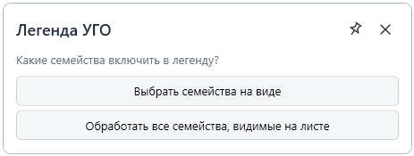
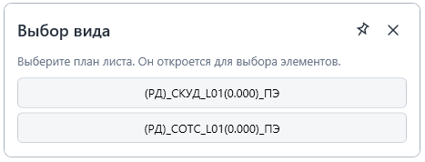
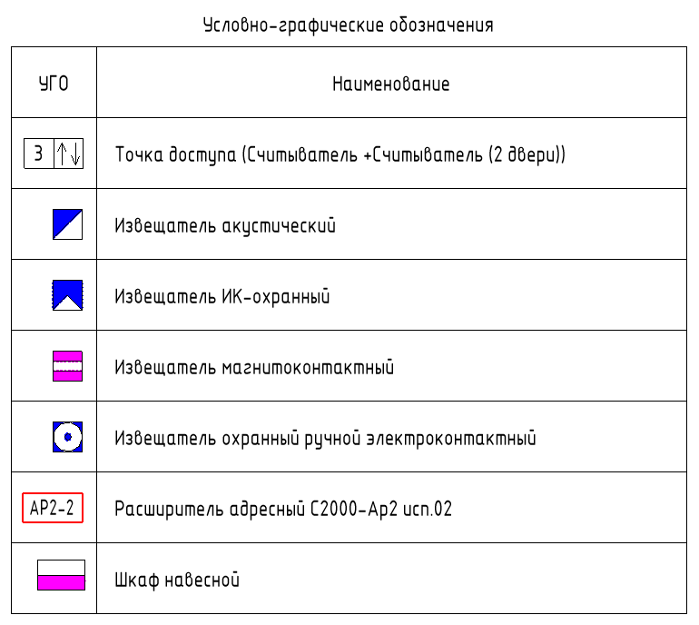

Плагин формирует отдельную легенду с таблицей условно-графических обозначений (УГО) с планов и размещает ее на листе Revit.

### Где находится

Плагин расположен на вкладке **GARDA_ВИС**, в панели **ЭОМ/СС/АК**.

{width=53px height=53px scale=69px}

### Что попадёт в таблицу

Команда учитывает категории: **Осветительные приборы**, **Выключатели**, **Электрооборудование**, **Электроустановочные изделия**, **Датчики**, **Охранная сигнализация**,  **Пожарная сигнализация**, **Устройства связи**, **Устройства вызова и оповещения**.

### Как пользоваться

<note>
  **Важно**

  В проекте нужен хотя бы один вид «Легенда». Если все легенды удалены, создайте пустую: Вид -> Легенды -> Легенда. Размещать её на листе не нужно.
</note>

1. Откройте лист, на котором размещён хотя бы один план этажа, и нажмите кнопку плагина.
2. Выберите, способ выбора семейств:

   {width=463px height=175px}

   | **Команда** | **Когда выбрать** |
   |---|---|
   | **Выбрать семейства на виде** | Нужна легенда для части плана: например, только для освещения одного помещения. |
   | **Обработать все семейства, видимые на листе** | Нужна общая легенда по всем планам, по всем УГО видимым на этом листе |
   - При ручном выборе семейств укажите план в появившемся списке:

     {width=467px height=178px}
   - На открывшемся виде отметьте экземпляры рамкой или щелчками с Ctrl, затем нажмите «Готово».

     <note type="info">
       Esc отменяет выбор. При обработке всего листа этот шаг пропускается.
     </note>
3. 3\. В окне «Какое наименование использовать в УГО» выберите способ именования УГО:

   {width=464px height=175px}

   | **Способ** | **Результат** |
   |---|---|
   | **По имени семейства и типа** | Имя семейства и тип в скобках |
   | **По содержимому выбранного параметра** | Текст из выбранного параметра. Если значение параметра не заполнено, в строке появится прочерк. |
4. Проверьте легенду в правом верхнем углу листа. Если она перекрывает чертёж, переместите её в свободное место.

   {width=770px height=688px scale=513px}

<note>
  Если в проекте есть полная легенда, созданная этой командой с тем же составом и способом именования, плагин использует её повторно.
</note>
