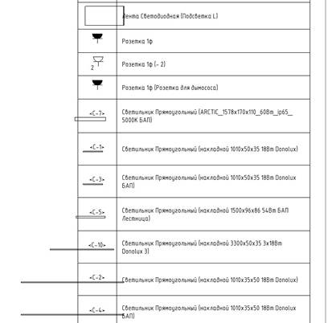

Плагин собирает условно-графические обозначения (УГО) с планов этажей и размещает их на листе Revit. В левой колонке таблицы показан символ, в правой -- его наименование.

**Что попадёт в таблицу**

Команда учитывает светильники, приборы управления освещением, электрооборудование и электроустановочные изделия, а также устройства охранной и пожарной сигнализации, связи, вызова и датчики. Семейства с префиксом «Влж» не образуют отдельных строк.

Одинаковые экземпляры не повторяются. Например, десять светильников одного типа с одним индексом и наименованием дадут одну строку. Если на плане у того же типа есть индексы С-1 и С-3, в таблице появятся две строки.

**Перед запуском**

<table header="row">
  <tr><td>Важно: в проекте нужен хотя бы один вид «Легенда». Если все легенды удалены, создайте пустую: Вид -> Легенды -> Легенда. Размещать её на листе не нужно.</td></tr>
</table>

Для построения символов нужен образец компонента легенды. Если в проекте его нет, команда возьмёт образец из ugo_seed.rvt рядом со [script.py](http://script.py). Этот файл не заменяет исходный вид «Легенда».

**Как найти команду**

На ленте Revit найдите кнопку расширения pyRevit с оранжевыми контурами круга, треугольника и квадрата. Запускайте её с листа, а не из активированного внутри листа плана.

**Как пользоваться**

1\. Откройте лист, на котором размещён хотя бы один план этажа, и нажмите кнопку плагина.

2\. Выберите, какие семейства включить в легенду.

| **Команда** | **Когда выбрать** |
|---|---|
| **Выбрать семейства на виде** | Нужна легенда для части плана: например, только для освещения одного помещения. |
| **Обработать все семейства, видимые на листе** | Нужна общая легенда по всем планам этажей, размещённым на этом листе. |

3\. В окне «Какое наименование использовать в УГО» выберите источник текста для правой колонки.

| **Способ** | **Результат** |
|---|---|
| **По имени семейства и типа** | Имя семейства и тип в скобках. Если тип называется «-», скобок не будет. Из имён убирается ADSK; в имени семейства кириллица после первой буквы переводится в нижний регистр. |
| **По содержимому параметра G_Наименование_УГО** | Текст параметра без изменения регистра: сначала проверяется экземпляр, затем тип. Если значение не заполнено, в строке появится прочерк. |

<table header="row">
  <tr><td>Если параметра нет в проекте, плагин попробует добавить его из текущего файла общих параметров (ФОП). Сообщение «Подключите актуальный ФОП» означает, что определение не найдено. Укажите нужный файл в Revit и запустите команду снова.</td></tr>
</table>

4\. При ручном выборе укажите план в списке. На открывшемся виде отметьте экземпляры рамкой или щелчками с Ctrl, затем нажмите «Готово». Esc отменяет выбор. При обработке всего листа этот шаг пропускается.

5\. Проверьте легенду в правом верхнем углу листа. Если она перекрывает чертёж, переместите её в свободное место.

**Как читать результат**

Легенда создаётся в масштабе 1:100 с низким уровнем детализации. В таблице «Условно-графические обозначения» символы отделены от наименований тонкими линиями.

Пример из проекта: фрагмент таблицы со светильниками и электрооборудованием.

**Индексы светильников**

Над светильником выводится значение ADSK_Номер устройства в угловых скобках, например ‹С-2›. Если индекс не появился, проверьте значение параметра у экземпляра и его типоразмера.

**Повторный запуск**

Если в проекте есть полная легенда, созданная этой командой с тем же составом и способом именования, плагин использует её повторно. При изменении состава или подписей сформируйте таблицу заново: прежняя легенда автоматически не удаляется.
