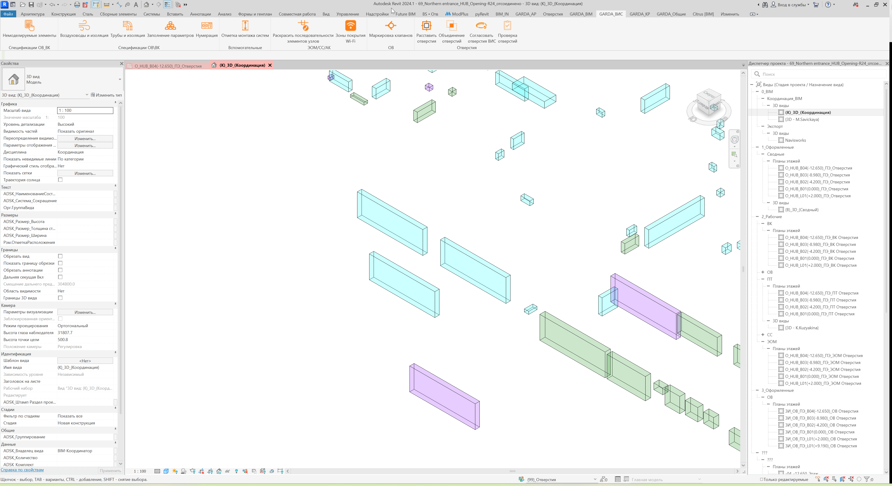

Плагин создаёт одно общее задание из нескольких выбранных заданий на отверстия.

## Где находится

Вкладка **GARDA_АР** -> панель **Отверстия**.

{width=309px height=97px}

<note type="info">
  Работает в открытой модели HUB.
</note>

## Как пользоваться

{width=3851px height=2099px}

<note>
  **Перед запуском:**

  Выберите не менее двух заданий на отверстия, которые должны стать одним заданием.
</note>

1. Запустите плагин с выбранными заданиями или выберите их по запросу Revit.
2. После выполнения проверьте общий охват исходных заданий, размеры, глубину, поворот, уровень и `G_Согласование_Раздел`.
3. Передайте новое задание на согласование ВИС, затем АР или КР.

<note>
  Исходные задания удаляются после создания и проверки нового элемента.

  У результата новый ID; старые ссылки на задания больше не актуальны.
</note>

## FAQ

### Почему проверка объединённого задания требует ручного разбора

Если через одно задание проходят несколько инженерных систем, автоматическая проверка не всегда может связать спорное пересечение с конкретной инженерной системой. Сверьте результат на 3D виде и в [«Проверке отверстий»](./proverka-otverstiy.md).

### Сохраняются ли старые согласования

Согласовывайте новый элемент как новое задание. Проверяйте согласования и разделы именно у

его ID.

[← Методология работы с отверстиями](./../../../revit/otverstiya.md)
