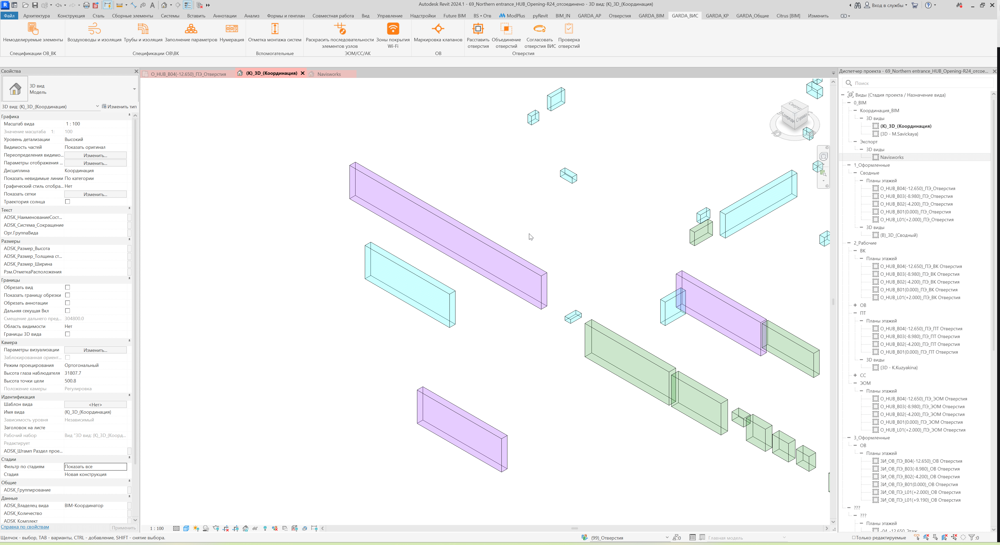

Плагин показывает состояние заданий на отверстия и согласований в HUB, проверяет положение инженерных систем относительно заданий.

## Где находится

Вкладка **GARDA_АР** -> панель **Отверстия**.

{width=309px height=97px}

## Как пользоваться

{width=3851px height=2099px}

<note>
  **Перед запуском:**

  Загрузите инженерные связи и вашу модель.

  Проверьте опорный 3D вид **Navisworks** и его фильтр стадии «План после реконструкции».
</note>

1. Если нужны только конкретные задания, выберите их до запуска. Без предварительного выбора плагин проверяет предусмотренный им объём модели.
2. Выберите инженерный раздел -- ОВ, ВК, СС, ЭОМ -- или все разделы ВИС.
3. Дождитесь окончания анализа.

<note>
  Все нарушения и ошибки кроме «Инженерная система не найдена в задании на отверстие» сбрасывают согласования автоматически при проверке
</note>

## FAQ

### Почему согласования слетели

Плагин обнаружил изменение положения или размеров задания, снятое закрепление у финально согласованного задания либо подтверждённое геометрическое нарушение. Причину смотрите в строке таблицы. После исправления повторите нужные согласования.

### Ошибка: Инженерная система не найдена в задании на отвертие

Проверьте загрузку связи, стадию, положение инженерной системы и задание. Само отсутствие найденной инженерной системы не является подтверждённым основанием для сброса.

### Что делать с неоднозначным результатом общего отверстия

Проверьте его на 3D виде вручную. При необходимости найдите конкретную инженерную систему через [«Поиск по ID»](./../../garda_obschee/moskva/poisk-po-id.md).

[← Методология работы с отверстиями](./../../../revit/otverstiya.md)
