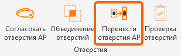

Плагин создаёт локальные отверстия в модели АР по согласованным заданиям из связанной модели HUB.

## Где находится

Вкладка **GARDA_АР** -> панель **Отверстия**.

{width=309px height=97px}

<note type="info">
  Работает в открытой модели АР.
</note>

## Как пользоваться

<note>
  **Перед запуском:**

  Подключите HUB как связь.

  Проверьте наличие локальных семейств отверстий стены и/или плиты.

  В HUB у задания должны действовать согласования ВИС и АР.
</note>

1. Запустите плагин и дождитесь анализа заданий.
2. В таблице отберите новые задания. Проверьте статусы изменённых, удалённых, уже перенесённых и конфликтных строк.
3. Выберите задания, при необходимости посмотрите их на ограниченном 3D виде и укажите правильный тип семейства.
4. Перенесите разрешённые строки. Повторно просканируйте таблицу.
5. В модели АР проверьте габариты, уровень, отметку и местоположение созданных отверстий.

<note>
  Плагин изменяет открытую модель АР. Связанная модель HUB при переносе не изменяется.
</note>

## FAQ

### Почему задание недоступно для переноса

Проверьте оба согласования, статус источника, наличие подходящего семейства и сообщение о конфликте в таблице.

### Что делать, если задание изменилось в HUB после переноса

Разберите статус «изменено в HUB», сверьте локальное отверстие с актуальным заданием и решите, как обновить его после повторного согласования.

[← Методология работы с отверстиями](README.md)
