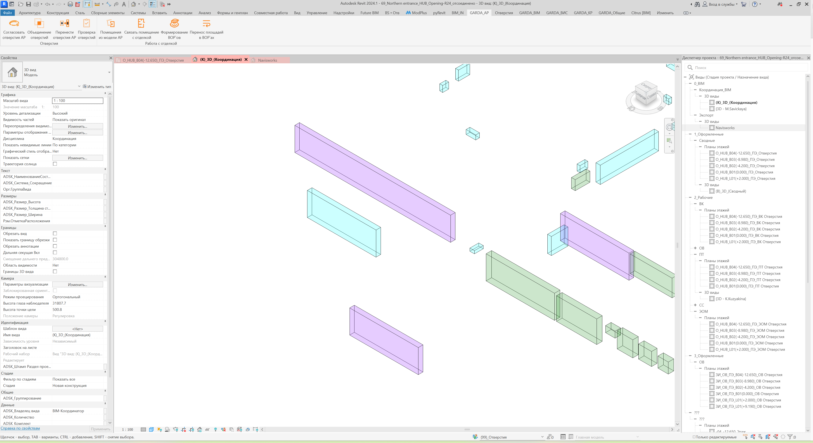

Плагин записывает согласование архитектурного раздела для выбранных заданий в HUB.

## Где находится

Вкладка **GARDA_АР** -> панель **Отверстия**.

{width=309px height=97px}

## Как пользоваться

{width=3851px height=2099px}

<note>
  **Перед запуском:**

  Проверьте задание по архитектурной конструкции: положение, габариты и допустимость проёма.

  При необходимости запустите «Проверка отверстий».
</note>

1. Выберите задания, которые хотите согласовать.
2. Если требуется, скорректируйте положение или размеры задания.
3. Запустите плагин.

<note>
  Если архитектор изменил положение или размеры задания, плагин записывает согласование АР, но сбрасывает прежнее согласование ВИС.
</note>

## FAQ

### Почему АР согласовано, а ВИС больше нет

Задание изменилось после согласования ВИС. Согласование АР относится к новому варианту, ВИС должен согласовать его повторно.

### Означает ли согласование АР, что инженерная система проходит через задание

Нет. Текущее пересечение проверяется отдельной кнопкой «Проверка отверстий».

← Методология работы с отверстиями
