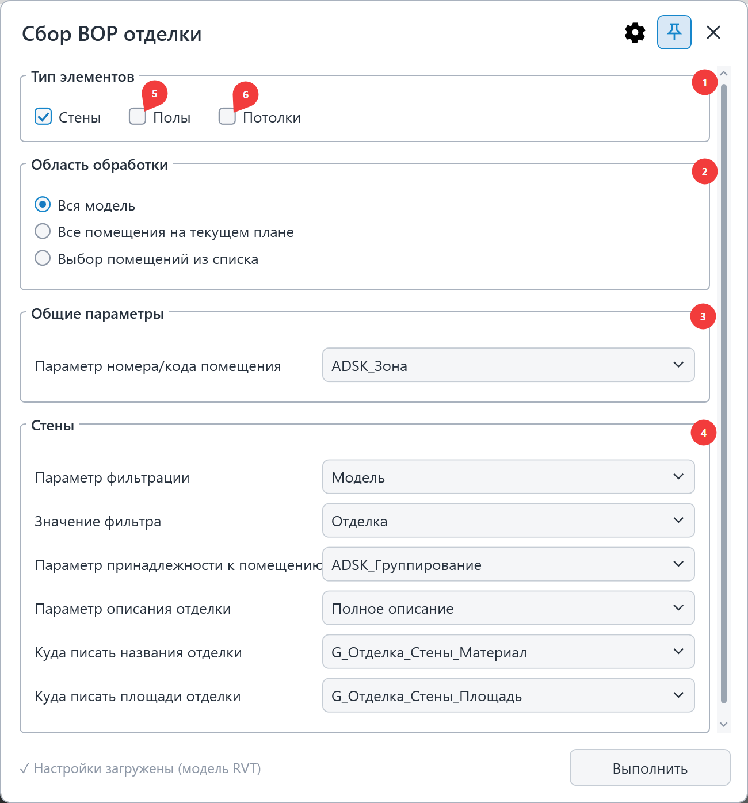
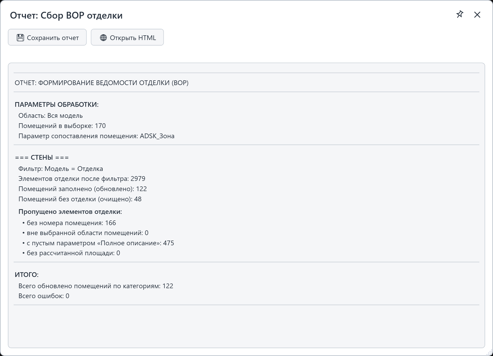
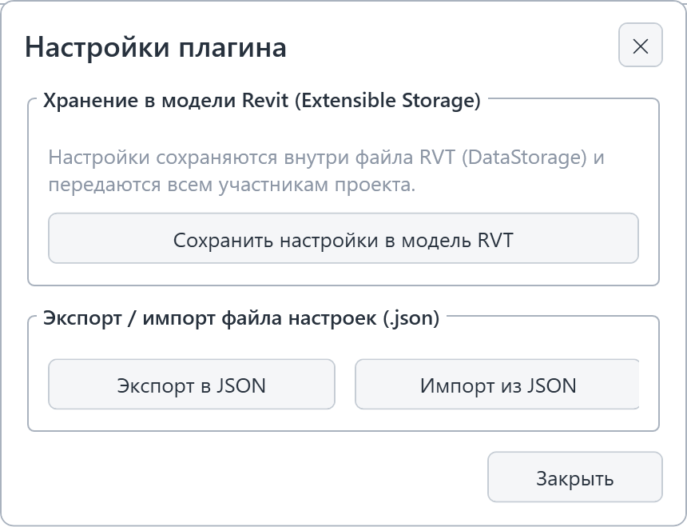

Собирает все привязанные элементы отделки (Стены, Полы, Потолки), группирует их по помещениям и наименованию материала, суммирует площади в м² и записывает готовый пронумерованный список материалов и их площадей в параметры помещения.

## Где находится

{width=191px height=165px}

Кнопка расположена на вкладке GARDA_АР, панели Работа с отделкой.

<note type="info">
  Примечание: Окно плагина работает в фоновом режиме. Вы можете свободно переключаться на Revit, вращать 3D-вид, проверять параметры и работать с проектом, не закрывая окно настроек.
</note>

## Как пользоваться

{width=1300px height=1396px}

1. **Тип элементов:** Отметьте галочками категории отделки, которые необходимо обработать (Стены, Полы, Потолки). В зависимости от вашего выбора в нижней части окна станут активны соответствующие блоки настроек (блоки 4, 5 или 6).
2. **Область обработки:** Укажите, какие помещения плагин должен проанализировать:
   - **Вся модель** -- обрабатываются абсолютно все помещения в проекте.
   - **Все помещения на текущем плане** -- плагин анализирует только помещения, попавшие на активный в данный момент вид.
   - **Выбор помещений из списка** -- позволяет выбрать конкретные помещения вручную. *Подсказка: используйте клавишу **Shift** для выбора диапазона строк или **Ctrl** для выделения помещений вразброс.*
3. **Общие параметры:** Выберите исходный параметр помещения (например, *«Номер»*), значение которого плагин будет считывать и переносить в элементы отделки.
4. **Стены:** Настройка фильтрации и записи данных из категории «Стены» в указанные параметры помещений:
   - **Параметр фильтрации** -- параметр, по которому плагин отличит отделочные стены от конструктивных.
   - **Значение фильтра** -- конкретное значение из выпадающего списка, чтобы взять в работу только нужные отделочные стены.
   - **Параметр описания отделки** -- параметр элемента, который содержит описание типа отделки.
   - **Куда писать название отделки** -- целевой параметр помещения (формат *«Многострочный текст»*), куда запишется нумерованный список всех типов отделки в этом помещении.
   - **Куда писать площадь отделки** -- целевой параметр помещения (формат *«Многострочный текст»*), куда запишется список суммарных площадей по каждому типу отделки.
5. **Полы:** Настройте параметры фильтрации, выбора значений и целевых параметров для помещений (настраивается аналогично блоку «Стены»).
6. **Потолки:** Настройте параметры фильтрации, выбора значений и целевых параметров для помещений (настраивается аналогично блоку «Стены»).

## Результат

После запуска плагин формирует отчет обработанных и необработанных элементов:

{width=1880px height=1360px}

<note type="tip">
  Если в отчете появились **пропущенные элементы отделки**, вернитесь на шаг назад -- в плагин **«Связать помещение с отделкой»**. Устраните все предупреждения в его отчете, чтобы каждый элемент корректно определил свое помещение и смог передать в него данные на этом этапе.
</note>

## Сохранение настроек плагина

Для того чтобы сохранить настройки формирования ВОР и не заполнять основное меню каждый раз, можно нажать на шестеренку в верхнем правом углу основного меню:

{width=860px height=659px}

- **Сохранить настройки в модель RVT** -- сохраняет все настройки данного плагина внутри модели проекта. Применяется для всех пользователей.
- **Экспорт/Импорт JSON** -- позволяет сохранить или загрузить в модель настройки отдельно, минуя сохранение на уровне проекта.
