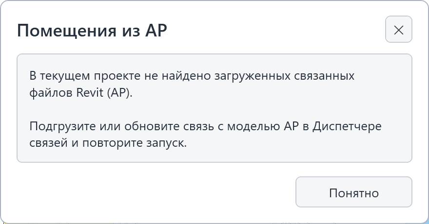
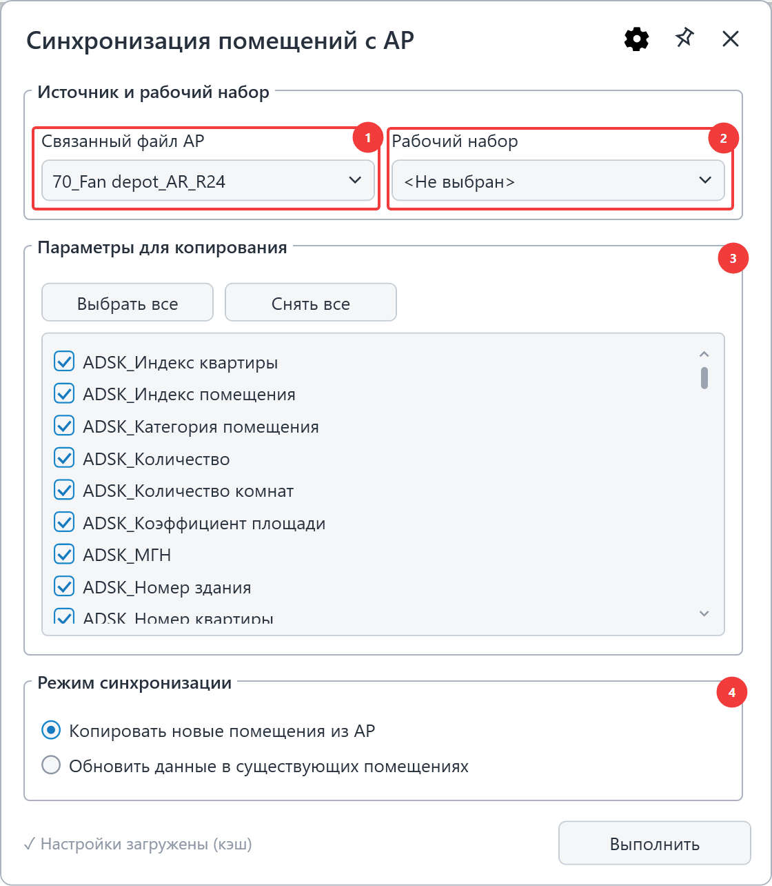
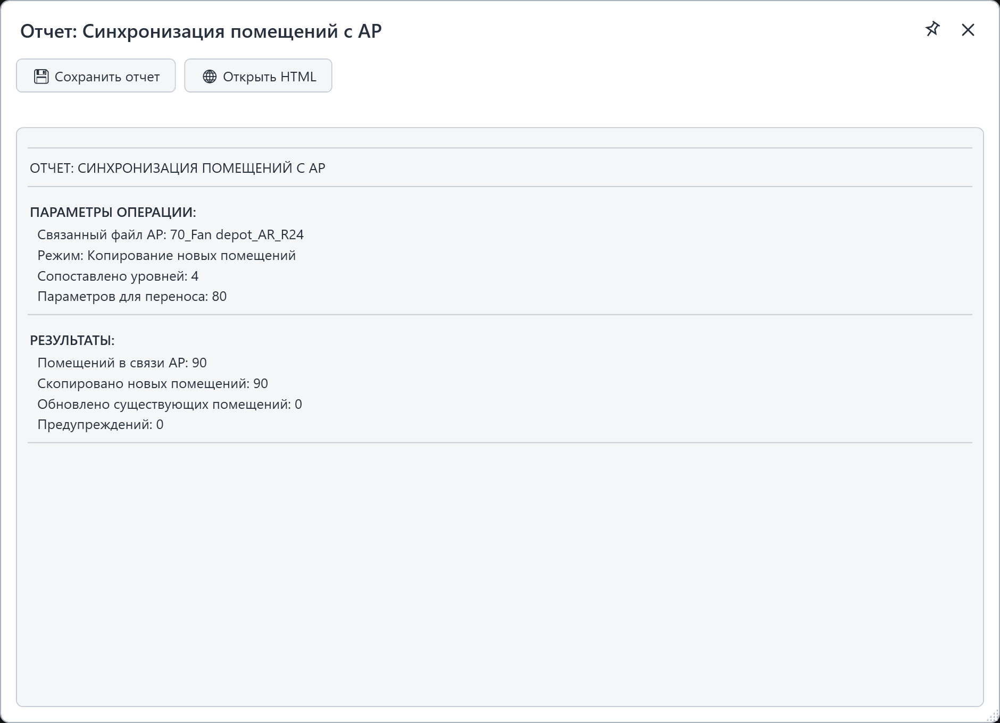
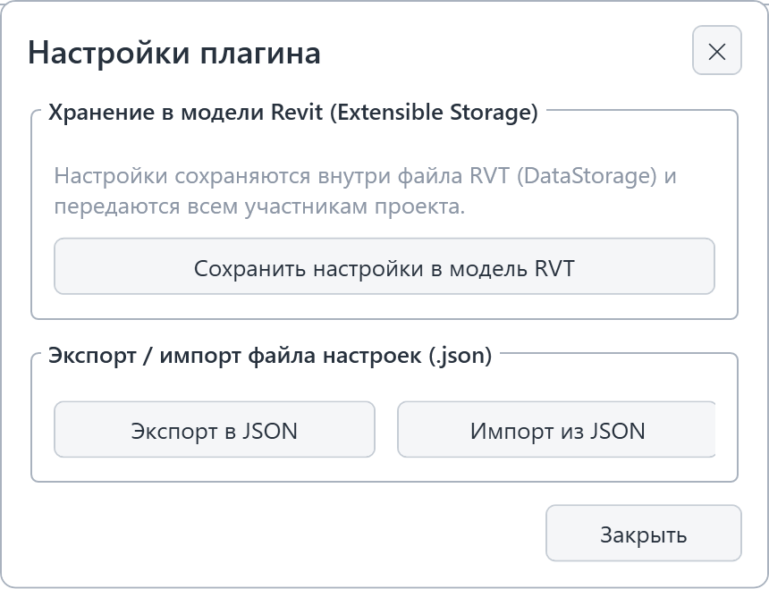

## Назначение инструмента

Плагин копирует помещения из выбранного связанного файла в текущий проект.

*Инструмент необходим, если вы работаете в модели АИ (Архитектурные интерьеры) и планируете использовать плагин «Отделка ModPlus» -- для его корректной работы помещений должны физически находиться в вашей текущей модели, а не только в связанном файле АР.*

## Расположение

{width=174px height=160px}

Кнопка расположена на вкладке GARDA_АР, панели Работа с отделкой.

<note type="info">
  Примечание: Окно плагина работает в фоновом режиме. Вы можете свободно переключаться на Revit, вращать 3D-вид, проверять параметры и работать с проектом, не закрывая окно настроек.
</note>

## **Как пользоваться**

### Нет нужной связи

Если в вашей модели нет связи АР или она не загружена, выскочит такое предупреждение:

{width=880px height=461px}

Необходимо открыть рабочие наборы со связью АР, или обновить связь, если ранее ее выгружали через Диспетчер проекта/ Диспетчер связей

### Основной интерфейс

{width=1120px height=1284px}

1. **Выбор связи:** В выпадающем списке выберите связанный файл, из которого необходимо скопировать помещения. Связанный файл должен быть загружен.
2. **Рабочий набор:** Укажите рабочий набор, который будет автоматически назначен всем скопированным помещениям.
3. **Выбор параметров:** Отметьте галочками параметры, значения которых нужно перенести из исходных помещений в новые.
4. **Тип операции:** Выберите режим работы плагина:
   - **Копировать** -- плагин сравнивает помещения в текущем проекте и связанном файле. В модель добавятся *только новые* помещения (которых еще нет физически). Существующие элементы не изменятся.
   - **Обновить данные** -- плагин перезапишет значения параметров (выбранных на шаге №3) у уже скопированных ранее помещений, если они изменились в исходной модели АР.

### Отчет

{width=1880px height=1360px}

Отчет разделен на параметры, в котором указываются связанные модели, режимы обработки, необходимые уровни и кол-во параметров для обработки \
И результаты обработки, в которые выведена информация по общему кол-ву помещений для обработки, успешно обработанным и предупреждениям.

### Сохранение настроек плагина

Для того чтоб сохранить настройки копирования и не заполнять основное меню каждый раз, можно нажать на шестеренку в верхнем правом углу основного меню

{width=860px height=659px}

Сохранить настройки в модель RVT - сохраняет все настройки данного плагина внутри модели проекта. Применяется для всех пользователей. \
Экспорт/Импорт Json - позволяет сохранить или загрузить в модель настройки отдельно, минуя сохранение на уровне проекта.
