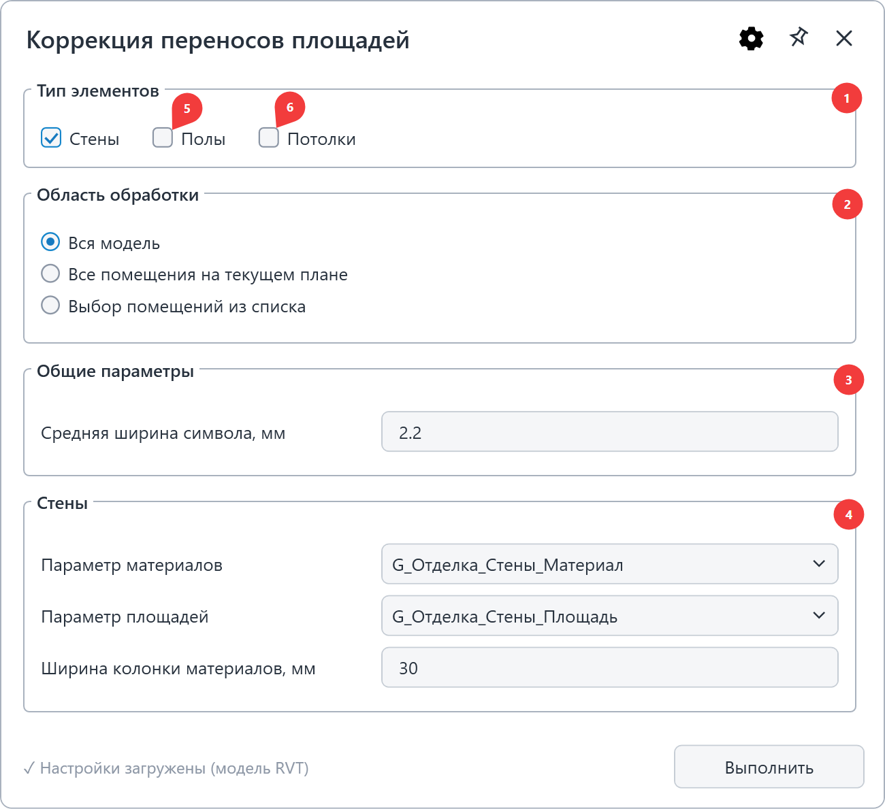

В спецификаци ВОР\`ов названия материалов отделки  и их площади  находятся в двух соседних колонках. Когда длинное название материала (например, «1. Декоративная штукатурка с фактурой травертина по сетке...») переносится в узкой колонке спецификации на 2 или 3 визуальные строки, строка с цифрой площади в соседней колонке остается на первой строчке, и все последующие площади «съезжают» вверх относительно своих материалов. Данный плагин добавляет перенос строки в таких длинных названиях типов отделки.

## Где находится

{width=243px height=154px}

Кнопка расположена на вкладке GARDA_АР, панели Работа с отделкой.

<note type="info">
  Примечание: Окно плагина работает в фоновом режиме. Вы можете свободно переключаться на Revit, вращать 3D-вид, проверять параметры и работать с проектом, не закрывая окно настроек.
</note>

## Как пользоваться

{width=1300px height=1189px}

1. **Тип элементов:** Отметьте галочками категории отделки, которые необходимо обработать (Стены, Полы, Потолки). В зависимости от вашего выбора в нижней части окна станут активны соответствующие блоки настроек (блоки 4, 5 или 6).
2. **Область обработки:** Укажите, какие помещения плагин должен проанализировать:
   - **Вся модель** -- обрабатываются абсолютно все помещения в проекте.
   - **Все помещения на текущем плане** -- плагин анализирует только помещения, попавшие на активный в данный момент вид.
   - **Выбор помещений из списка** -- позволяет выбрать конкретные помещения вручную. *Подсказка: используйте клавишу **Shift** для выбора диапазона строк или **Ctrl** для выделения помещений вразброс.*
3. **Общие параметры:** Выберите ширину символа, для текста Gost Common 2.5 примерная ширина символа 2.2мм. Этот параметр можно пробовать менять для достижения наболее удобовлетворимого результата.
4. **Стены:** Настройка параметров помещений, в которых указаны данные:
   - **Параметр материалов** -- параметр, по которому плагин определяет ширину строки текста.
   - **Параметр площадей** -- параметр, по которому плагин переносит значение площади каждого типа на некоторое кол-во строк.
   - **Ширина колонки материалов** -- значение ширины колонки в вашей спецификации.
5. **Полы:** Настройте параметры фильтрации, выбора значений и целевых параметров для помещений (настраивается аналогично блоку «Стены»).
6. **Потолки:** Настройте параметры фильтрации, выбора значений и целевых параметров для помещений (настраивается аналогично блоку «Стены»).

## Результат

После запуска плагин формирует отчет перенесенных строк по обрабатываемым разделам:

{width=1880px height=1360px}

<note type="tip">
  Если в отчете появились **пропущенные пустые помещения**, вернитесь на шаг назад -- в плагин **«Формирование ВОР\`ов»**. Устраните все предупреждения в его отчете, чтобы каждый элемент корректно определил свое помещение и смог передать в него данные на этом этапе.
</note>

## Сохранение настроек плагина

{width=860px height=659px}

Для того чтобы сохранить настройки формирования ВОР и не заполнять основное меню каждый раз, можно нажать на шестеренку в верхнем правом углу основного меню:

- **Сохранить настройки в модель RVT** -- сохраняет все настройки данного плагина внутри модели проекта. Применяется для всех пользователей.
- **Экспорт/Импорт JSON** -- позволяет сохранить или загрузить в модель настройки отдельно, минуя сохранение на уровне проекта.
