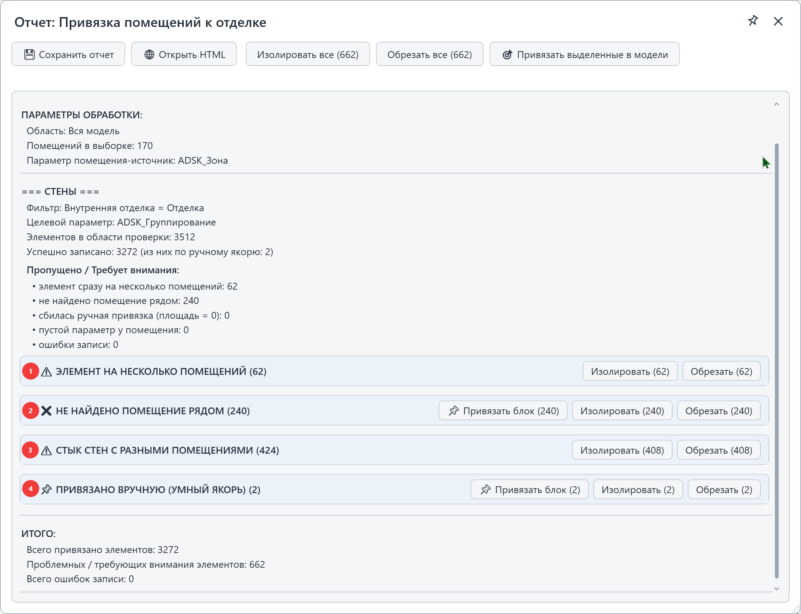

Плагин автоматически определяет, в каком помещении находятся конкретные элементы отделки (стены, полы, потолки), и записывает номер этого помещения в параметры элементов.

## Где находится

{width=248px height=167px}

Кнопка расположена на вкладке GARDA_АР, панели Работа с отделкой.

<note type="info">
  Примечание: Окно плагина работает в фоновом режиме. Вы можете свободно переключаться на Revit, вращать 3D-вид, проверять параметры и работать с проектом, не закрывая окно настроек.
</note>

## **Как пользоваться**

{width=1300px height=1189px}

1. **Тип элементов:** Отметьте галочками категории отделки, которые необходимо обработать (Стены, Полы, Потолки). В зависимости от вашего выбора в нижней части окна станут активны соответствующие блоки настроек (блоки 4, 5 или 6).
2. **Область обработки:** Укажите, какие помещения плагин должен проанализировать:
   - **Вся модель** -- обрабатываются абсолютно все помещения в проекте.
   - **Все помещения на текущем плане** -- плагин анализирует только помещения, попавшие на активный в данный момент вид.
   - **Выбор помещений из списка** -- позволяет выбрать конкретные помещения вручную. *Подсказка: используйте клавишу **Shift** для выбора диапазона строк или **Ctrl** для выделения помещений вразброс.*
3. **Общие параметры:** Выберите исходный параметр помещения (например, *«Номер»*), значение которого плагин будет считывать и переносить в элементы отделки.
4. **Стены:** Настройка фильтрации и записи данных для категории «Стены»:
   - *Параметр фильтрации* -- выберите параметр, по которому плагин отличит отделочные стены от конструктивных (например, *ADSK_Группирование*).
   - *Значение фильтра* -- выберите конкретное значение из выпадающего списка, чтобы плагин взял в работу только нужные отделочные стены.
   - *Куда записывать номер помещения* -- укажите целевой параметр экземпляра стены, в который запишется номер помещения.
5. **Полы:** Настройте параметры фильтрации, выбора значений и целевого параметра для элементов пола (настраивается аналогично блоку «Стены»).
6. **Потолки:** Настройте параметры фильтрации, выбора значений и целевого параметра для элементов потолка (настраивается аналогично блоку «Стены»).

## Результат

В результате обработки плагина формируется отчет, разделенный на функциональные блоки, каждый из которых можно раскрыть

{width=2114px height=1620px}

1. Список элементов отделки, которые соприкасаются с несколькими помещениями, необходимо проверить и разделить на разные помещения
2. Список элементов отделки, которые не соприкасаются ни с одним из помещений подели в обрабатываемой области. Необходимо:\
   а. Найти причину по которой ближайшее помещение не соприкасается с данным элементо\
   б. Если п.а не реализуем, привязать помещение в ручную через кнопку Привязать, так, через умный якорь, этот экземпляр отделки будет жестко привязан к конкретному помещению и при последующей проверке не будет переопределен в группу не найдено помещение рядом.
3. Список элементов отделки, коны которых соприкасаются с другими элементами отделки, у которых разные номера помещений.
4. Список элементов отделки, у которых в ручную привязан номер помещения через кнопку **Привязать**.

Данный отчет можно сохранить отдельно, открыть в

## Сохранение настроек плагина

Для того чтоб сохранить настройки привязки отделки и не заполнять основное меню каждый раз, можно нажать на шестеренку в верхнем правом углу основного меню

{width=860px height=659px}

Сохранить настройки в модель RVT - сохраняет все настройки данного плагина внутри модели проекта. Применяется для всех пользователей. \
Экспорт/Импорт Json - позволяет сохранить или загрузить в модель настройки отдельно, минуя сохранение на уровне проекта.
