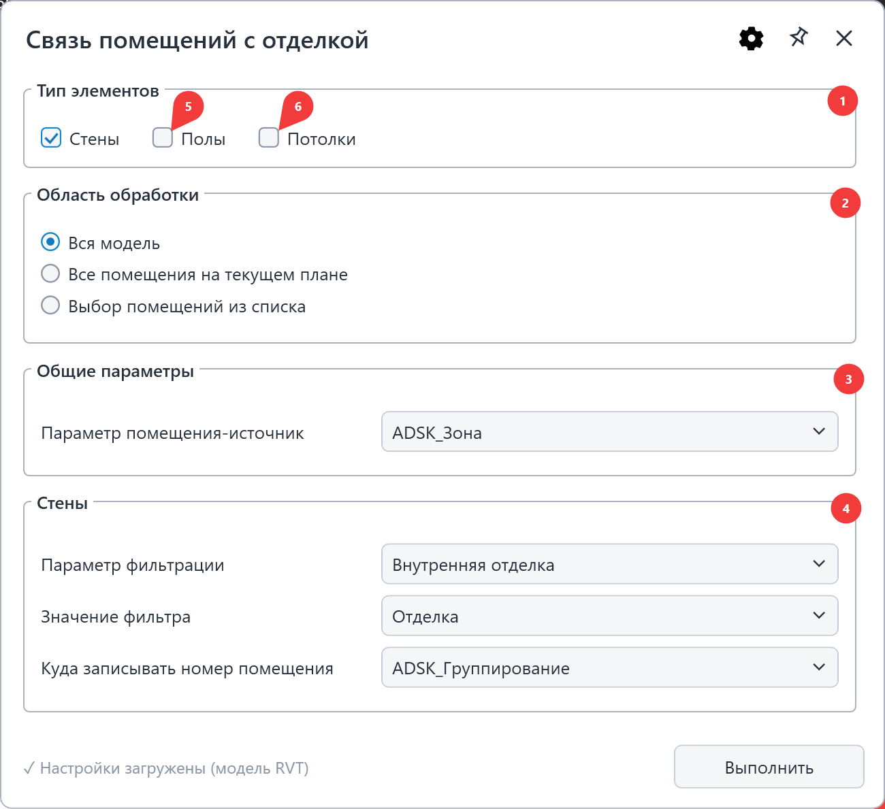
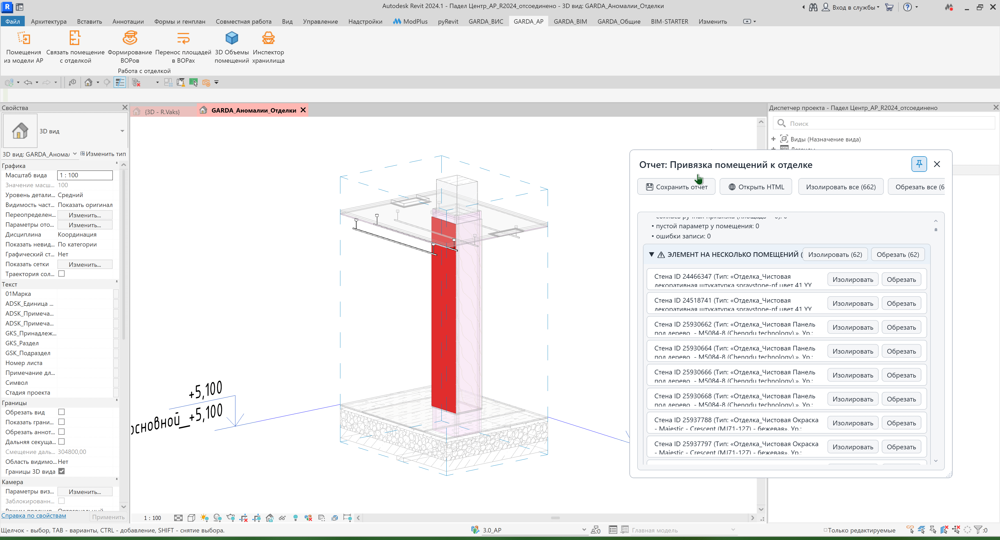
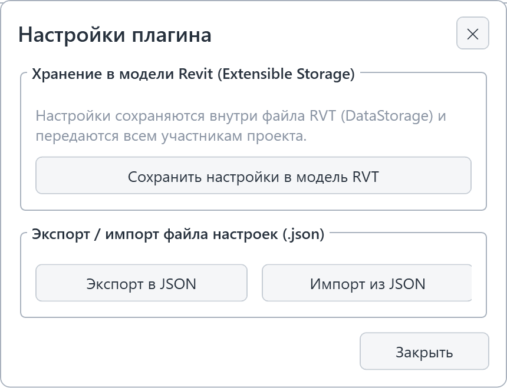

Плагин автоматически определяет, в каком помещении находятся конкретные элементы отделки (стены, полы, потолки), и записывает номер этого помещения в параметры элементов.

## Где находится

{width=248px height=167px}

Кнопка расположена на вкладке GARDA_АР, панели Работа с отделкой.

<note type="info">
  Примечание: Окно плагина работает в фоновом режиме. Вы можете свободно переключаться на Revit, вращать 3D-вид, проверять параметры и работать с проектом, не закрывая окно настроек.
</note>

## **Как пользоваться**

{width=1300px height=1189px}

1. **Тип элементов:** Отметьте галочками категории отделки, которые необходимо обработать (Стены, Полы, Потолки). В зависимости от вашего выбора в нижней части окна станут активны соответствующие блоки настроек (блоки 4, 5 или 6).
2. **Область обработки:** Укажите, какие помещения плагин должен проанализировать:
   - **Вся модель** -- обрабатываются абсолютно все помещения в проекте.
   - **Все помещения на текущем плане** -- плагин анализирует только помещения, попавшие на активный в данный момент вид.
   - **Выбор помещений из списка** -- позволяет выбрать конкретные помещения вручную. *Подсказка: используйте клавишу **Shift** для выбора диапазона строк или **Ctrl** для выделения помещений вразброс.*
3. **Общие параметры:** Выберите исходный параметр помещения (например, *«Номер»*), значение которого плагин будет считывать и переносить в элементы отделки.
4. **Стены:** Настройка фильтрации и записи данных для категории «Стены»:
   - *Параметр фильтрации* -- выберите параметр, по которому плагин отличит отделочные стены от конструктивных (например, *ADSK_Группирование*).
   - *Значение фильтра* -- выберите конкретное значение из выпадающего списка, чтобы плагин взял в работу только нужные отделочные стены.
   - *Куда записывать номер помещения* -- укажите целевой параметр экземпляра стены, в который запишется номер помещения.
5. **Полы:** Настройте параметры фильтрации, выбора значений и целевого параметра для элементов пола (настраивается аналогично блоку «Стены»).
6. **Потолки:** Настройте параметры фильтрации, выбора значений и целевого параметра для элементов потолка (настраивается аналогично блоку «Стены»).

## Результат

После запуска плагин формирует отчет с раскрывающимися блоками проблемных и проверенных элементов:

{width=2114px height=1620px}

1. **Элемент на несколько помещений.** Элементы, которые заходят сразу в несколько помещений. Их нужно проверить и разделить по разным помещениям.
2. **Не найдено помещение рядом.** Элементы вне границ помещений в выбранной области. Как исправить:\
   *Вариант А:* Найти и устранить причину, по которой ближайшее помещение не дотягивается до элемента.\
   *Вариант Б:* Если вариант А не подходит, назначить помещение вручную через кнопку **Привязать**. Сработает «умный якорь»: элемент жестко привяжется к выбранному помещению и при следующих проверках не попадет в список ошибок.
3. **Стык сстен с разными помещениями.** Элементы, края которых соприкасаются с другими элементами отделки, имеющей отличающийся номер помещения.
4. **Привязано вручную.** Список элементов, для которых номер помещения был назначен принудительно через кнопку **Привязать**.

Для любого элемента или группы в отчете доступны кнопки **Изолировать** (скрывает все лишнее на отдельном 3D-виде по ID) и **Обрезать** (подрезает 3D-вид границей вокруг выбранных элементов с ближайшим окружением).

{width=3840px height=2077px}

<note type="info">
  Данный отчет можно сохранить отдельно или открыть в HTML формате для более удобного анализа. Кнопки Изолировать и Обрезать работают из браузера.
</note>

## Сохранение настроек плагина

Для того чтоб сохранить настройки привязки отделки и не заполнять основное меню каждый раз, можно нажать на шестеренку в верхнем правом углу основного меню

{width=860px height=659px}

Сохранить настройки в модель RVT - сохраняет все настройки данного плагина внутри модели проекта. Применяется для всех пользователей. \
Экспорт/Импорт Json - позволяет сохранить или загрузить в модель настройки отдельно, минуя сохранение на уровне проекта.
