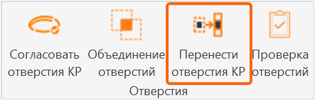

Плагин создаёт отверстия в модели КР по согласованным заданиям из связанной модели HUB.

## Где находится

Вкладка **GARDA_КР** -> панель **Отверстия**.

{width=456px height=145px}

## Как пользоваться

{width=3851px height=2099px}

<note>
  **Перед запуском:**

  Подключите HUB как связь.

  В HUB у задания должны действовать согласования ВИС и КР.
</note>

### Создание отверстий по заданию из HUB:

1. Запустите плагин и дождитесь анализа заданий.
2. Выберите задания, которые хотите перенести в модель.
3. Создайте отверстия по заданиям.
4. В модели КР у перенесенных отверстий проверьте:

   Габариты,

   Уровень,

   Местоположение созданных отверстий.

### Анализ и сравнение отверстий в модели КР с заданиями в HUB:

1. Запустите плагин и дождитесь анализа заданий.
2. Проверьте статусы изменённых, удалённых, актуальных и конфликтных строк.

<note>
  Плагин изменяет открытую модель КР. Связанная модель HUB при переносе не изменяется.
</note>

## FAQ

### Почему задание недоступно для переноса

Проверьте оба согласования, статус источника, наличие подходящего семейства и сообщение о конфликте в таблице.

### Что делать, если задание изменилось в HUB после переноса

Разберите статус «изменено в HUB», сверьте отверстие с актуальным заданием и решите, как обновить его после повторного согласования.

[← Методология работы с отверстиями](./../../../revit/otverstiya.md)
