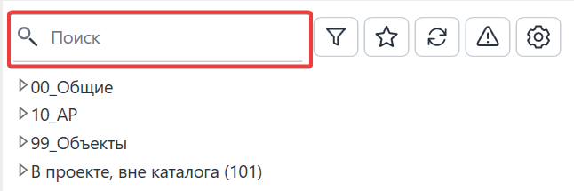
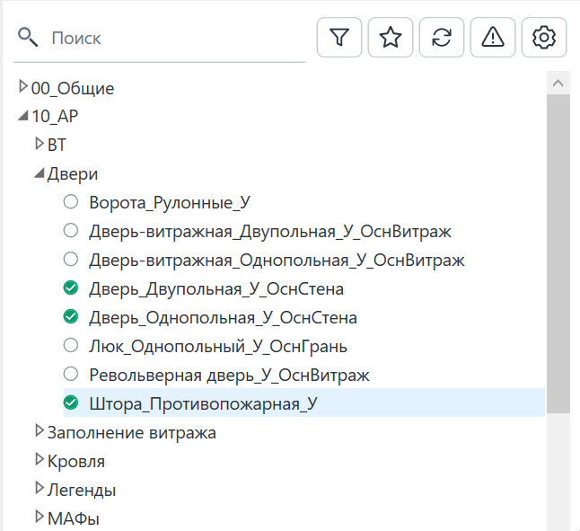
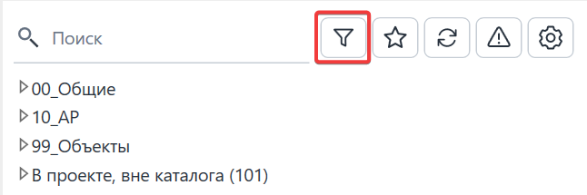
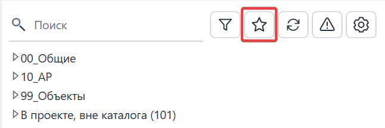
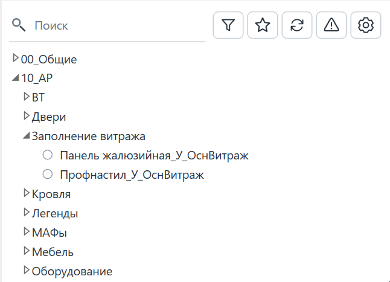
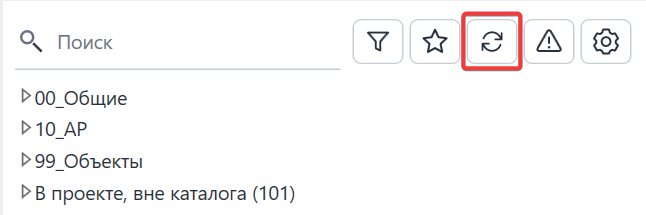
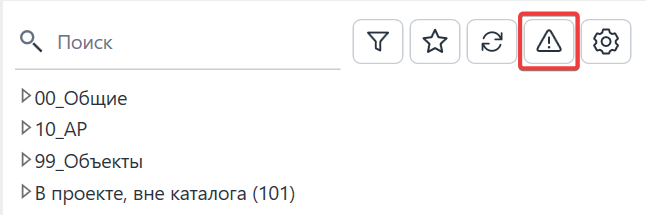
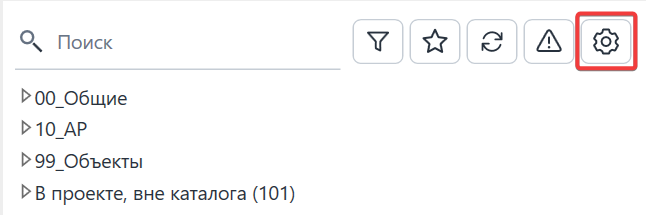
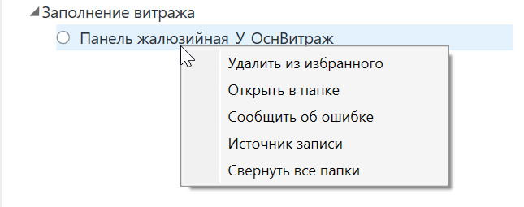

**Family Manager (Библиотека семейств)** -- это единый корпоративный диспетчер BIM-библиотеки, встроенный в интерфейс Autodesk Revit через платформу pyRevit. Инструмент предназначен для быстрого поиска, проверки и загрузки семейств и спецификаций в проект, а также для централизованного администрирования библиотеки.

## Где находится

Плагин расположен на вкладке **GARDA_Общие**, панели **Библиотека,** кнопка **Библиотека семейств**.

## Основной функционал и интерфейс

### Поиск и фильтрация семейств

1. **Строка поиска**

   {width=646px height=215px}

   \
   Позволяет мгновенно находить семейства по названию или папке. При вводе текста справа появляется крестик (`✕`) для быстрой очистки строки.

   {width=646px height=591px}
2. **Фильтр по статусам:**

   {width=646px height=215px}

   {width=646px height=592px}

   \
   Позволяет отфильтровать элементы по их состоянию относительно текущего проекта:
   - 🟢 *Актуальные* -- версия в проекте полностью совпадает с библиотечной.
   - 🟠 *Требуется обновление* -- в библиотеке появилась более свежая версия семейства.
   - 🔴 *Нужна консультация* -- отличается основная версия (MAJOR), требуется согласование с BIM-координатором.
   - 🟣 *Не найдены в каталоге* -- семейство есть в проекте, но отсутствует в корпоративной библиотеке. Данная категория семейств не проверена BIM-командой, может быть тяжелой, иметь лишние параметры, материалы и подкатегории, что может существенно влиять на скорость работы в модели.
3. **Избранное:**

   {width=646px height=215px}

   Позволяет отобразить только те семейства, которые вы добавили в свой персональный список избранного.

   Для добавления семейства в избранное выделите в списке нужное семейство -> ПКМ -> Добавить в избранное.

   Для удаления из избранного открыть избранное -> ПКМ -> Удалить из избранного.

   {width=646px height=467px}

4) **Обновить дерево:**

{width=646px height=215px}

Позволяет перезагрузить список семейств, если были какие-то изменения в библиотеке.

5. **Сообщить об ошибке:**

   {width=646px height=215px}

Если вы столкнулись с некорректной работой семейства, битым файлом или хотите предложить улучшение:

- Выберите проблемное семейство в дереве Family Manager.
- Нажмите кнопку **«Сообщить об ошибке»**.
- Плагин автоматически сформирует отчет (название проекта, имя семейства, текущая версия), **скопирует эти данные в буфер обмена** и мгновенно откроет форму корпоративного **Яндекс Трекера (очередь TIM)** в вашем браузере.
- В открывшейся форме нажмите `Ctrl + V`, чтобы вставить скопированные данные в описание задачи, и опишите суть проблемы. Поверх браузера также откроется небольшая памятка-шпаргалка, которую можно использовать для повторного копирования текста.

6. **Настройки и подсказка:**

{width=646px height=215px}

### Загрузка семейств в проект

1. **Загрузка в проект:** **Двойной щелчок** по названию семейства в дереве мгновенно загружает его в проект и привязывает нужный типоразмер к курсору мыши.
2. **Просмотр превью:**
   - При включенном отображении миниатюр клик по картинке открывает крупное всплывающее окно, которое автоматически закрывается при клике в сторону или по клавише `Esc`.
   - При отключенных миниатюрах превью и подробные свойства отображаются в фиксированной карточке подвала (высоту подвала можно настроить или зафиксировать через меню настроек).
3. **Контекстное меню (ПКМ):** Клик правой кнопкой мыши по семейству открывает меню быстрых действий: добавить в избранное, открыть папку в проводнике, посмотреть историю изменений или открыть инструкцию в Gramax.

{width=645px height=255px}

## Настройки панели и справка

В правом верхнем углу панели расположена кнопка **«Настройки» (шестерёнка)**. При нажатии на неё справа плавно выезжает панель, а основной интерфейс аккуратно размывается:

1. **Разделы проектирования:** Вы можете включить или отключить видимость отдельных разделов библиотеки (АР, КР, ОВиК/ВК, СС, АК, ЭОМ, ТХ).
2. **Отображение карточек (плавающий свитч):**
   - *Вкл:* крупные карточки с миниатюрами отображаются прямо у каждой строки дерева.
   - *Выкл (по умолчанию):* компактное дерево + информативная карточка в подвале.
3. **Режим подвала:** Если миниатюры выключены, вы можете выбрать тип подвала -- *Статический* (фиксированная высота) или *Динамический* (с возможностью изменять высоту разделителем).
4. **Подсказка по статусам:** Встроенная справочная памятка с расшифровкой всех иконки-индикаторов и горячих клавиш.
