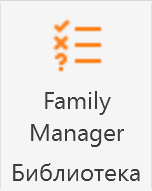
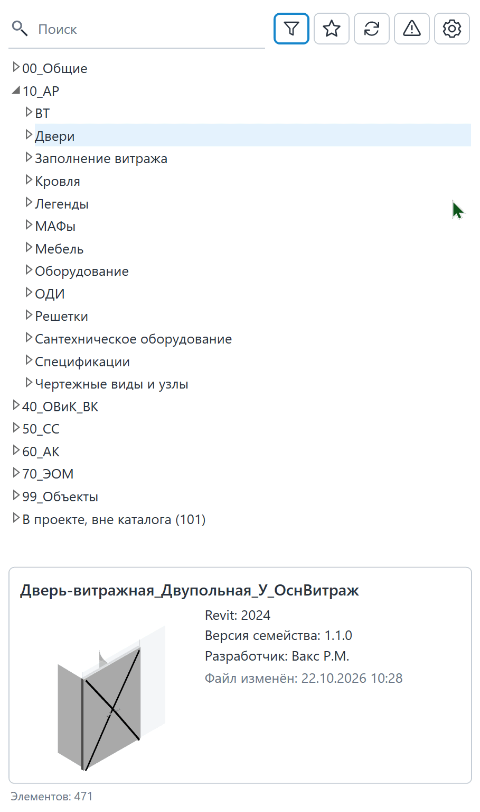
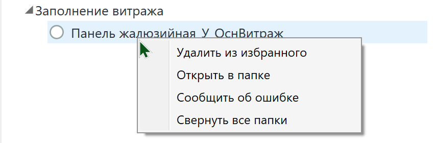

Единый корпоративный диспетчер BIM-библиотеки, встроенный в интерфейс Autodesk Revit через платформу pyRevit. Инструмент предназначен для быстрого поиска, проверки и загрузки семейств и спецификаций в проект, а также для централизованного администрирования библиотеки.

## Где находится

Плагин расположен на вкладке GARDA_Общие, панели Библиотека, кнопка Family Manager.

<comment id="VuM5F">{width=152px height=191px scale=156px}</comment>

## **Как пользоваться**

### **Строка поиска**

Позволяет мгновенно находить семейства по названию или папке. При вводе текста справа появляется крестик (`✕`) для быстрой очистки строки.

{width=646px height=591px}

### **Фильтр по статусам:**

Позволяет отфильтровать элементы по их состоянию относительно текущего проекта:

- 🟢 *Актуальные* -- версия в проекте полностью совпадает с библиотечной.
- 🟠 *Требуется обновление* -- в библиотеке появилась более свежая версия семейства.
- 🔴 *Нужна консультация* -- отличается основная версия (MAJOR), требуется согласование с BIM-координатором.
- 🟣 *Не найдены в каталоге* -- семейство есть в проекте, но отсутствует в корпоративной библиотеке. Данная категория семейств не проверена BIM-командой, может быть тяжелой, иметь лишние параметры, материалы и подкатегории, что может существенно влиять на скорость работы в модели.

{width=646px height=592px}

### **Избранное:**

Позволяет отобразить только те семейства, которые вы добавили в свой персональный список избранного.

{width=646px height=467px}

<note type="info">
  Для добавления семейства в избранное выделите в списке **нужное семейство -> ПКМ -> Добавить в избранное**.

  Для удаления из избранного **открыть избранное -> ПКМ -> Удалить из избранного**.
</note>

### **Обновить дерево:**

Позволяет перезагрузить список семейств, если были какие-то изменения в библиотеке.

{width=646px height=215px scale=658px}

<note type="info">
  Постоянно обновлять дерево не нужно, только если вы хотите проверить актуальность. Библиотека сама обновляется каждые 60 секунд.
</note>

### **Сообщить об ошибке:**

{width=646px height=215px}

Если вы столкнулись с некорректной работой семейства, битым файлом или хотите предложить улучшение:

- Выберите проблемное семейство в дереве Family Manager.
- Нажмите кнопку **«Сообщить об ошибке»**.
- Плагин автоматически сформирует отчет (название проекта, имя семейства, текущая версия), **скопирует эти данные в буфер обмена** и мгновенно откроет форму корпоративного **Яндекс Трекера (очередь TIM)** в вашем браузере.
- В открывшейся форме нажмите `Ctrl + V`, чтобы вставить скопированные данные в описание задачи, и опишите суть проблемы. Поверх браузера также откроется небольшая памятка-шпаргалка, которую можно использовать для повторного копирования текста.

### **Настройки и подсказка:**

{width=646px height=215px}

При нажатии на неё справа плавно выезжает панель, а основной интерфейс аккуратно размывается:

- **Разделы проектирования:** Вы можете включить или отключить видимость отдельных разделов библиотеки (АР, КР, ОВиК/ВК, СС, АК, ЭОМ, ТХ).
- **Отображение карточек (плавающий свитч):**
  - *Вкл:* крупные карточки с миниатюрами отображаются прямо у каждой строки дерева.
  - *Выкл (по умолчанию):* компактное дерево + информативная карточка внизу панели.
- **Режим информации внизу панели:** Если миниатюры выключены, вы можете выбрать тип подвала -- *Статический* (фиксированная высота) или *Динамический* (с возможностью изменять высоту разделителем).
- **Подсказка по статусам:** Встроенная справочная памятка с расшифровкой всех иконки-индикаторов и горячих клавиш.

<gallery>
  {width=909px height=1534px}
</gallery>

### Загрузка семейств в проект

**Загрузка в проект:** **Двойной щелчок** по названию семейства в дереве мгновенно загружает его в проект и привязывает нужный типоразмер к курсору мыши.

## Результат

Диспетчер семейств позволяет быстро искать, добавлять, обновлять и

### **Просмотр миниатюры:**

- При включенном отображении миниатюр клик по картинке открывает крупное всплывающее окно, которое автоматически закрывается при клике в сторону или по клавише `Esc`.
- При отключенных миниатюрах превью и подробные свойства отображаются в фиксированной карточке внизу панели (высоту карточки можно настроить или зафиксировать через меню настроек).

1. **Контекстное меню (ПКМ):** Клик правой кнопкой мыши по семейству открывает меню быстрых действий: добавить в избранное, открыть папку в проводнике, посмотреть историю изменений или открыть инструкцию в Gramax.

{width=854px height=280px scale=662px}
