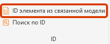
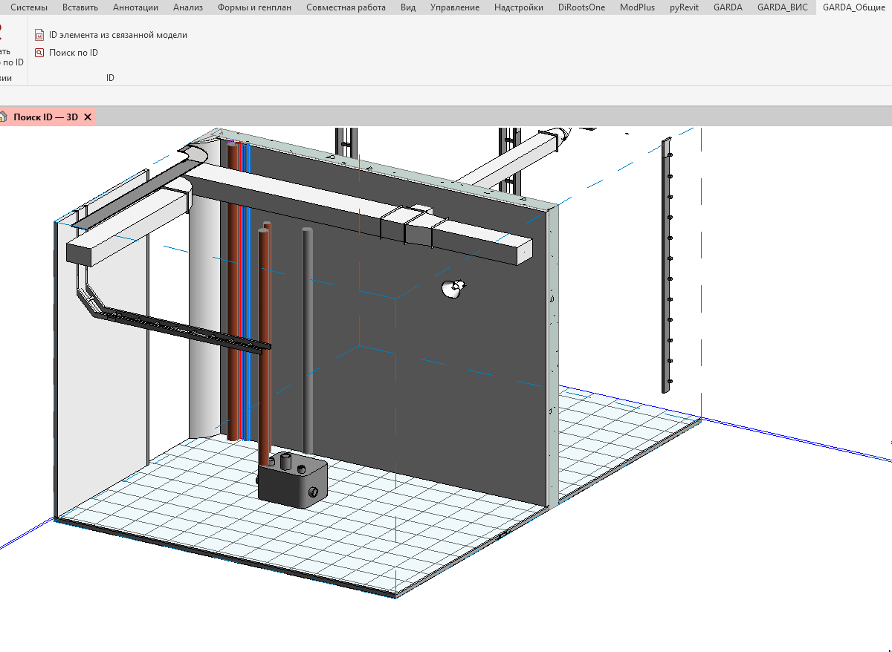
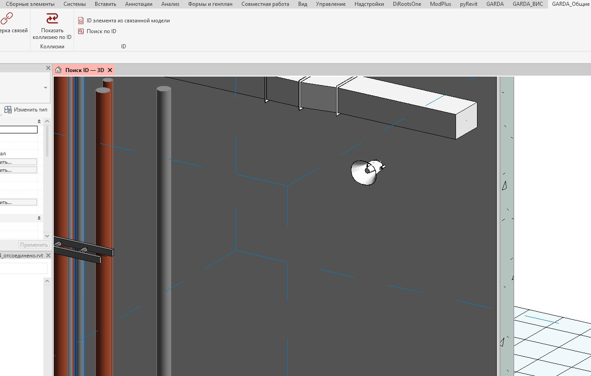

Плагин служит для получения ID элемента из связанной модели.

## Где находится

Плагин расположен на вкладке «**GARDA_Общие**», в панели «**ID**»

{width=221px height=90px}

## Как пользоваться

Получение ID из связанной модели возможно двумя способами:

- Заранее выбрать элемент из связанной модели (прожимая Tab) и нажать кнопку плагина:

  {width=1200px height=878px}
- Нажать на кнопку плагина и выбрать элемент связанной модели:

  {width=1322px height=840px}

## Итог

В обоих случаях выводится окно с информацией об элементе, при нажатии по ID, его значение копируется в буфер обмена.
