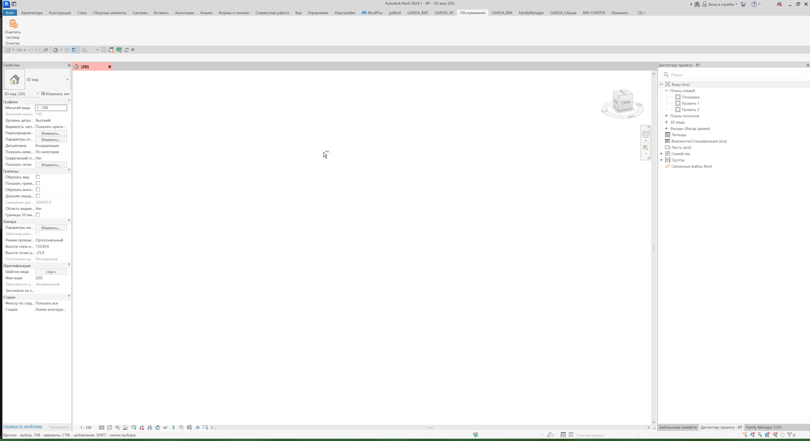
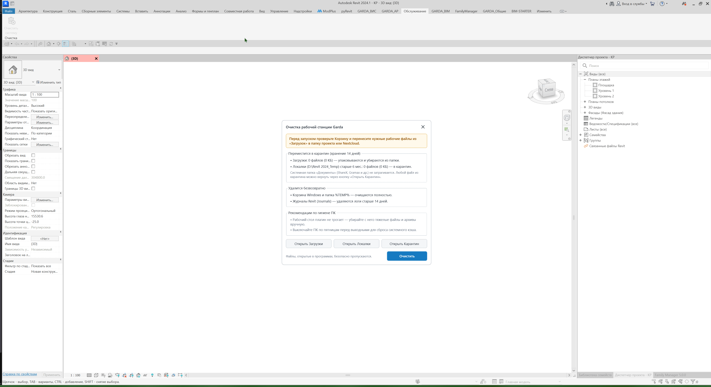

Плагин в один клик освобождает место на системном диске C:, предотвращая тормоза, долгую синхронизацию и фатальные ошибки при сохранении моделей в Revit.

Он безопасно удаляет системный мусор и переносит забытые пользовательские файлы во временный архив (Карантин). Плагин обходит стороной кэш совместной работы, папки проектов, Рабочий стол и автоматически пропускает файлы, которые в данный момент открыты в любых программах.

## Где находится

Лента Revit -> вкладка **«GARDA_Общие»** -> панель **«Очистка»** -> кнопка **«Очистить систему»**.

{width=97px height=140px}

## Как очистить систему

1. Нажмите кнопку **«Очистить систему»** на вкладке «GARDA_Общие». (Само нажатие ничего не удаляет -- это безопасно).
2. В появившемся окне нажмите **«Открыть Загрузки»**. Проверьте, нет ли там важных рабочих файлов, и перенесите их в нужную папку проекта на Nextcloud или личную папку.
3. Нажмите синюю кнопку **«Очистить»** и подтвердите запуск. Процесс займет несколько секунд.

{width=3851px height=2099px}

## Как восстановить файлы из карантина

**Если случайно удалили нужное:**

У вас есть 14 дней на возврат файлов из папок **«Загрузки»** и **«Документы»**.

1. Нажмите кнопку **«Очистить систему»** на ленте Revit.
2. В окне плагина нажмите **«Открыть карантин»** -- откроется папка с архивами.
3. Найдите папку с нужной датой очистки (например, Downloads_2026-10-21_08-48-46_c5cee9d7).
4. Откройте архив `Files.zip` внутри этой папки.
5. Скопируйте нужные файлы из архива в вашу рабочую папку (не открывайте их для работы прямо внутри ZIP-архива).

   {width=3851px height=2099px}

## Результат

За несколько секунд на диске C: освобождаются десятки гигабайт свободного места, Revit начинает работать быстрее и стабильнее.

Итог распределения файлов:

- **Удалено безвозвратно:** системный кэш (%TEMP%), содержимое Корзины Windows, журналы Revit старше 14 дней и истекшие архивы карантина.
- **Заархивировано в Карантин (на 14 дней):** все файлы из «Загрузок» и старые файлы из «Документов» (которые не изменялись больше 6 месяцев).
