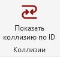
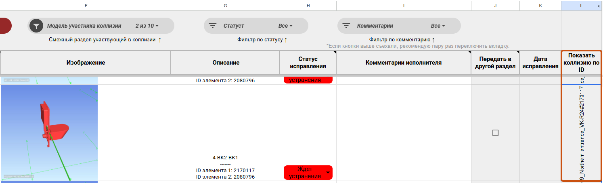
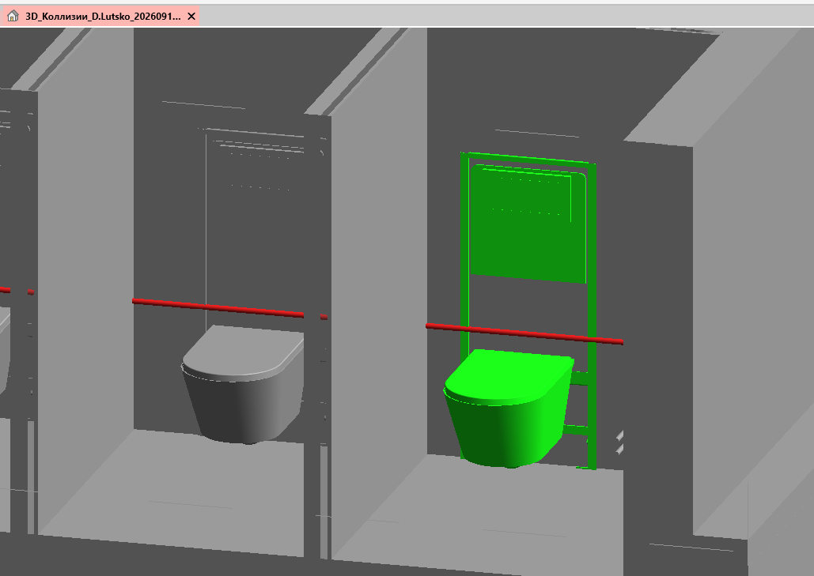

<comment id="SSW1h">Плагин предназначен для визуального выделения элементов, участвующих в коллизиях.</comment>

<note type="info">
  Применяется только совместно с таблицами коллизий на проекте.
</note>

## Где находится

Плагин расположен на вкладке «**GARDA_ОБщие**», в панели «**Коллизии**»

{width=100px height=95px scale=106px}

## Как пользоваться

1. Скопировать в буфер обмера значение из **Таблицы увязки объекта** (столбец **L**):

   {width=1494px height=456px scale=748px}
2. Перейти в открытую модель Revit, нажать кнопку плагина.
   - При нажатии на кнопку плагина создается временный 3D-вид, с настроенной подрезкой и цветовым отображением пересекаемых элементов (красный цвет - элемент из текущей модели, зеленый цвет - пересекающий элемент, серый цвет - все остальные элементы, не участвующие в коллизии):

{width=1029px height=729px scale=780px}
