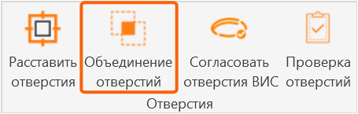
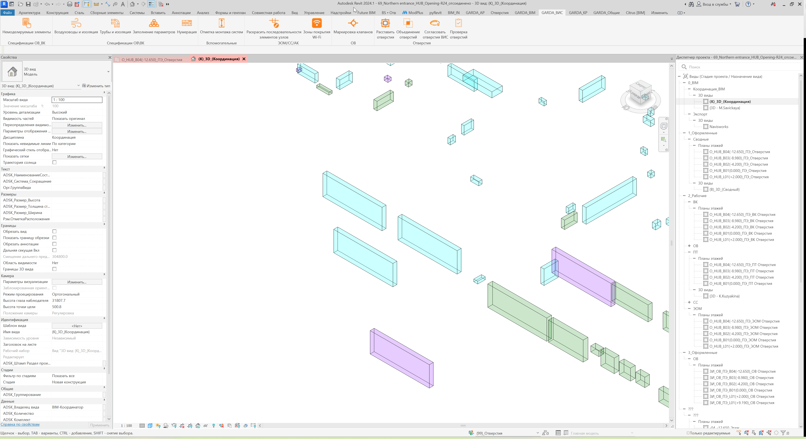

Плагин создаёт одно общее задание на отверстия из нескольких выбранных заданий.

## Где находится

Вкладка **GARDA_ВИС** -> панель **Отверстия**.

{width=455px height=145px}

## Как пользоваться

{width=3851px height=2099px}

<note>
  **Перед запуском:**

  Выберите не менее двух заданий на отверстия, которые должны стать одним общим заданием.
</note>

1. Запустите плагин с выбранными заданиями или выберите их по запросу плагина.
2. После выполнения проверьте общий размер исходных заданий, размеры, глубину, поворот, уровень (ближайший нижестоящий) и `G_Согласование_Раздел` (список разделов чьи задания были объеденины).

<note>
  Исходные задания удаляются после создания нового элемента.

  У результата новый ID; старые ссылки на задания больше не актуальны.

  Требуется повторное согласование задания ВИС.
</note>

## FAQ

### Почему проверка объединённого задания требует ручного разбора

Если через общее задание проходят несколько инженерных систем, автоматическая проверка не всегда может связать спорное пересечение с конкретной инженерной системой. Сверьте результат на 3D виде и в [«Проверке отверстий»](./untitled-4.md).

### Сохраняются ли старые согласования

Согласовывайте новый элемент как новое задание. Проверяйте согласования и разделы именно у

его ID.

[← Методология работы с отверстиями](./../../../revit/otverstiya.md)
