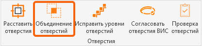

Плагин создаёт одно общее задание из нескольких выбранных заданий на отверстия.

## Где находится

Вкладка **GARDA_ВИС** -> панель **Отверстия**.

{width=416px height=95px}

<note type="info">
  Работает в открытой модели HUB.
</note>

## Как пользоваться

<note>
  **Перед запуском:**

  Выберите не менее двух заданий, которые должны стать одним проёмом.

  Проверьте, что они относятся к нужной конструкции.
</note>

1. Запустите плагин с выбранными заданиями или выберите их по запросу Revit.
2. При необходимости укажите тип результирующего семейства.
3. После выполнения проверьте общий охват исходных заданий, размеры, глубину, поворот, уровень и `G_Согласование_Раздел`.
4. Передайте новое задание на [согласование ВИС](03-согласовать-вис.md), затем АР или КР.

<note>
  Исходные задания удаляются после создания и проверки нового элемента.

  У результата новый ID; старые ссылки на задания больше не актуальны.
</note>

## FAQ

### Почему проверка объединённого задания требует ручного разбора

Если через общий проём проходят несколько трасс, автоматическая проверка не всегда может связать спорное пересечение с конкретной инженерной системой. Сверьте результат на 3D виде и в [«Проверке отверстий»](06-проверка-отверстий.md).

### Сохраняются ли старые согласования

Согласовывайте новый элемент как новое задание. Проверяйте подписи и разделы именно у его ID.

[← Методология работы с отверстиями](README.md)
