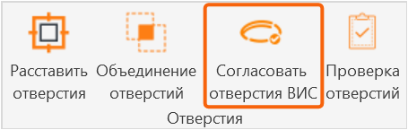
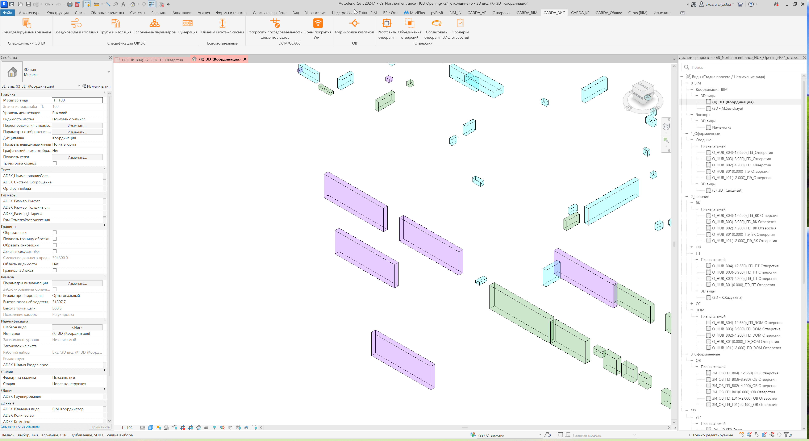

Плагин фиксирует подтверждение инженера о том, что задание на отверстия в модели HUB проверено, корректно и согласовано для последующего переноса в модели АР/КР.

## Где находится

Вкладка **GARDA_ВИС** -> панель **Отверстия**.

{width=455px height=145px}

## Как пользоваться

{width=3851px height=2099px}

1. Выберите задания на отверстия.
2. Проверьте, что оно корректно.
3. Запустите плагин. Если задание относится к нескольким разделам, выберите свой раздел: ОВ, ВК, СС или ЭОМ.

<note>
  `G_GUID` хранит состояние задания -- положение и размеры.

  Если задание изменилось после прежнего согласования, старые согласования могут быть сброшены.
</note>

## FAQ

### Достаточно ли флага ВИС для вырезания отверстия

Нет. Для обычного маршрута необходимо также актуальное согласование принимающего раздела -- АР или КР.

### Что делать, если задание изменили после согласования АР или КР

После повторного согласования ВИС проверьте, сохранилось ли согласование принимающего раздела. Для изменённого варианта АР или КР должны проверить и согласовать задание заново.

← Методология работы с отверстиями
