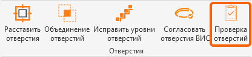

Плагин показывает состояние заданий и согласований в HUB, проверяет положение инженерных систем относительно отверстий.

## Где находится

Вкладка **GARDA_ВИС** -> панель **Отверстия**.

{width=416px height=95px}

<note type="info">
  Работает в открытой модели HUB.
</note>

## Как пользоваться

<note>
  **Перед запуском:**

  Загрузите инженерные связи.

  Проверьте опорный 3D вид **Navisworks** и его фильтр стадии «План после реконструкции».
</note>

1. Если нужны только конкретные задания, выберите их до запуска. Без предварительного выбора плагин проверяет предусмотренный им объём модели.
2. Выберите инженерный раздел -- ОВ, ВК, СС, ЭОМ -- или все разделы ВИС.
3. В таблице смотрите ID, статус, причину и согласования. Используйте поиск и фильтр для разбора проблемных строк.
4. Для выбранных заданий при необходимости создайте ограниченный 3D вид или скопируйте ID. Повторите проверку после исправлений.

<note>
  Подтверждённое нарушение геометрии обычного задания может сбросить его действующие согласования.

  Создание 3D вида также изменяет HUB.
</note>

## FAQ

### Почему согласования слетели

Плагин обнаружил изменение положения или размеров задания, снятое закрепление у финально согласованного задания либо подтверждённое геометрическое нарушение. Причину смотрите в строке таблицы. После исправления повторите нужные согласования.

### Инженерная система не найдена

Не обязательно. Проверьте загрузку связи, стадию, положение инженерной системы и задание. Само отсутствие найденной инженерной системы не является подтверждённым основанием для сброса.

### Что делать с неоднозначным результатом общего отверстия

Проверьте его на 3D виде вручную. При необходимости найдите конкретную инженерную систему через [«Найти ID в связях»](11-найти-id-в-связях.md).

[← Методология работы с отверстиями](README.md)
