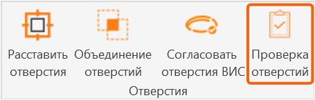
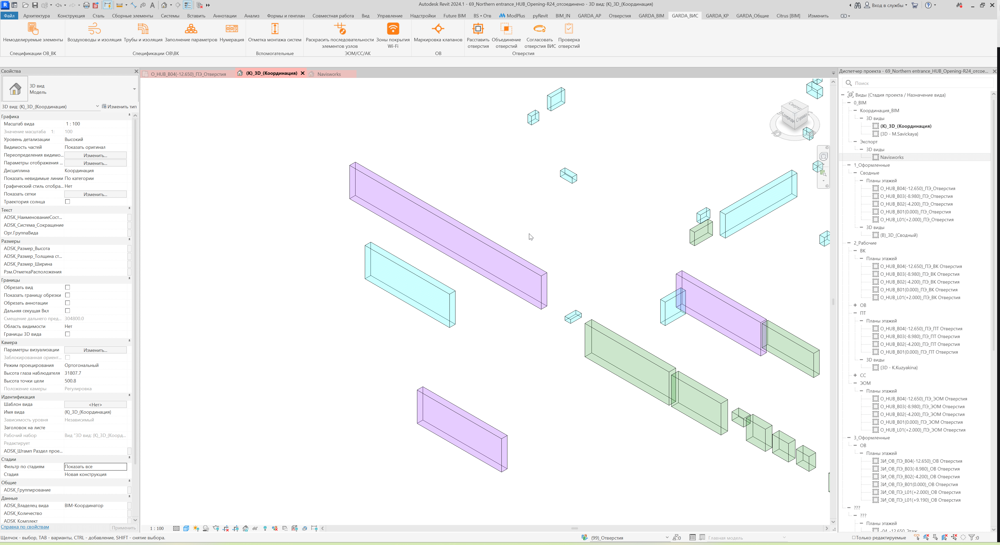

Плагин показывает состояние заданий и согласований в HUB, проверяет положение инженерных систем относительно заданий.

## Где находится

Вкладка **GARDA_ВИС** -> панель **Отверстия**.

{width=455px height=145px}

## Как пользоваться

{width=3851px height=2099px}

<note>
  **Перед запуском:**

  Загрузите свою модель и АР.

  Проверьте 3D вид **Navisworks** (его фильтр стадии должен быть - «План после реконструкции»).
</note>

1. Если нужны только конкретные задания, выберите их до запуска. Без предварительного выбора плагин проверяет предусмотренный им объём модели.
2. Выберите инженерный раздел -- ОВ, ВК, СС, ЭОМ -- или все разделы ВИС.
3. В таблице смотрите ID, статус, причину и согласования. Используйте поиск и фильтр для разбора проблемных строк.
4. Для выбранных заданий при необходимости нажмите  «Создать 3D вид» или скопируйте ID.

<note>
  Подтверждённое нарушение геометрии задания может сбросить его действующие согласования.
</note>

## FAQ

### Почему согласования слетели

Плагин обнаружил изменение:

Положения в пространстве,

Размеров задания,

Снятие закрепления у полностью согласованного задания,

Подтверждённое геометрическое нарушение.

Причину смотрите в строке таблицы.

После исправления повторите нужные согласования.

### Ошибка: Инженерная система отсутствует в задании на отверстие

Проверьте загрузку связи, стадию, положение инженерной системы и задания. Само отсутствие найденной инженерной системы не является подтверждённым основанием для сброса.

### Что делать с неоднозначным результатом общего отверстия

Проверьте его на 3D виде вручную. При необходимости найдите конкретную инженерную систему через [«Поиск по ID»](./../../garda_obschee/moskva/poisk-po-id.md).

[← Методология работы с отверстиями](./../../../revit/otverstiya.md)
