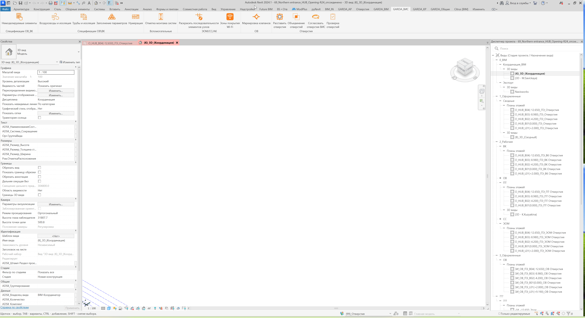

Плагин создаёт в модели HUB задания на отверстия там, где инженерные системы пересекают стены и перекрытия связанных моделей.

## Где находится

Вкладка **GARDA_ВИС** -> панель **Отверстия**.

{width=455px height=145px}

## Как пользоваться

{width=3851px height=2099px}

<note>
  **Перед запуском:**

  Проверьте наличие загреженных моделей АР\\КР и вашей инженерной модели в HUB.
</note>

1. Откройте HUB и запустите плагин.
2. Выберите инженерный раздел, связи, режим обработки и настройки размеров.
3. Если выбран режим отдельных элементов, укажите элементы в разрешённых связях. Для массовой обработки проверьте выбранную область поиска.
4. После создания, при наличии ошибок появится отчет с проблемными элементами, прочитайте отчёт: сколько заданий создано и какие места пропущены, выберите проблемные элементы, создайте 3д-вид, проверьте.
5. На 3D виде проверьте:
6. Размеры -
7.  Уровень -
8. Положение заданий относительно инженерной системы и конструкции - проходит ли инженерная система скрвозь контсрукцию.

<note>
  Плагин изменяет HUB. Модели связей он **не** изменяет. После расстановки проверьте возможные дубли перед согласованием.
</note>

## FAQ

### Что делать, если рядом несколько инженерных систем

Если нужен один общий проём, используйте [«Объединение отверстий»](02-объединение-отверстий.md) и проверьте итоговый габарит.

### Можно ли сразу передавать созданное задание АР или КР

Сначала ВИС проверяет задание и выполняет [«Согласовать отверстия ВИС»](03-согласовать-вис.md). Далее задание проверяет принимающий раздел.

[← Методология работы с отверстиями](README.md)
