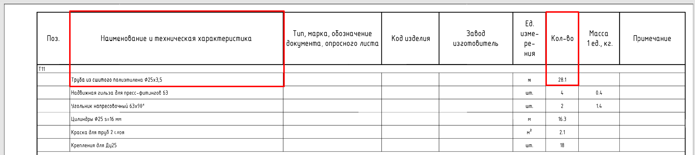
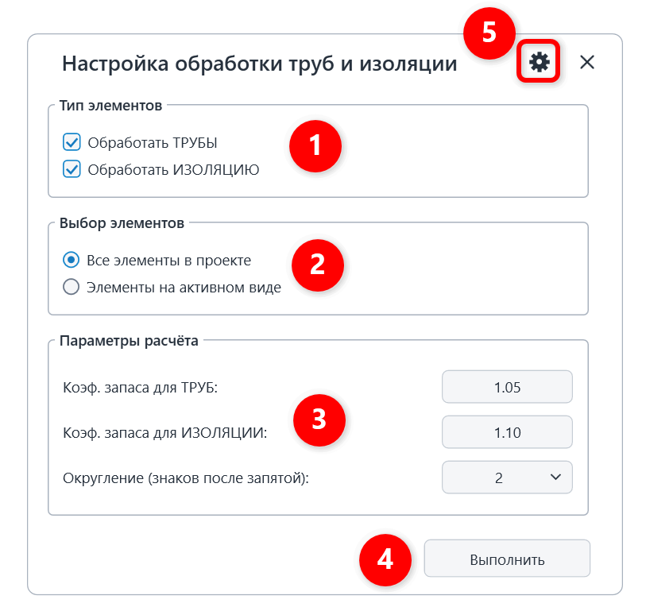
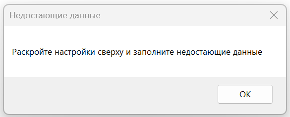
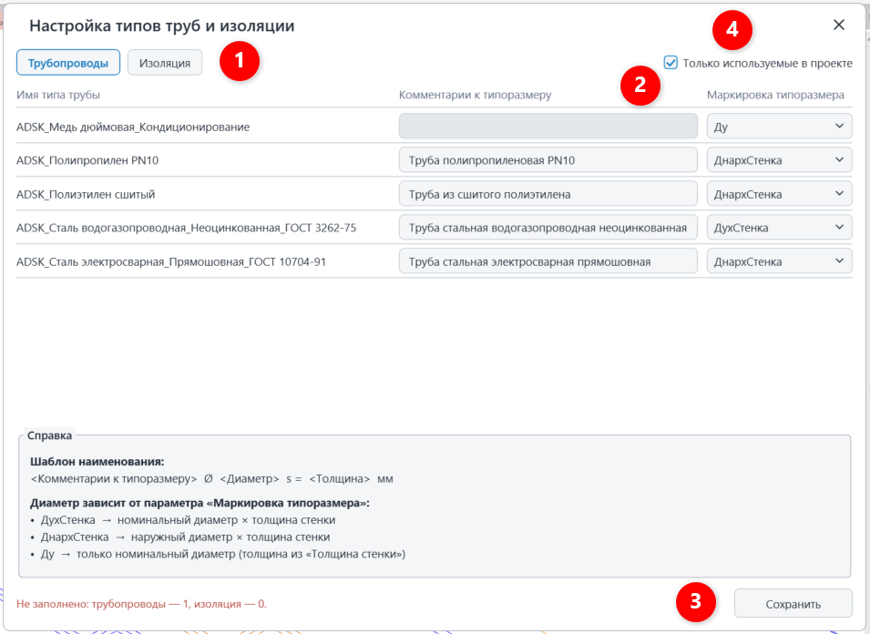
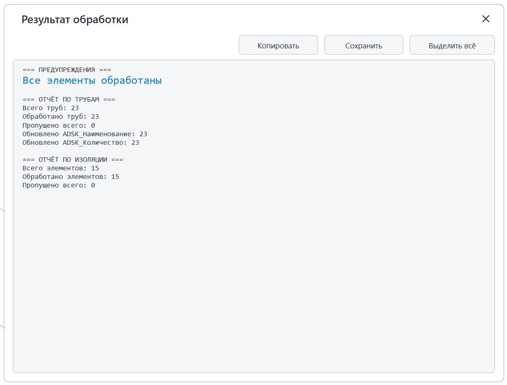
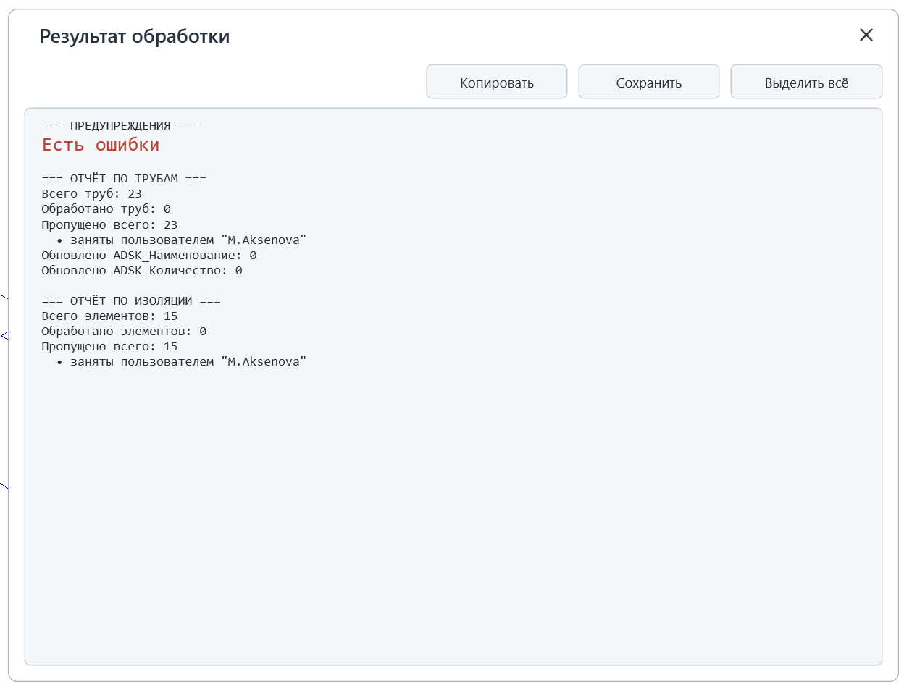

Плагин рассчитывает количество трубопроводов и изоляции трубопроводов, а также заполняет параметры **«ADSK_Наименование»** и **«ADSK_Количество»**.

## 1. Где находится

Плагин расположен на вкладке **«GARDA_ВИС»**, панели **«Спецификации ОВ\ВК»**.

## 2. Как пользоваться

### 2.1. Интерфейс

Запустите плагин и выберите, что именно необходимо обрабатывать и с какими настройками:

1. Что именно необходимо обработать.
2. Обработать все элементы в проекте или только элементы на активном виде.
3. Указываются коэффициенты запаса, с которыми будет производиться расчет количества трубопроводов и изоляции.
4. Запуск плагина.
5. Расширенные настройки.

### 2.2. Расширенные настройки

Данное окно нужно для быстрого заполнения необходимых параметров для работы плагина. Если какой-то параметр не заполнен, появится следующее предупреждение:

Тогда необходимо нажать на шестеренку и заполнить все поля:

1. Переключение режима «Трубопроводы / Изоляция».
2. Комментарии к типоразмеру. Серые строчки необходимо заполнить.
3. Сохранение настроек.
4. Показать только те элементы, которые используются в проекте / все элементы.

## 3. Отчет по обработке ошибок

Два варианта отчета:

1. Все прошло успешно и плагин отработал все элементы:

   

2. Что-то пошло не так, и плагин не смог обработать все элементы:

   

Возможные причины:

| Причины ошибок | Кто устраняет |
| :--- | :--- |
| Элементы заняты другим пользователем. Данные элементы пропускаются плагином и выводится ошибка: заняты пользователем «Имя пользователя». | Инженер просит коллегу синхронизироваться и повторно запускает плагин. |
| У элемента недоступен параметр для записи. | BIM-Координатор |
| Проверьте тип изоляции для диаметра выше 150 мм:  • диаметр 200.0 мм — требуется Маты или Рулон.  Для труб диаметром выше 150 должна быть назначена изоляция, содержащая в параметре «Комментарии к типоразмеру» слова «Маты» или «Рулон». Данная изоляция считается в м². | Инженер создает отдельный тип изоляции для таких элементов. |
