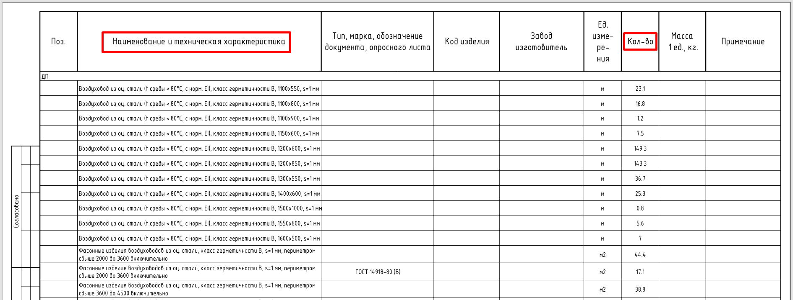
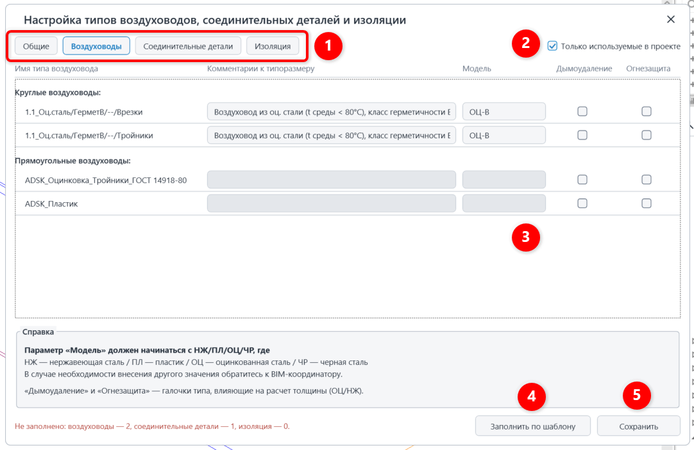
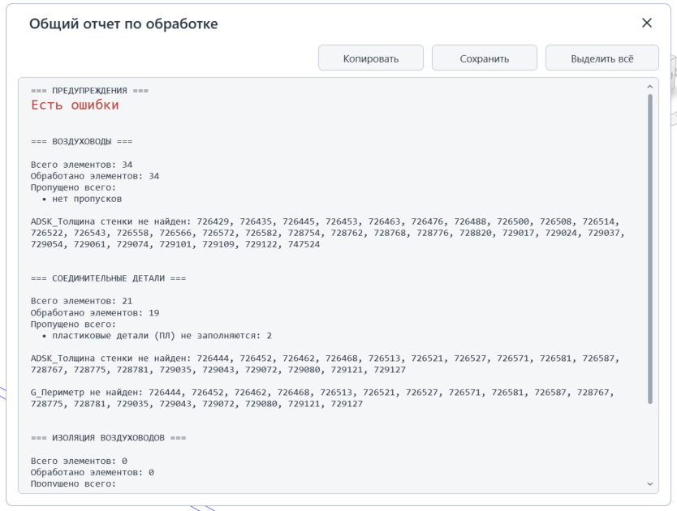
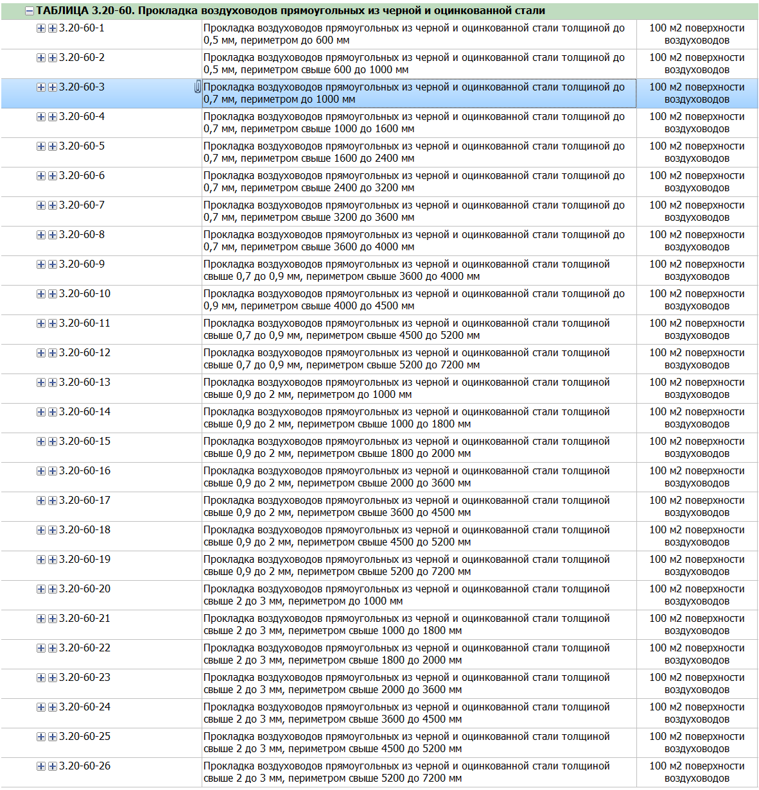
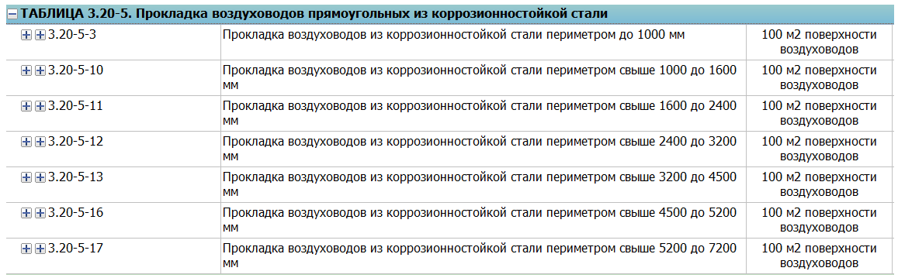

Плагин автоматически рассчитывает толщину стенки и количество для воздуховодов, соединительных деталей и изоляций воздуховодов, а также заполняет параметры **«ADSK_Наименование»**, **«ADSK_Единица измерения»**, **«ADSK_Количество»**, **«ADSK_Толщина стенки»**, **«G_Периметр»**.

## 1. Где находится

Плагин расположен на вкладке **GARDA_ВИС**, панели **Спецификации ОВ\ВК**.

## 2. Как пользоваться

### 2.1. Интерфейс

Запустите плагин и выберите, что именно необходимо обрабатывать и с какими настройками:

1. Что именно необходимо обработать.
2. Обработать все элементы в проекте или только элементы на активном виде.
3. Указываются коэффициенты запаса, с которыми будет производиться расчет количества воздуховодов и составляющих.
4. Настройки расчета соединительных деталей (расчет производится в м² либо в м).
5. Расширенные настройки.

> **Пример заполнения параметров при выборе «Считать в м2»:**
>
> ADSK_Наименование = Фасонные изделия воздуховодов из оц. стали, s=1 мм, диаметром свыше 800 до 1250 мм включительно

> **Пример заполнения параметров при выборе «Считать в м»:**
>
> ADSK_Наименование = Воздуховод из оц. стали (t среды < 80 °C), класс герметичности B, Ø1000, s=1 мм

**После выбора настроек необходимо нажать кнопку «Выполнить».**

### 2.2. Расширенные настройки

#### 2.2.1. Общие

В данной вкладке выбирается, необходимо ли записывать информацию о толщине стенки и периметре в отдельные параметры.

#### 2.2.2. Остальные вкладки

Данное окно нужно для быстрого заполнения необходимых параметров для работы плагина. Если какой-то параметр не заполнен, появится следующее предупреждение:

Тогда необходимо нажать на шестеренку и заполнить все поля:

1. Настройки по категориям. Здесь указано, какие параметры необходимо заполнить для корректной работы плагина.
2. Показать только те элементы, которые используются в проекте / все элементы.
3. Комментарии к типоразмеру / Модель. Серые строчки необходимо заполнить.
4. Заполнить настройки по шаблону (если данные семейства есть в эталонном шаблоне, то параметры заполнятся автоматически. Существующее значение параметров перезапишется).
5. Сохранить. Обязательно нажать на данную кнопку для внесения изменений.

> **Информация:** Данные настройки сохраняются под проект.

## 3. Отчет по обработке ошибок

Два варианта отчета:

1. Все прошло успешно и плагин отработал все элементы:

   

2. Что-то пошло не так, и плагин не смог обработать все элементы:

   

Возможные причины:

| Причины ошибок | Кто устраняет |
| :--- | :--- |
| Элементы заняты другим пользователем. Данные элементы пропускаются плагином и выводится ошибка: заняты пользователем «Имя пользователя». | Инженер просит коллегу синхронизироваться и повторно запускает плагин. |
| У элемента недоступен параметр для записи. | BIM-Координатор |

## 4. Логика расчета и заполнения параметров

### 4.1. Общая информация

#### 4.1.1. Толщина стенки

Толщина стенки воздуховодов и соединительных деталей принимается в соответствии с приложением К СП 60.13330.2020.

Толщину листовой стали для воздуховодов, по которым перемещается воздух температурой не выше 80 °C, следует принимать не более:

Для воздуховодов из листовой стали, имеющих огнезащитное покрытие, а также для воздуховодов систем дымоудаления толщину стенки принимают с добавлением **0,1 мм** к значению, определённому по приложению К СП 60.13330.2020, но не менее 0,9 мм.

Для черной стали толщина стенки — 1,5 мм.

Огнезащитное покрытие или система дымоудаления определяются с помощью параметров типа:

- Дымоудаление;
- Огнезащитное покрытие (для соединительных деталей параметр называется «Огнезащита»).

> **Информация:** На расчет толщины стенки влияет значение параметра «Модель», через данный параметр определяется материал воздуховода.

> **Примечание:** При размере воздуховода более 2000 мм толщина стенки записывается как «s=уточняется конструкторами».

### 4.2. Параметры категории «Воздуховоды»

#### 4.2.1. ADSK_Наименование

> **Информация:** Шаблон наименования:
> `<Комментарии к типоразмеру> <Размер>, s=<толщина> мм`

**Пример:** `<Воздуховод из оц. стали (t среды < 80 °C), класс герметичности B>, Ø1000, s=1 мм`

#### 4.2.2. ADSK_Единица измерения

Заполняется пользователем в проекте.

#### 4.2.3. ADSK_Количество

`ADSK_Количество = Длина * Коэф. запаса для воздуховодов и соед. деталей`

### 4.3. Соединительные детали воздуховодов

#### 4.3.1. ADSK_Наименование

**Режим: Считать в м**

> **Информация:** Шаблон наименования:
> `<Комментарии к типоразмеру (у подключенного воздуховода)>, <Размер>, s=<Толщина стенки> мм`

> **Пример:** `<Воздуховод из оц. стали (t среды < 80 °C), класс герметичности B>, Ø1000, s=1 мм`
>
> Для воздуховодов из пластика и при неопределённом материале блок `s=…` не выводится.

Для черной стали толщина стенки — 1,5 мм.

**Режим: Считать в м2**

> **Информация:** Шаблон наименования:
> `Фасонные изделия воздуховодов из <Материал>[, <Класс герметичности>], s=<Толщина стенки> мм, <Диапазон>`

> **Пример:** Фасонные изделия воздуховодов из оц. стали, s=1 мм, диаметром свыше 800 до 1250 мм включительно

- **`<Материал>`** определяется по параметру «Модель».
- **`<Класс герметичности>`** извлекается из «Комментарии к типоразмеру» **типа детали** (а не подключённого воздуховода); если не найден — блок отсутствует.
- **`<Диапазон>`** для круглых деталей — диапазон по диаметру; для прямоугольных — диапазон по периметру, зависящий от толщины стенки; при толщине свыше 3,0 мм — периметром `<N> мм`.

**Диапазоны диаметров круглых воздуховодов:**

- `≤ 355` → «диаметром до 355 мм включительно»
- `356–560` → «диаметром свыше 355 до 560 мм включительно»
- `561–800` → «диаметром свыше 560 до 800 мм включительно»
- `801–1250` → «диаметром свыше 800 до 1250 мм включительно»
- `1251–1600` → «диаметром свыше 1250 до 1600 мм включительно»
- `> 1600` → «диаметром свыше 1600 мм»

**Диапазоны прямоугольных воздуховодов:**

Набор диапазонов периметра зависит от толщины: ≤0.5, ≤0.7, <0.9, ==0.9, ≤2.0, ≤3.0.

> **Информация:** Диапазоны диаметров и периметров (режим «Считать в м²») приняты согласно информации от сметного отдела.

#### 4.3.2. ADSK_Единица измерения

**Режим: Считать в м**

`ADSK_Единица измерения = м`

**Режим: Считать в м2**

`ADSK_Единица измерения = м2`

#### 4.3.3. ADSK_Количество

**Режим: Считать в м**

`ADSK_Количество = Эквивалентная длина * Коэф. запаса для воздуховодов и соед. деталей`

**Эквивалентная длина считается по формуле:**
`Площадь соед. детали (определяется методом кода) / Периметр`

Для переходов берется периметр для стороны с большим размером. Для тройников — по магистральному сечению.

**Режим: Считать в м2**

`ADSK_Количество = Площадь соед. детали (определяется методом кода) * Коэф. запаса для воздуховодов и соед. деталей`

### 4.4. Материалы изоляции воздуховодов

#### 4.4.1. ADSK_Наименование

Шаблон наименования: `<Комментарии к типоразмеру>`

Примечания:

- Для изоляции врезок в наименование записывается `!Не учитывать`, количество = `0`.

#### 4.4.2. ADSK_Единица измерения

Заполняется пользователем в проекте.

#### 4.4.3. ADSK_Количество

`ADSK_Количество = Площадь изоляции воздуховода/соед. детали возд. * Коэф. запаса для изоляции`
