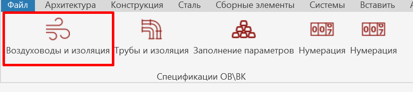
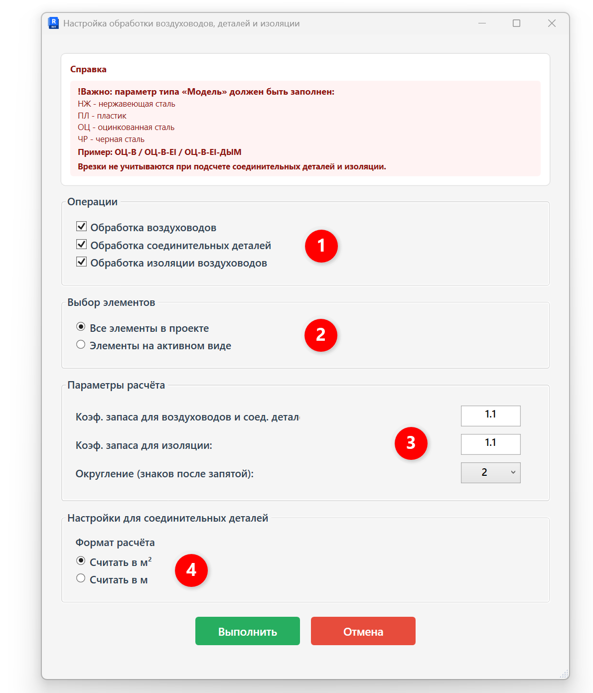
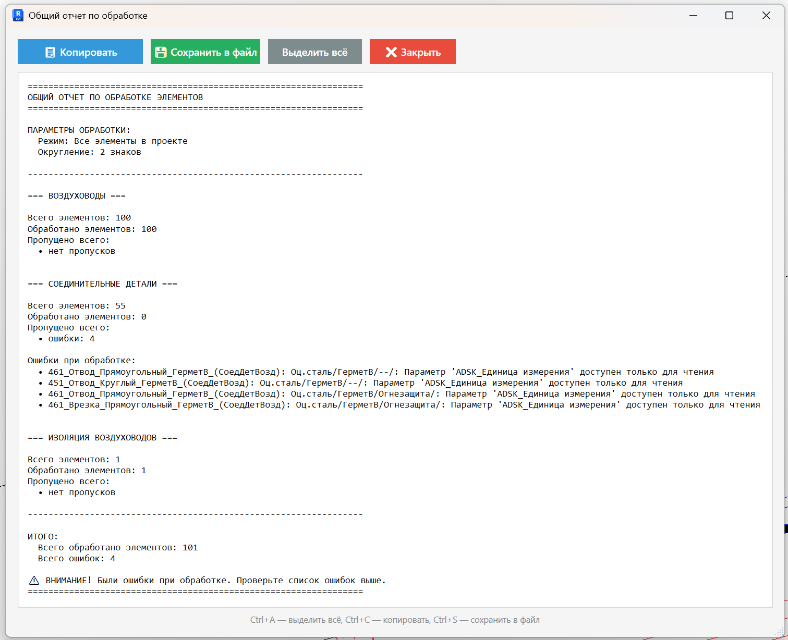
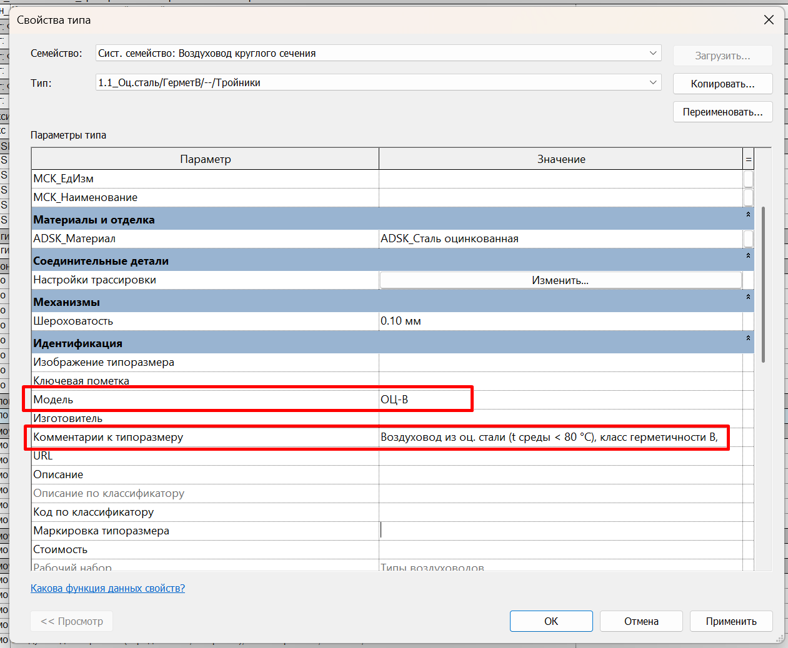
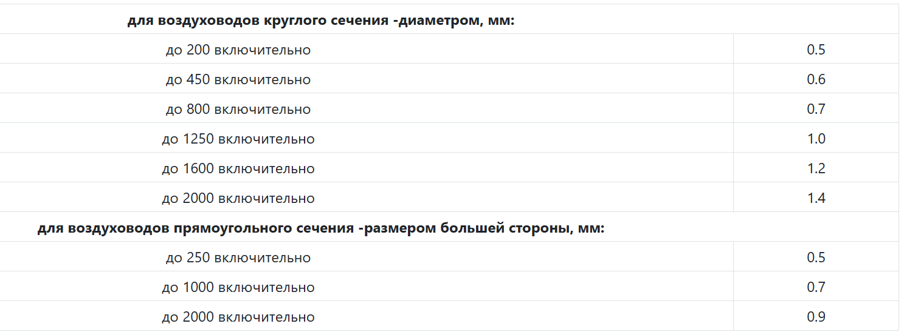

## 1\. Назначение плагина

Плагин обрабатывает воздуховоды, соединительные детали и изоляцию воздуховодов: автоматически рассчитывает толщину стенки и количество, заполняет параметры **«ADSK_Наименование», «ADSK_Единица измерения», «ADSK_Количество», «ADSK_Толщина стенки», «G_Периметр».**

<note type="info">
  **Перед запуском:** проверьте, что исходные параметры элементов заполнены по правилам из раздела «Подготовка модели».
</note>

## 2\. Где находится

Плагин расположен на вкладке **GARDA_ВИС**, панели **Спецификации ОВ\\ВК**.

{width=827px height=186px scale=74}

## 3\. **Запуск и настройки**

Запустите плагин и выберите, что именно необходимо обрабатывать и с какими настройками:

{width=1190px height=1391px scale=70}

1. \- что именно необходимо обработать;
2. \- обработать все элементы в проекте или только элементы на активном виде;
3. \- указывается коэффициенты запаса с которыми будет производиться расчет количества воздуховодов;
4. \- настройки расчета соединительных деталей (расчет производится в м2, либо в м)

   **Пример заполнения параметров при выборе «Считать в м2»:**

   ADSK_Наименование = Фасонные изделия воздуховодов из оц. стали, s=1 мм, диаметром свыше 800 до 1250 мм включительно

   ADSK_Единица измерения= «м2»

   ADSK_Количество= Площадь \* Коэффициент запаса

   **Пример заполнения параметров при выборе «Считать в м»:**

   ADSK_Наименование= Воздуховод из оц. стали (t среды \< 80 °C), класс герметичности B, Ø1000, s=1 мм

   ADSK_Единица измерения= «м»

   ADSK_Количество= Эквивалентная длина \* Коэффициент запаса

## 4\. **Отчёт об обработке**

После завершения обработки плагин выводит отчёт. В нём отображаются обработанные элементы и ошибки, возникшие во время обработки.

{width=1511px height=1228px scale=76}

Если в отчёте указана ошибка:

1. Найдите соответствующий элемент или тип.
2. Проверьте заполнение параметров **«Модель»** и **«Комментарии к типоразмеру»** в соответствии с пунктом **«5. Подготовка модели».**
3. Исправьте данные и повторно запустите обработку.

<note type="info">
  Для проектов, созданных на актуальном шаблоне, параметры элементов должны быть заполнены заранее. Дополнительная подготовка модели перед запуском плагина обычно не требуется.
</note>

## **5\. Подготовка модели**

Перед обработкой проверьте параметры типов элементов. Плагин использует значения параметров **«Модель»** и **«Комментарии к типоразмеру»** для определения характеристик элемента и формирования результата.

#### 5\.1. Воздуховоды

{width=1261px height=1038px scale=71}

У типа воздуховода должен быть заполнен параметр **«Модель»**. Используйте следующие обозначения:

- НЖ - нержавеющая сталь;
- ПЛ- пластик;
- ОЦ - оцинкованная сталь;
- ЧР - черная сталь

  **Пример**: ОЦ-B; ОЦ-B-EI; ОЦ-B-EI-ДЫМ ;НЖ-В;

У типа воздуховода также должен быть заполнен параметр **«Комментарии к типоразмеру»**. Примеры:

- Воздуховод из оц. стали (t среды \< 80 °C), класс герметичности B,;
- Воздуховод из оц. стали (t среды \< 80 °C, с норм. EI), класс гермет. B,;
- Воздуховод из нерж. стали (с норм. EI), класс гермет. B,;
- Воздуховод пластиковый для круглых каналов

#### 5\.2. Соединительные детали

У типа соединительной детали должен быть заполнен параметр **«Модель»**. Заполняйте его по той же логике, что и для воздуховодов.

В параметре **«Комментарии к типоразмеру»** укажите класс герметичности -- `B` или `A`.

**Пример:** Переход  прям./кр. из нерж. стали (t среды\<80°C, с норм. EI), класс герметичности В

#### 5\.3. Материалы изоляции воздуховодов

Для материала изоляции заполните параметр **«Комментарии к типоразмеру»**. От его значения зависит заполнение параметра `ADSK_Наименование`.

Для материалов изоляции расчёт выполняется в **м²**.

## **6\. Логика расчета**

#### 6\.1. Толщина стенки

Определяется в соответствии с **СП 60.13330.2020** (Приложение К):

{width=1492px height=553px scale=78}

Для обычных воздуховодов

1\.5 мм для черной стали
