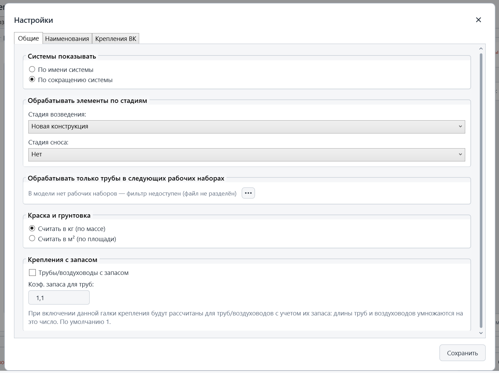
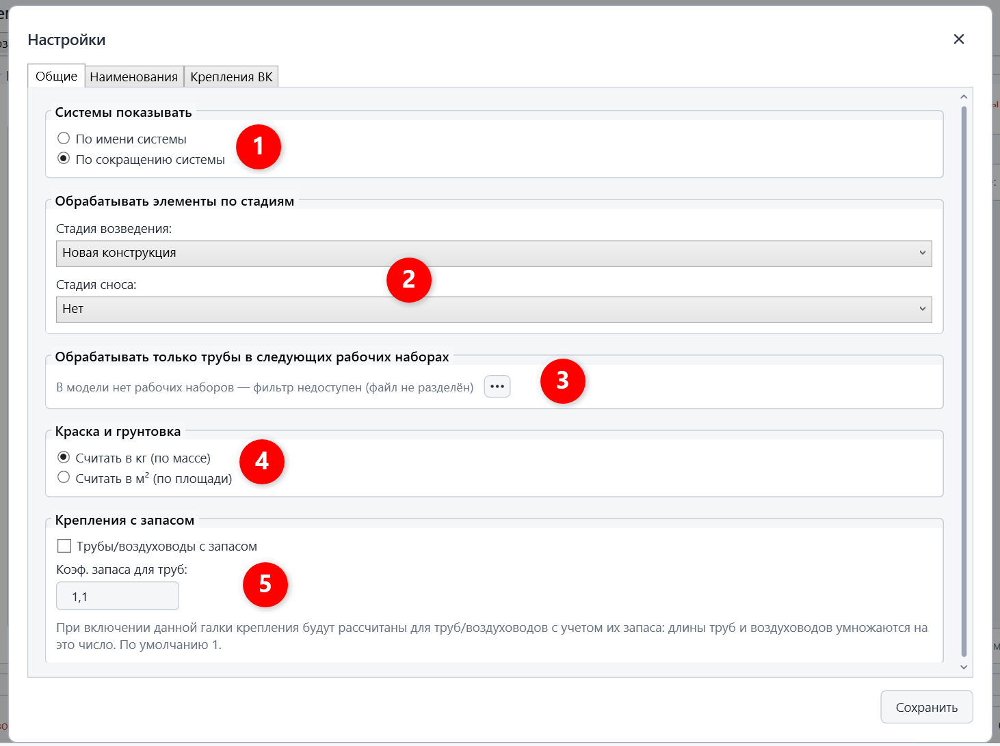
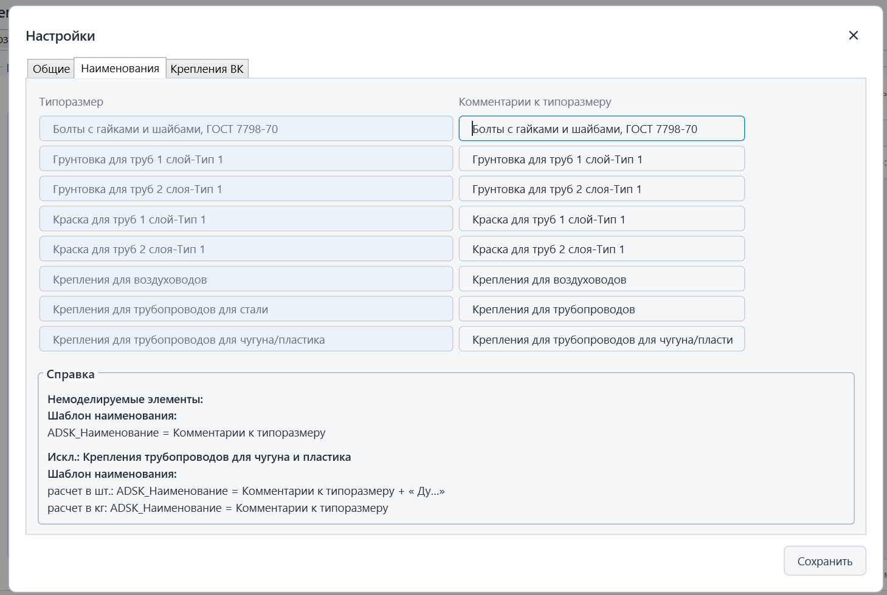
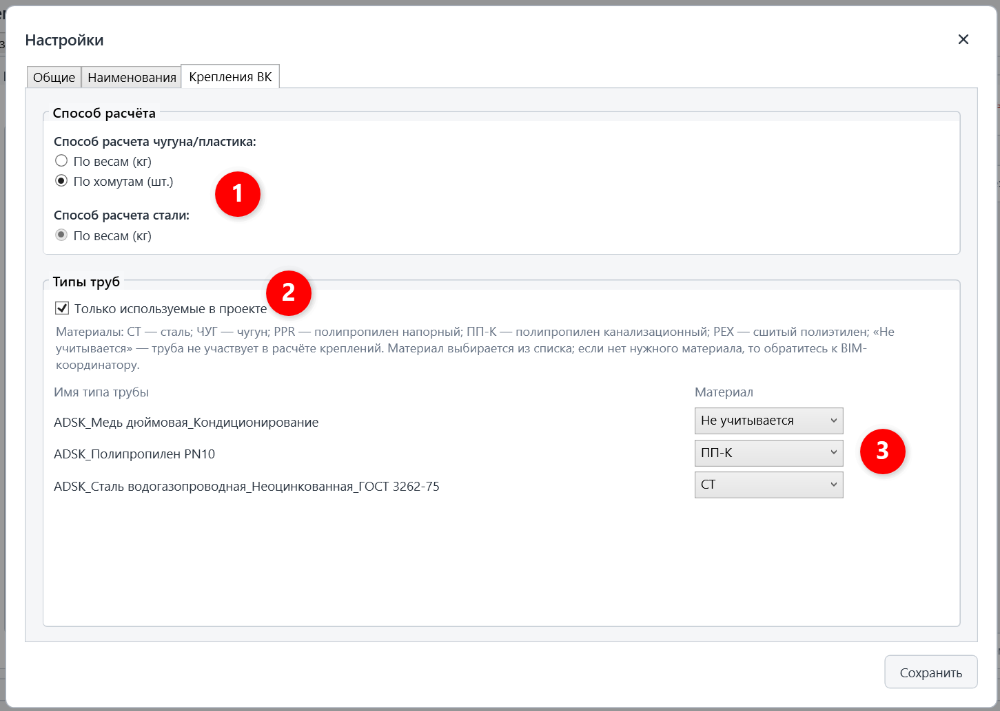
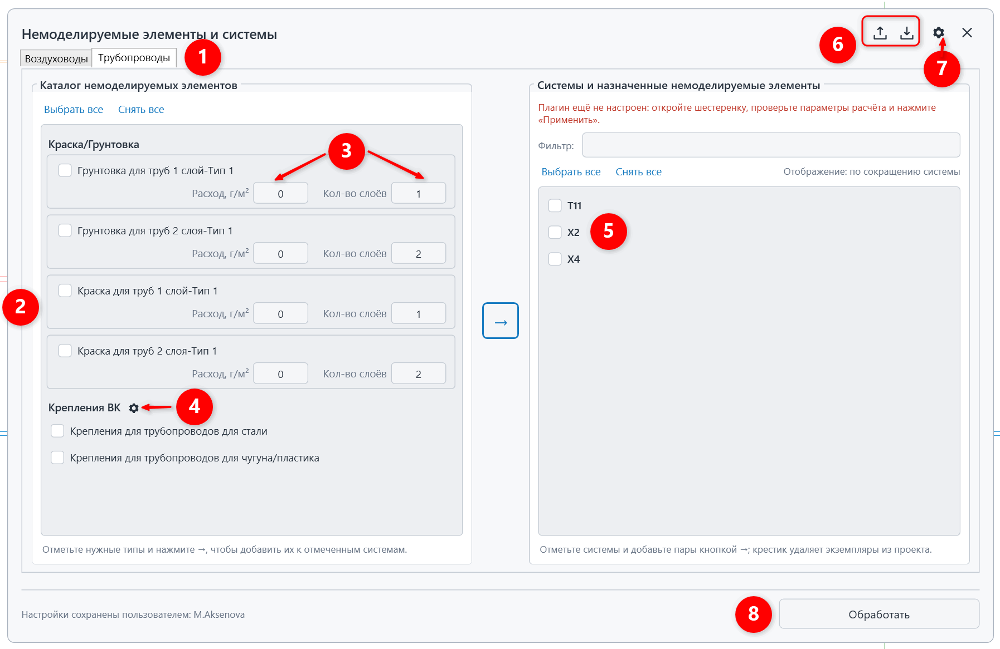
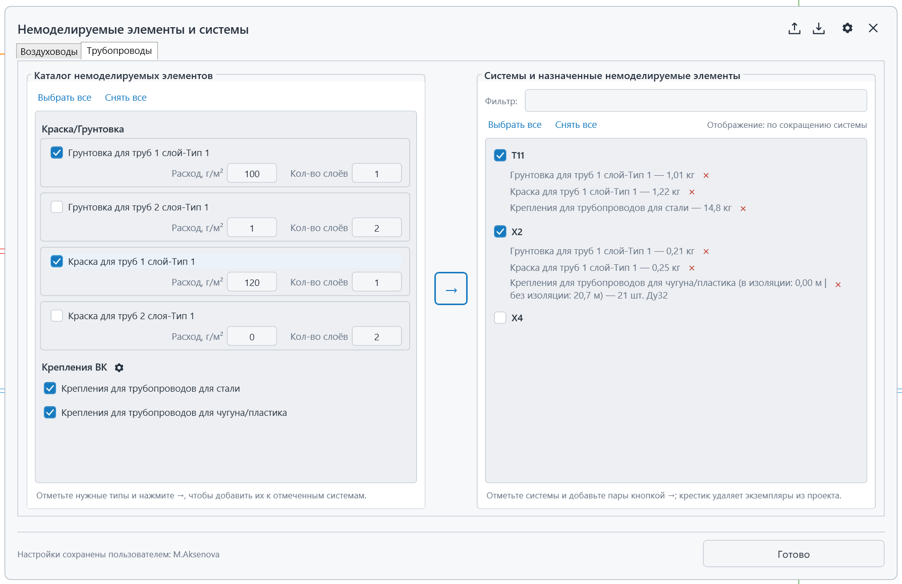
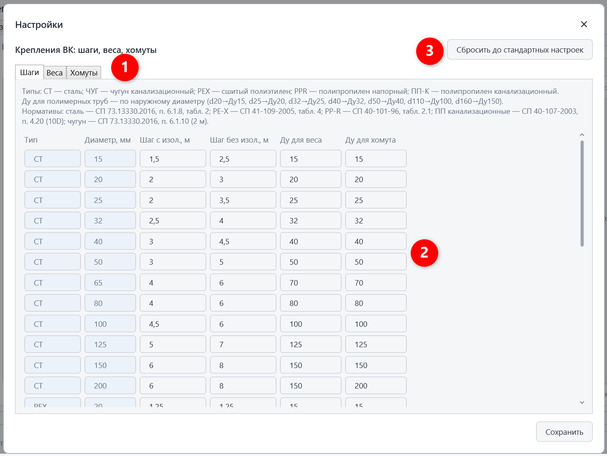

Плагин создаёт в модели немоделируемые элементы по системам ОВ и ВК и рассчитывает их количество.

### 1\. Где находится

Плагин расположен на вкладке «**GARDA_ВИС»**, панели «**Спецификации ОВ\\ВК»**.

<highlight color="yellow">ВСТАВИТЬ КАРТИНКУ</highlight>

### 2\. Как пользоваться

#### 2\.1 Предподготовка

1. Необходимо из библиотеки семейств загрузить семейство «00_Немоделируемые элементы»
2. Проверить, что в модель добавлен параметр «G_СО_Имя системы» для категории Обобщенные модели.

#### 2\.1 Интерфейс начального окна плагина

При первом открытии модели сначала откроется окно настроек:

{width=1463px height=1095px scale=555px}

Необходимо проверить параметры на данных трех вкладках и нажать «Сохранить». Настройки будут сохранены для текущего проекта.\\

- вкладка «Общие»:

{width=1462px height=1092px scale=631px}

1 - указывается что будет записываться в G_СО_Имя системы и как будут считаться элементы;

2 - указывается для какой стадии необходимо обрабатывать элементы;

3 - указываются элементы из каких рабочих наборов учитываются при расчете;

4 - задается правило как будет рассчитываться краска и грунтовка;

5 - указывается какой объем труб брать при расчете немоделируемых (количество труб с запасом или без)

- вкладка «Наименования»:

{width=1459px height=980px scale=667px}

В данном окне прописывается как будет заполнен параметр ADSK_Наименование для немоделируемых. Пользователь может поменять «Комментарии к типоразмеру» прям в окне плагина.

- вкладка «Крепления ВК»:

{width=1451px height=1033px scale=549px}

1 - указывается в чем необходимо подсчитывать немоделируемые для труб из чугуна и пластика;

2 - Можно показать «Только используемые трубы в проекте», либо все;

3 - указывается материал труб. Некоторые правила заданы в плагине по умолчанию, но обязательно еще раз проверьте данный пункт.

<note type="info">
  После просмотра всех вкладок нажимаем «Сохранить». ДАнные настройки при необходимости можно будет изменить.
</note>

#### 2\.2 Интерфейс основного окна плагина

{width=1794px height=1166px}

1. \- дисциплина расчёта. От неё зависит, какие типы и системы показывает окно;
2. \- каталог немоделируемых семейств в проекте;
3. \- указывается расход краски/грунтовки и кол-во слоев;
4. \- расширенные настройки креплений ВК;
5. \- список всех систем в проекте;
6.  - импорт/экспорт настроек (настройки из шестеренок);
7. \- глобальные настройки;
8.  - обработка элементов. <highlight color="yellow">После нажатия кнопки «Обработать» появится кнопка «Готово». После ее нажатия вы выйдете из окна плагина.</highlight> 

Окно после нажатия кнопки «Обработать»:

{width=1788px height=1160px}

#### 2\.3 Расширенные настройки креплений

{width=1453px height=1094px}

1. \- вкладки со стандартными значениями, которые предоставили инженеры;
2. значения для различных размеров. При необходимости эти значения можно менять. Там, где изменены значения ячейка темно-серого цвета;
3. \- сброс до начальных настроек (по СП)

<note type="info">
  Плагин сохраняет значения в конкретный проект.
</note>

Плагин создаёт в модели немоделируемые элементы по системам ОВ и ВК и рассчитывает их количество: заполняет **ADSK_Количество**, **ADSK_Наименование**, **ADSK_Единица измерения** и

###
