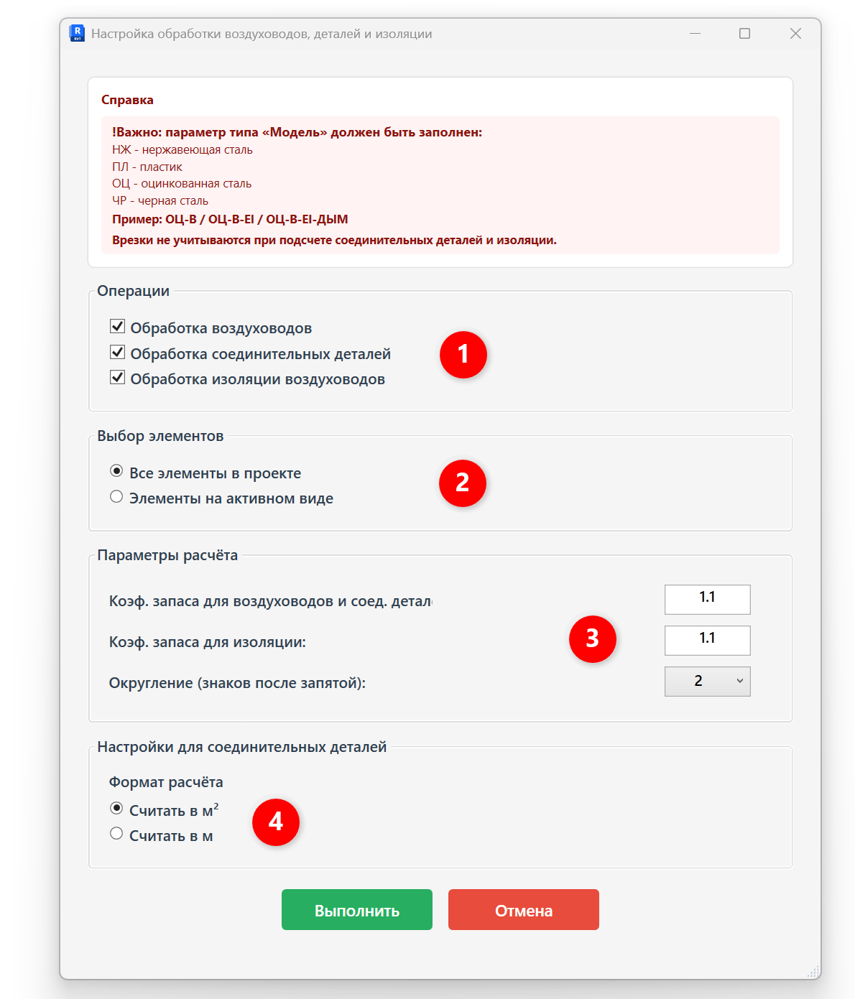
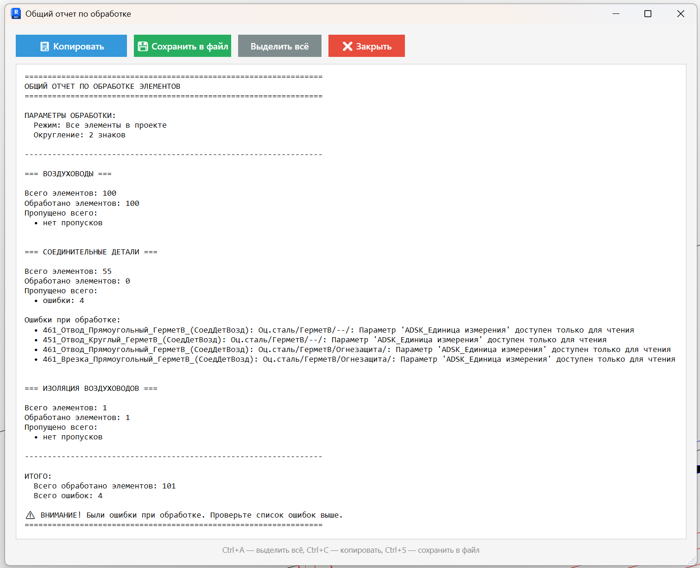

Плагин обрабатывает трубопроводы и изоляцию трубопроводов:  рассчитывает  количество, заполняет параметры **«ADSK_Наименование» и «ADSK_Количество».**

## 1\. Где находится

Плагин расположен на вкладке **GARDA_ВИС**, панели **Спецификации ОВ\\ВК**.

## 2\. Преднастройка

Для корректной обработки элементов через плагин нужно, чтобы были корректно заполнены определенные параметры для категорий ниже:

#### Воздуховоды

- параметр типа «Модель»;
- параметр типа «Комментарии к типоразмеру»
- параметры типа «Дымоудаление» и «Огнезащита»

#### Соединительные детали

- параметр типа «Модель»;
- параметр типа «Комментарии к типоразмеру»
- параметры типа «Дымоудаление» и «Огнезащита»

#### Материалы изоляции воздуховодов

- параметр типа «Комментарии к типоразмеру»

<note type="info">
  Подробную информацию о заполнении данных параметров см. пункт 5.

  Врезки не учитываются.
</note>

## 3\. Как пользоваться

Запустите плагин и выберите, что именно необходимо обрабатывать и с какими настройками:

{width=1190px height=1391px scale=70}

1. \- что именно необходимо обработать;
2. \- обработать все элементы в проекте или только элементы на активном виде;
3. \- указывается коэффициенты запаса с которыми будет производиться расчет количества воздуховодов и составляющих;
4. \- настройки расчета соединительных деталей (расчет производится в м2, либо в м)

   **Пример заполнения параметров при выборе «Считать в м2»:**

   ADSK_Наименование = Фасонные изделия воздуховодов из оц. стали, s=1 мм, диаметром свыше 800 до 1250 мм включительно

   ADSK_Единица измерения= «м2»

   ADSK_Количество= Площадь \* Коэффициент запаса

   **Пример заполнения параметров при выборе «Считать в м»:**

   ADSK_Наименование= Воздуховод из оц. стали (t среды \< 80 °C), класс герметичности B, Ø1000, s=1 мм

   ADSK_Единица измерения= «м»

   ADSK_Количество= Эквивалентная длина \* Коэффициент запаса

После выбора настроек, необходимо нажать кнопку «Выполнить».

## 4\. Отчет по обработке ошибок

После обработки плагина будет выведен отчет:

{width=1511px height=1228px scale=88}

Здесь выводится информация, какие элементы обработаны и какие ошибки при обработке возникают.

Частые ошибки:

1. Не заполнены параметры «Модель»/«Комментарии к типоразмеру» - устраняет инженер
2. Элемент занят другим пользователем - устраняет инженер
3. Параметр «ADSK_Единица измерения» или другой - устраняет координатор
