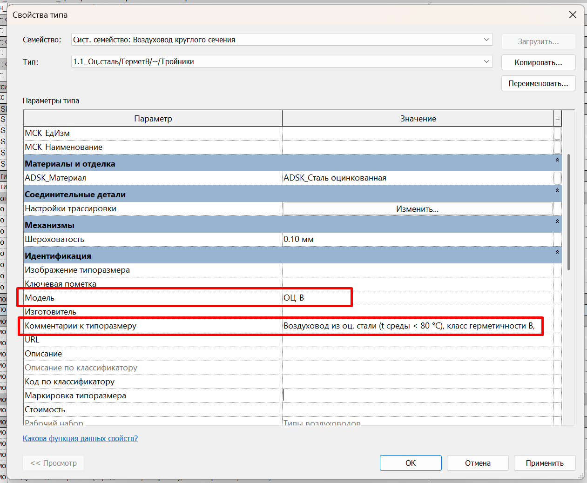

Плагин обрабатывает воздуховоды, соединительные детали и изоляцию воздуховодов: автоматически рассчитывает толщину стенки и количество, заполняет параметры **«ADSK_Наименование», «ADSK_Единица измерения», «ADSK_Количество», «ADSK_Толщина стенки», «G_Периметр».**

## Где находится

Плагин расположен на вкладке **GARDA_ВИС**, панели **Спецификации ОВ\\ВК**.

<image src="./vozdukhovody-i-izolyaciya.png" crop="0,0,100,100" scale="63" width="827px" height="186px" float="center"/>

## Преднастройка

Для корректной обработки элементов через плагин нужно, чтобы были корректно заполнены определенные параметры для категорий ниже::

#### Воздуховоды

{width=1261px height=1038px}

параметр типа «Модель» должен быть заполнен: 

-  НЖ - нержавеющая сталь; 

-  ПЛ- пластик;

-  ОЦ - оцинкованная сталь;

-  ЧР - черная сталь

   Пример: ОЦ-B; ОЦ-B-EI; ОЦ-B-EI-ДЫМ ;НЖ-В; 

параметр типа «Комментарии к типоразмеру» примеры заполнения: 

-  Воздуховод из оц. стали (t среды \< 80 °C), класс герметичности B,;

-  Воздуховод из оц. стали (t среды \< 80 °C, с норм. EI), класс гермет. B,; 

-  Воздуховод из нерж. стали (с норм. EI), класс гермет. B,; 

-  Воздуховод пластиковый для круглых каналов

#### Соединительные детали

параметр типа «Модель» должен быть заполнен, по такой же логике, как у воздуховодов

параметр типа «Комментарии к типоразмеру» должен содержать класс герметичности В/A

Пример: Переход  прям./кр. из нерж. стали (t среды\<80°C, с норм. EI), класс герметичности В

#### Материалы изоляции воздуховодов

параметр типа «Комментарии к типоразмеру» - от этого параметра зависит заполнение параметра ADSK_Наименование 

Расчет производится всегда в м2

## Как пользоваться

Запустите плагин и выберите, что именно необходимо обрабатывать и с какими настройками:

<image src="./vozdukhovody-i-izolyaciya-2.png" crop="0,0,100,100" scale="70" width="1190px" height="1391px" float="center"/>

1. \- что именно необходимо обработать; 

2. \- обработать все элементы в проекте или только элементы на активном виде;

3. \- указывается коэффициенты запаса с которыми будет производиться расчет количества воздуховодов;

4. \- настройки расчета соединительных деталей (расчет производится в м2, либо в м)

   **Пример заполнения параметров при выборе «Считать в м2»:** 

   ADSK_Наименование = Фасонные изделия воздуховодов из оц. стали, s=1 мм, диаметром свыше 800 до 1250 мм включительно 

   ADSK_Единица измерения= «м2»

   ADSK_Количество= Площадь \* Коэффициент запаса

   **Пример заполнения параметров при выборе «Считать в м»:** 

   ADSK_Наименование= Воздуховод из оц. стали (t среды \< 80 °C), класс герметичности B, Ø1000, s=1 мм

   ADSK_Единица измерения= «м»

   ADSK_Количество= Эквивалентная длина \* Коэффициент запаса

## Отчет по обработке ошибок

После обработки плагина будет выведен отчет: 

<image src="./vozdukhovody-i-izolyaciya-3.png" crop="0,0,100,100" scale="88" width="1511px" height="1228px" float="center"/>

Здесь выводится информация какие элементы обработаны и какие ошибки при обработке возникают. 