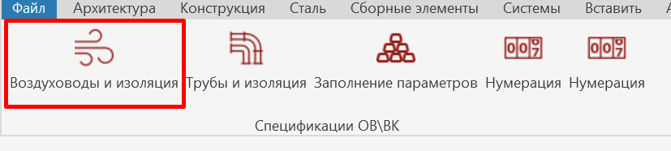
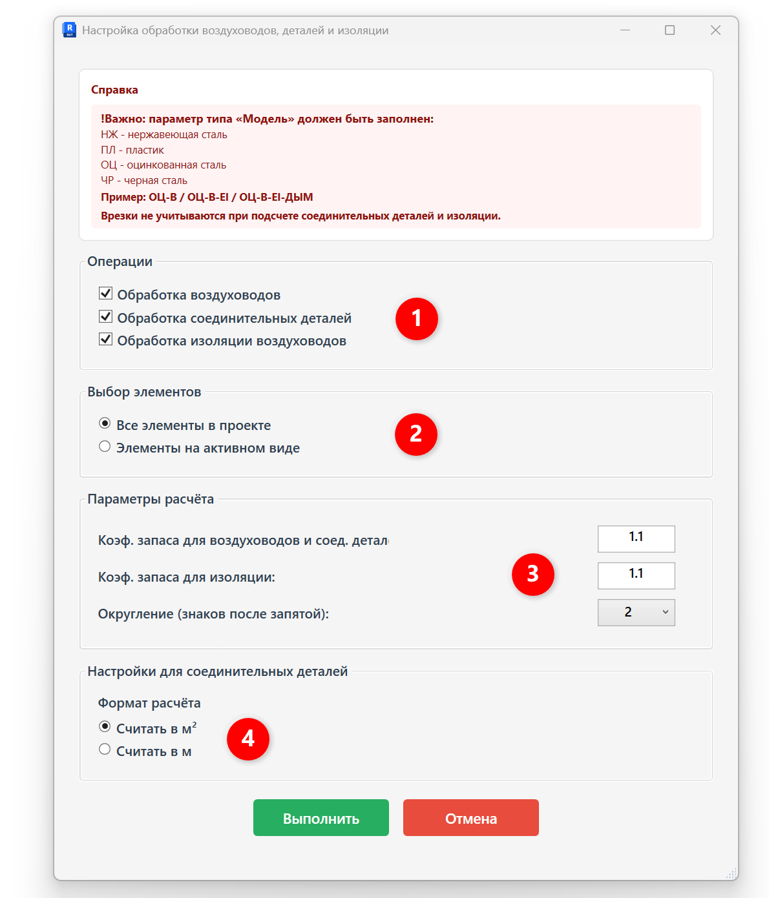
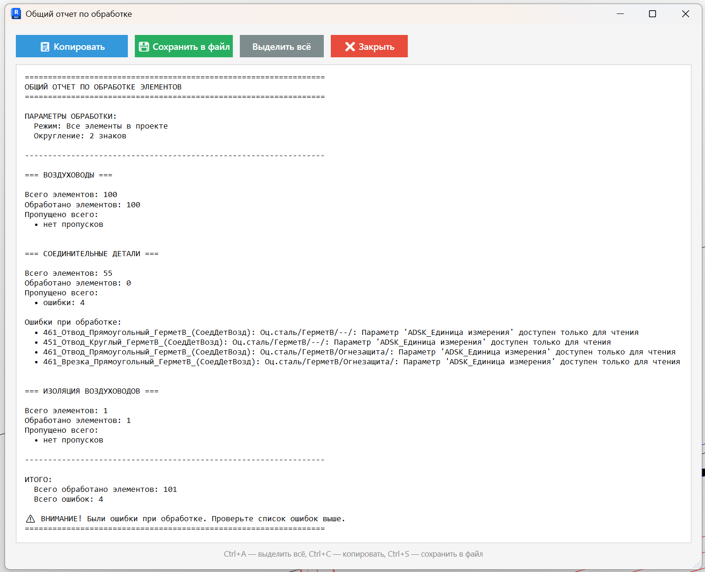
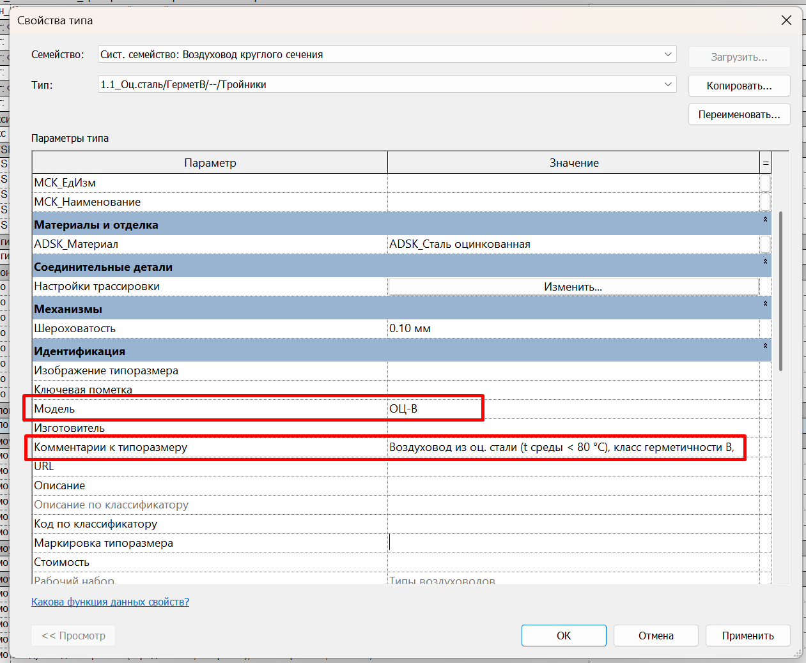
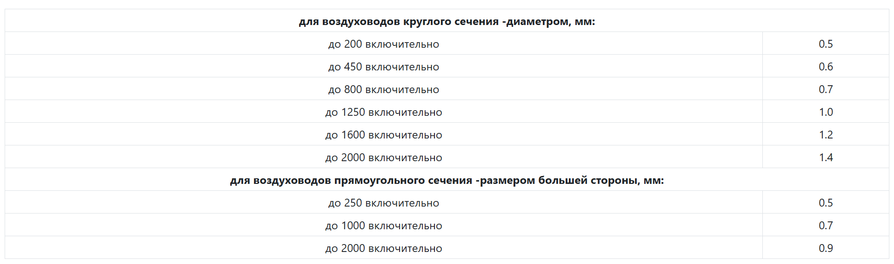
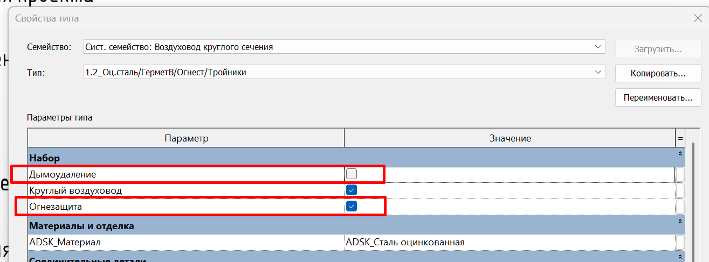

{width=1330px height=962px}Воздуховоды и изоляция

Плагин обрабатывает воздуховоды, соединительные детали и изоляцию воздуховодов: автоматически рассчитывает толщину стенки и количество, заполняет параметры **«ADSK_Наименование», «ADSK_Единица измерения», «ADSK_Количество», «ADSK_Толщина стенки», «G_Периметр».**

## 1\. Где находится

Плагин расположен на вкладке **GARDA_ВИС**, панели **Спецификации ОВ\\ВК**.

{width=827px height=186px scale=63}

## 2\. Преднастройка

Для корректной обработки элементов через плагин нужно, чтобы были корректно заполнены определенные параметры для категорий ниже:

#### Воздуховоды

- параметр типа «Модель»;
- параметр типа «Комментарии к типоразмеру»
- параметры типа «Дымоудаление» и «Огнезащита»

#### Соединительные детали

- параметр типа «Модель»;
- параметр типа «Комментарии к типоразмеру»
- параметры типа «Дымоудаление» и «Огнезащита»

#### Материалы изоляции воздуховодов

- параметр типа «Комментарии к типоразмеру»

<note type="info">
  Подробную информацию о заполнении данных параметров см. пункт \__\_
</note>

## 3\. Как пользоваться

Запустите плагин и выберите, что именно необходимо обрабатывать и с какими настройками:

{width=1190px height=1391px scale=70}

1. \- что именно необходимо обработать;
2. \- обработать все элементы в проекте или только элементы на активном виде;
3. \- указывается коэффициенты запаса с которыми будет производиться расчет количества воздуховодов и составляющих;
4. \- настройки расчета соединительных деталей (расчет производится в м2, либо в м)

   **Пример заполнения параметров при выборе «Считать в м2»:**

   ADSK_Наименование = Фасонные изделия воздуховодов из оц. стали, s=1 мм, диаметром свыше 800 до 1250 мм включительно

   ADSK_Единица измерения= «м2»

   ADSK_Количество= Площадь \* Коэффициент запаса

   **Пример заполнения параметров при выборе «Считать в м»:**

   ADSK_Наименование= Воздуховод из оц. стали (t среды \< 80 °C), класс герметичности B, Ø1000, s=1 мм

   ADSK_Единица измерения= «м»

   ADSK_Количество= Эквивалентная длина \* Коэффициент запаса

После выбора настроек, необходимо нажать кнопку «Выполнить».

## 4\. Отчет по обработке ошибок

После обработки плагина будет выведен отчет:

{width=1511px height=1228px scale=88}

Здесь выводится информация, какие элементы обработаны и какие ошибки при обработке возникают.

Частые ошибки:

1. Не заполнены параметры «Модель»/«Комментарии к типоразмеру» - устраняет инженер
2. Элемент занят другим пользователем - устраняет инженер
3. Параметр «ADSK_Единица измерения» или другой - устраняет координатор

## 5\. Заполнение параметров (подробная версия)

### 5\.3. Воздуховоды

1. параметр «Модель»

{width=1261px height=1038px}

В параметре «Модель» должна содержаться информация о материале воздуховода, доступны следующие аббревиатуры:

НЖ - нержавеющая сталь;

ПЛ - пластик;

ОЦ - оцинкованная сталь;

ЧР - черная сталь

Пример: ОЦ-B / ОЦ-B-EI / ОЦ-B-EI-ДЫМ

Другие материалы должны быть согласованы и переданы в доработку BIM-специалистам.

2. параметр «Комментарии к типоразмеру»\
   В данном параметре прописывается начало наименования воздуховода

Пример: Воздуховод из оц. стали (t среды \< 80°C), класс герметичности B,

### 5\.3. Соединительные детали воздуховодов

1. В параметре «Модель» должна содержаться информация о материале детали, логика как у воздуховодов (см. пункт выше).

В параметре «Комментарии к типоразмеру» должна содержаться информация о классе герметичности (если данная информация должна попадать в наименовании)

Пример: Отвод круглый из оц. стали (t среды\<600°C, с норм. EI), **класс герметичности B**

### 5\.4. Материалы изоляции воздуховодов

1. параметр «Комментарии к типоразмеру»\
   В данном параметре прописывается начало наименования воздуховода

Пример: Комбинированное покрытие на основе базальтового рулонного материала, кашированного алюминиевой фольгой, и клеевого состава, EI60, b=10 мм

## 6\. Логика расчета и заполнения параметров

### 6\.1. Общая информация

#### 6\.1.1 Толщина стенки

Толщина стенки воздуховодов и соединительных деталей принимается в соответствии с приложением К СП 60.13330.2020.

Толщину листовой стали для воздуховодов, по которым перемещается воздух температурой не выше 80°С, следует принимать, не более:

{width=1922px height=570px}

Для воздуховодов из листовой стали, имеющих огнезащитное покрытие, а также для воздуховодов систем дымоудаления толщину стенки принимают с добавлением **0,1 мм** к значению, определённому по приложению К СП 60.13330.2020, но не менее 0,9 мм.

Огнезащитное покрытие или система дымоудаления определяются с помощью параметров типа:

{width=1315px height=487px}

- Дымоудаление;
- Огнезащитное покрытие (для соед. деталей параметр называется «Огнезащита»)

Для черной стали толщина стенки - 1,5 мм.

<note type="info">
  На расчет толщины стенки влияет значение параметра «Модель», через данный параметр определяется материал воздуховода.
</note>

При размере воздуховода более 2000 мм толщина стенки записывается как «s=уточняется конструкторами».

### 5\.2. Воздуховоды

#### 5\.2.1. ADSK_Наименование

Шаблон наименования: \
\<Комментарии к типоразмеру> \<Размер>, s=\<толщина> мм

**Пример:** \<Воздуховод из оц. стали (t среды \< 80 °C), класс герметичности B>, Ø1000, s=1 мм

#### 5\.2.2. ADSK_Единица измерения

Заполняется пользователем в проекте

#### 5\.2.3. ADSK_Количество

ADSK_Количество=Длина \* Коэф. запаса для воздуховодов и соед. деталей

### 5\.3. Соединительные детали воздуховодов

#### 5\.3.1. ADSK_Наименование

- **Режим: Считать в м**

Шаблон наименования: \
\<<highlight color="yellow">Комментарии к типоразмеру (у подключенного воздуховода)</highlight>\>, \<<highlight color="green">Размер</highlight>\> , s=\<<highlight color="purple">Толщина стенки</highlight>\> мм

**Пример:** \<Воздуховод из оц. стали (t среды \< 80 °C), класс герметичности B>, Ø1000, s=1 мм

Для воздуховодов из пластика и при неопределённом материале блок `s=…` не выводится.

- **Режим: Считать в м2**

Шаблон наименования: \
Фасонные изделия воздуховодов из \<Материал>\[, \<Класс герметичности>\], s=\<Толщина стенки> мм, \<Диапазон

**Пример:** Фасонные изделия воздуховодов из оц. стали, s=1 мм, диаметром свыше 800 до 1250 мм включительно

`<Материал>` определяется по параметру «Модель»

`<Класс герметичности>` извлекается из «Комментарии к типоразмеру» **типа детали** (а не подключённого воздуховода); если не найден -- блок отсутствует;

`<Диапазон>` для круглых деталей -- диапазон по диаметру; для прямоугольных -- диапазон по периметру, зависящий от толщины стенки; при толщине свыше 3,0 мм -- `периметром <N> мм`;

Диапазон\*\*:\*\*

**для круглых  - диапазон диаметров**

- `≤ 355` -> «диаметром до 355 мм включительно»
- `356–560` -> «диаметром свыше 355 до 560 мм включительно»
- `561–800` -> «диаметром свыше 560 до 800 мм включительно»
- `801–1250` -> «диаметром свыше 800 до 1250 мм включительно»
- `1251–1600` -> «диаметром свыше 1250 до 1600 мм включительно»
- `> 1600` -> «диаметром свыше 1600 мм»

**для прямоугольных - диапазон периметров:**

- набор диапазонов периметра зависит от «корзины» толщины: `≤0.5`, `≤0.7`, `<0.9`, `==0.9` (отдельный блок), `≤2.0`, `≤3.0`, иначе;
- если вернулся  (толщина `> 3.0` или не определена) -- fallback: конкретный периметр `«периметром <N> мм»`.

<note type="info">
  Диапазоны диаметров и периметров (режим «Считать в м²») приняты согласно информации от сметного отдела.
</note>

#### 5\.3.2. ADSK_Единица изменения

**Режим: Считать в м**

ADSK_Единица изменения=м

**Режим: Считать в м2**

ADSK_Единица изменения=м2

#### 5\.3.3. ADSK_Количество

**Режим: Считать в м**

ADSK_Количество= Эквивалентная длина  \* Коэф. запаса для воздуховодов и соед. деталей

Эквивалентная длина считается по формуле: Площадь соед. детали (определяется методом кода)/Периметр

Для переходов берется периметр для стороны с большим размером.\
Для тройников - по магистральному сечению.

**Режим: Считать в м2**

ADSK_Количество= Площадь соед. детали (определяется методом кода) \* Коэф. запаса для воздуховодов и соед. деталей

### 5\.4. Материалы изоляции воздуховодов

#### 5\.4.1. ADSK_Наименование

Шаблон наименования: \<Комментарии к типоразмеру>

Примечания:

- для изоляции врезок в наименование записывается `!Не учитывать`, количество = `0`;

#### 5\.4.1. ADSK_Единица измерения

Заполняется пользователем в проекте

#### 5\.4.2. ADSK_Количество

ADSK_Количество = Площадь воздуховода/соед. детали возд. \* Коэф. запаса для изоляции
