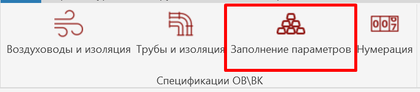
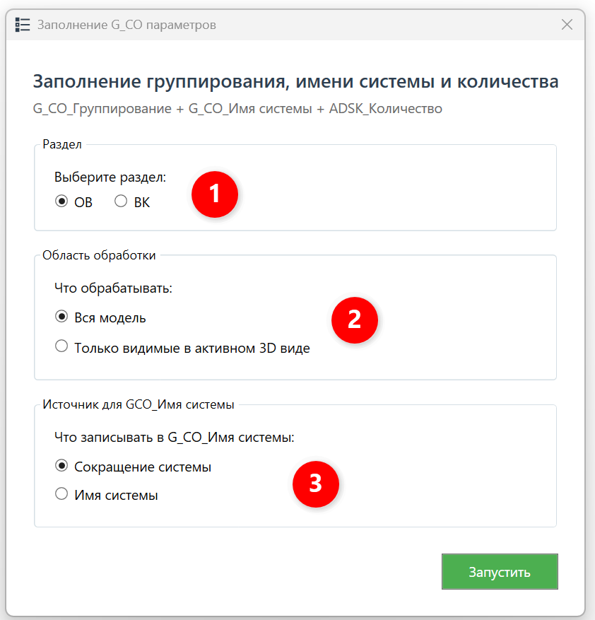
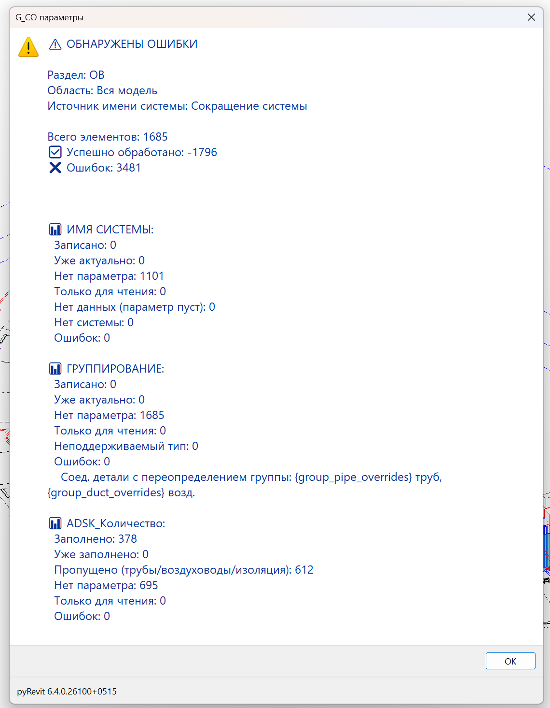

Плагин обрабатывает все категории инженерных систем, заполняет параметры G_СО_Имя системы, G_СО_Группирование и ADSK_Количество (в определённых случаях).

## 1\. Где находится

Плагин расположен на вкладке «**GARDA_ВИС»**, панели «**Спецификации ОВ\\ВК»**.

{width=703px height=155px scale=423px}

## 2\. Как пользоваться

### 2\.2 Интерфейс

Запустите плагин и выберите, что именно необходимо обрабатывать и с какими настройками:

{width=842px height=877px scale=411px}

1. \- проектируемый раздел;
2. \- обработать все элементы в проекте или только элементы на активном виде;
3. \- указывается что будет записываться в G_СО_Имя системы;

После выбора настроек, необходимо нажать кнопку «Выполнить».

## 3\. Отчет по обработке ошибок

После обработки плагина будет выведен отчет:

{width=1140px height=1465px scale=423px}

Здесь выводится информация, какие элементы обработаны и какие ошибки при обработке возникают.

Частые ошибки:

1. Не заполнены параметры «Маркировка типоразмера»/«Комментарии к типоразмеру» - устраняет инженер
2. Элемент занят другим пользователем - устраняет инженер
3. Параметр «ADSK_Единица измерения»(или другой)  не доступен для записи- устраняет координатор
