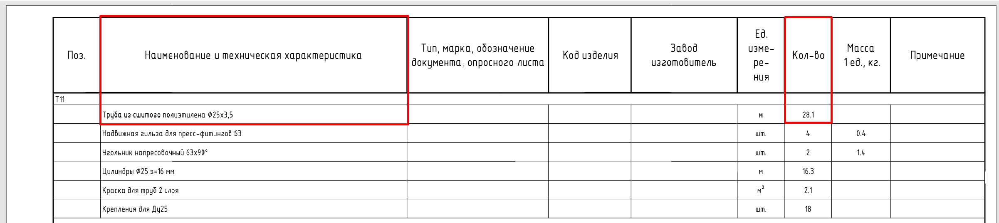
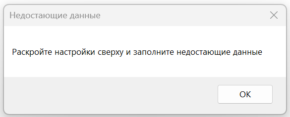
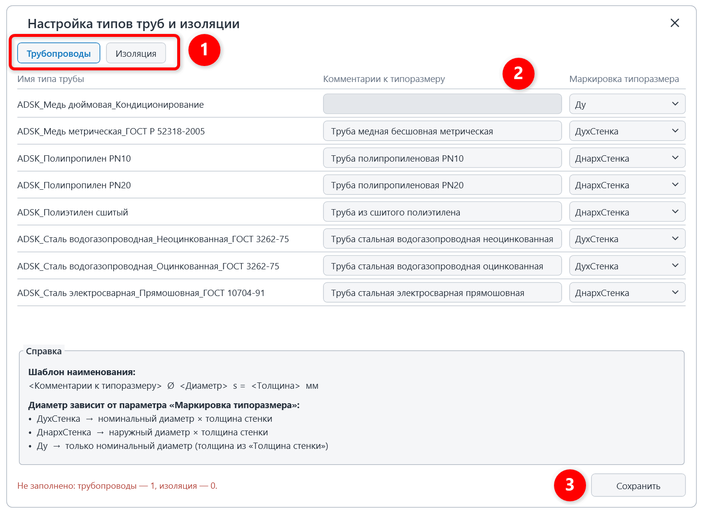

Плагин обрабатывает трубопроводы и изоляцию трубопроводов:  рассчитывает  количество, заполняет параметры **«ADSK_Наименование» и «ADSK_Количество».**

{width=2402px height=537px}

## 1\. Где находится

Плагин расположен на вкладке «**GARDA_ВИС»**, панели «**Спецификации ОВ\\ВК»**.

{width=599px height=159px scale=388px}

## 2\. Как пользоваться

### 2\.1 Интерфейс

Запустите плагин и выберите, что именно необходимо обрабатывать и с какими настройками:

{width=813px height=769px scale=399px}

1. \- что именно необходимо обработать;
2. \- обработать все элементы в проекте или только элементы на активном виде;
3. \- указывается коэффициенты запаса с которыми будет производиться расчет количества трубопроводов и изоляции;
4. \- запуск плагина;
5. \- расширенные настройки

### 2\.2 Расширенные настройки

Данное окно нужно для быстрого заполнения необходимых параметров для работы плагина. Если какой-то параметр не заполнен, то появится следующее предупреждение:

{width=585px height=237px scale=400px}

Тогда необходимо нажать на шестеренку и заполнить все поля:

{width=955px height=696px scale=622px}

1. \- переключение режима трубопроводы/изоляция;
2. \- Комментарии к типоразмеру. Серые строчки необходимо заполнить;
3. \- сохранение настроек;
4. \- показать только те элементы, которые используются в проекте/все элементы;

## 3\. Отчет по обработке ошибок

Два варианта отчета:

1. Все прошло успешно и плагин отработал все элементы:

{width=1246px height=947px scale=515px}

2. Что-то пошло не так и плагин не смог обработать все элементы:

{width=1248px height=949px scale=595px}

Возможные причины:

<table header="row">
  <tr><td align="center">Причины ошибок</td><td align="center">Кто устраняет</td></tr>
  <tr>
    <td align="center">
      элементы заняты другим пользователем.\
      Данные элементы пропускаются плагинов и выводится ошибка : заняты пользователем «Имя пользователя»
    </td>
    <td align="center">Инженер просит коллегу синхронизироваться и повторно запускает плагин.</td>
  </tr>
  <tr><td align="center">У элемента недоступен параметр для записи.</td><td align="center">BIM-Координатор</td></tr>
  <tr>
    <td>
      Проверьте тип изоляции для диаметра выше 150 мм:

      • диаметр 200.0 мм -- требуется Маты или Рулон\
      \
      Для труб диаметров выше 150 должна быть назначена изоляция содержащая в параметре «Комментарии к типоразмеру» Маты или Рулон. Данная изоляция считается в м2
    </td>
    <td>Инженер создает отдельный тип изоляции для таких элементов.</td>
  </tr>
</table>
