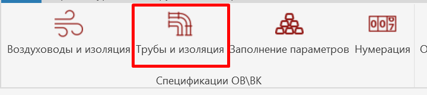
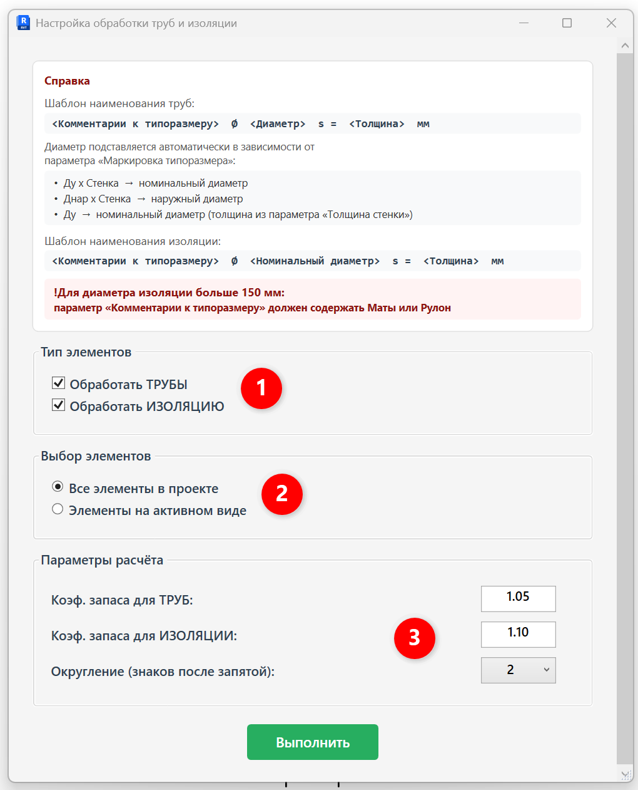
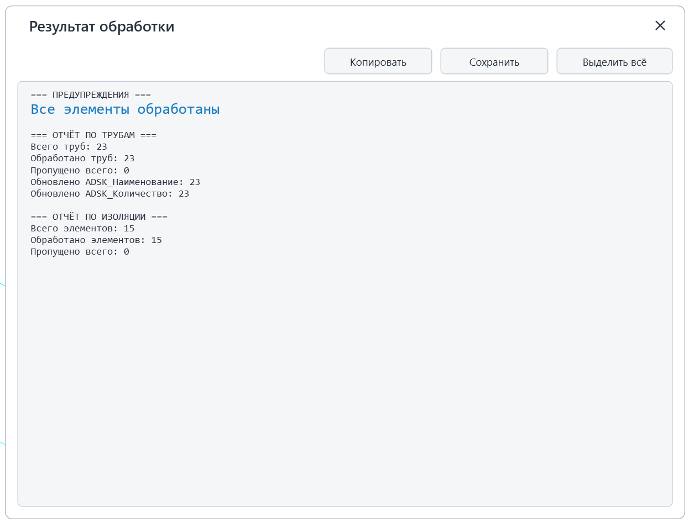

Плагин обрабатывает трубопроводы и изоляцию трубопроводов:  рассчитывает  количество, заполняет параметры **«ADSK_Наименование» и «ADSK_Количество».**

## 1\. Где находится

Плагин расположен на вкладке «**GARDA_ВИС»**, панели «**Спецификации ОВ\\ВК»**.

{width=720px height=160px scale=494px}

Для корректной обработки элементов через плагин нужно, чтобы были корректно заполнены определенные параметры для категорий ниже:

## 2\. Как пользоваться

### 2\.1. Преднастройка

Для корректной обработки элементов через плагин нужно, чтобы были корректно заполнены определенные параметры для категорий ниже:

#### Трубопроводы

- Параметр типа **«Комментарии к типоразмеру»** (Пример заполнения: *Труба стальная водогазопроводная, Труба из сшитого полиэтилена*).
- Параметр типа **«Маркировка типоразмера»**. От его заполнения зависит, какой диаметр подставится в наименование:
  - `Ду х Стенка` -> подставляется **номинальный диаметр**;
  - `Днар х Стенка` -> подставляется **наружный диаметр**;
  - `Ду` -> подставляется **номинальный диаметр** (толщина берется из параметра «Толщина стенки»).

<note type="info">
  Итоговый шаблон наименования трубы:

  `<Комментарии к типоразмеру> ⌀ <Диаметр> s = <Толщина> мм`
</note>

#### Изоляция трубопроводов

- Параметр типа **«Комментарии к типоразмеру»**.

  <note>
    Для диаметра изоляции больше 150 мм параметр «Комментарии к типоразмеру» **должен содержать слова «Маты» или «Рулон»**.
  </note>

<note type="info">
  Итоговый шаблон наименования изоляции: \
  `<Комментарии к типоразмеру> ⌀ <Номинальный диаметр> s = <Толщина> мм`
</note>

### 2\.2 Интерфейс

Запустите плагин и выберите, что именно необходимо обрабатывать и с какими настройками:

{width=1020px height=1261px scale=438px}

1. \- что именно необходимо обработать;
2. \- обработать все элементы в проекте или только элементы на активном виде;
3. \- указывается коэффициенты запаса с которыми будет производиться расчет количества трубопроводов и изоляции;

После выбора настроек, необходимо нажать кнопку «Выполнить».

## 3\. Отчет по обработке ошибок

После обработки плагина будет выведен отчет:

{width=802px height=757px scale=412px}

Здесь выводится информация, какие элементы обработаны и какие ошибки при обработке возникают.

Частые ошибки:

1. Не заполнены параметры «Маркировка типоразмера»/«Комментарии к типоразмеру» - устраняет инженер
2. Элемент занят другим пользователем - устраняет инженер
3. Параметр «ADSK_Единица измерения»(или другой)  не доступен для записи- устраняет координатор
