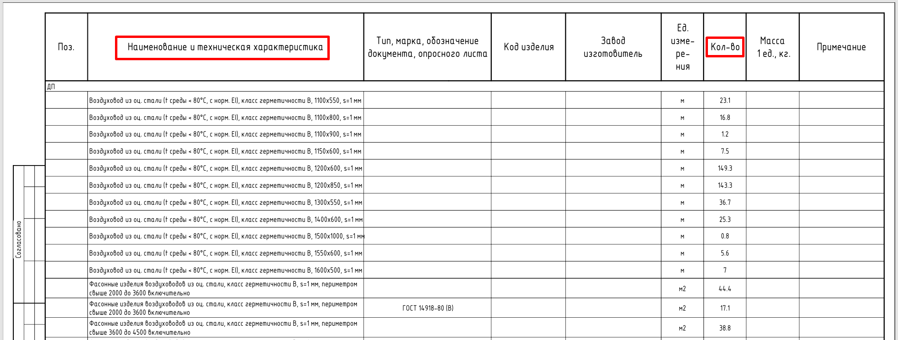
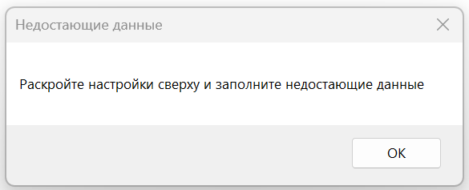
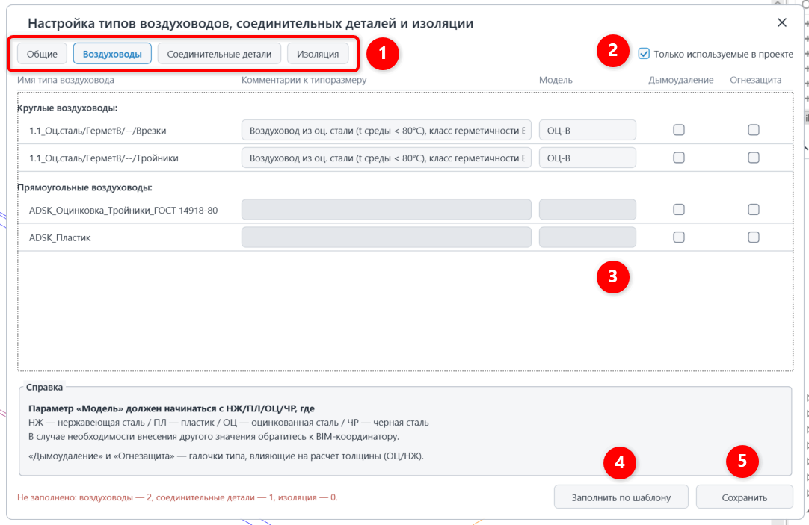
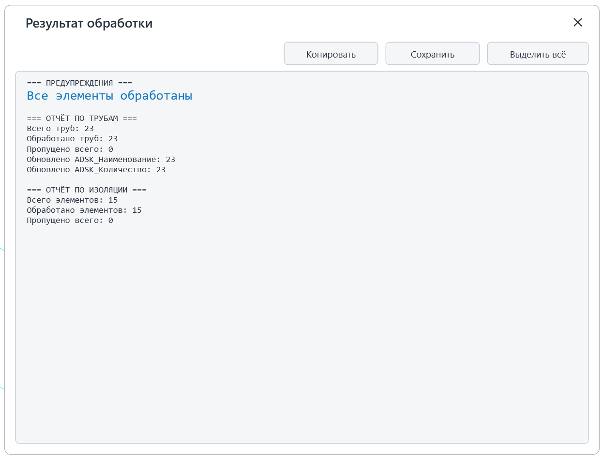
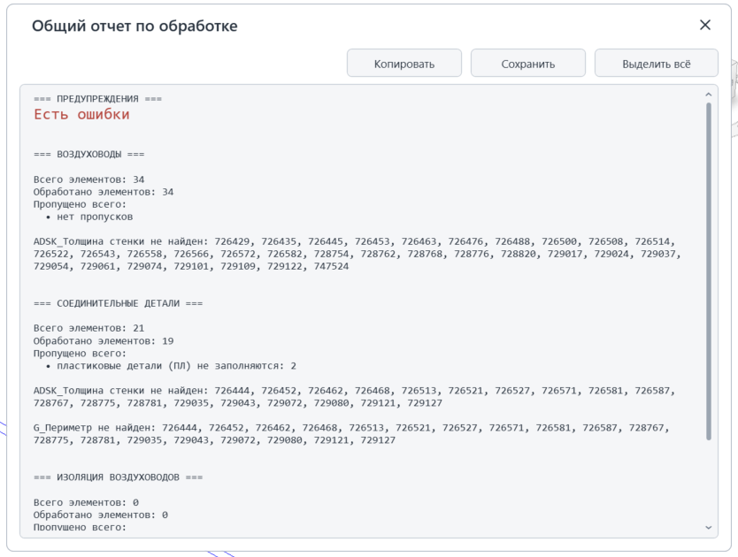
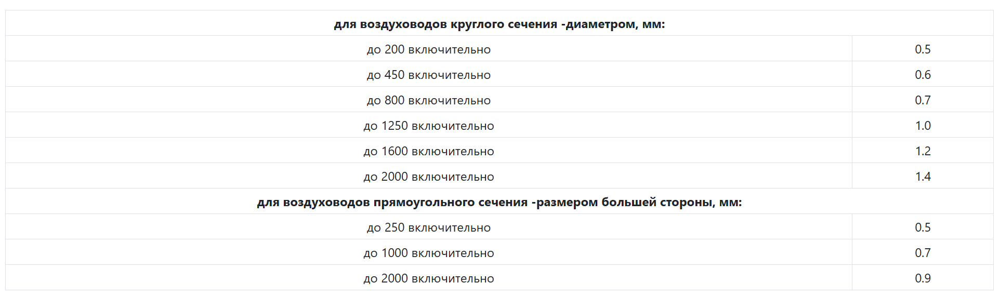
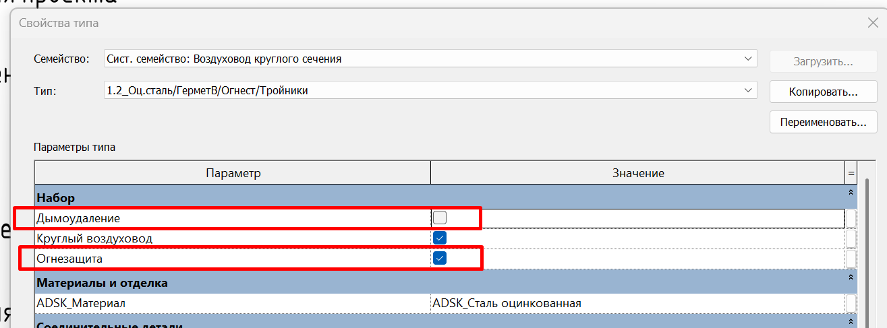

Плагин обрабатывает воздуховоды, соединительные детали и изоляцию воздуховодов: автоматически рассчитывает толщину стенки и количество, заполняет параметры **«ADSK_Наименование», «ADSK_Единица измерения», «ADSK_Количество», «ADSK_Толщина стенки», «G_Периметр».**

{width=1890px height=717px}

## 1\. Где находится

Плагин расположен на вкладке **GARDA_ВИС**, панели **Спецификации ОВ\\ВК**

{width=701px height=154px scale=408px}

## 2\. Как пользоваться

### 2\.1 Интерфейс

Запустите плагин и выберите, что именно необходимо обрабатывать и с какими настройками:

{width=641px height=624px scale=462px}

1. \- что именно необходимо обработать;
2. \- обработать все элементы в проекте или только элементы на активном виде;
3. \- указывается коэффициенты запаса с которыми будет производиться расчет количества воздуховодов и составляющих;
4. \- настройки расчета соединительных деталей (расчет производится в м2, либо в м)
5. \- расширенные настройки

   **Пример заполнения параметров при выборе «Считать в м2»:**

   ADSK_Наименование = Фасонные изделия воздуховодов из оц. стали, s=1 мм, диаметром свыше 800 до 1250 мм включительно

   **Пример заполнения параметров при выборе «Считать в м»:**

   ADSK_Наименование= Воздуховод из оц. стали (t среды \< 80 °C), класс герметичности B, Ø1000, s=1 мм

После выбора настроек, необходимо нажать кнопку «Выполнить».

### 2\.2 Расширенные настройки

**2\.2.1 Общие**

{width=1077px height=703px scale=624px}

В данной вкладке выбирается необходимо ли записывать информацию о толщине стенки и периметру в отдельные параметры.

**2\.2.1 Остальные вкладки**

Данное окно нужно для быстрого заполнения необходимых параметров для работы плагина. Если какой-то параметр не заполнен, то появится следующее предупреждение:

{width=585px height=237px scale=400px}

Тогда необходимо нажать на шестеренку и заполнить все поля:

{width=1082px height=703px}

1. \- настройки по категориям. Здесь указаны, какие параметры необходимо заполнить для корректной работы плагина;
2. \- показать только те элементы, которые используются в проекте/все элементы;
3. \- Комментарии к типоразмеру/Модель. Серые строчки необходимо заполнить;
4. \- заполнить настройки по шаблону (если данные семейства есть в эталонном шаблоне, то параметры заполнятся автоматически. Существующее значение параметров перезапишется.
5. \- сохранить. Обязательно нажать на данную кнопку для внесения изменений.

   <note type="info">
     Данные настройки сохраняются под проект.
   </note>

## 3\. Отчет по обработке ошибок

3\. Отчет по обработке ошибок

Два варианта отчета:

1. Все прошло успешно и плагин отработал все элементы:

   {width=829px height=633px scale=595px}
2. Что-то пошло не так и плагин не смог обработать все элементы:

   {width=834px height=630px scale=602px}

Возможные причины:

<table header="row">
  <tr><td align="center">Причины ошибок</td><td align="center">Кто устраняет</td></tr>
  <tr>
    <td align="center">
      элементы заняты другим пользователем.\
      Данные элементы пропускаются плагинов и выводится ошибка : заняты пользователем «Имя пользователя»
    </td>
    <td align="center">Инженер просит коллегу синхронизироваться и повторно запускает плагин.</td>
  </tr>
  <tr><td align="center">У элемента недоступен параметр для записи.</td><td align="center">BIM-Координатор</td></tr>
</table>

## 4\. Логика расчета и заполнения параметров

### 4\.1. Общая информация

#### 4\.1.1 Толщина стенки

Толщина стенки воздуховодов и соединительных деталей принимается в соответствии с приложением К СП 60.13330.2020.

Толщину листовой стали для воздуховодов, по которым перемещается воздух температурой не выше 80°С, следует принимать, не более:

{width=1922px height=570px}

Для воздуховодов из листовой стали, имеющих огнезащитное покрытие, а также для воздуховодов систем дымоудаления толщину стенки принимают с добавлением **0,1 мм** к значению, определённому по приложению К СП 60.13330.2020, но не менее 0,9 мм.

Огнезащитное покрытие или система дымоудаления определяются с помощью параметров типа:

{width=1315px height=487px}

- Дымоудаление;
- Огнезащитное покрытие (для соед. деталей параметр называется «Огнезащита»)

Для черной стали толщина стенки - 1,5 мм.

<note type="info">
  На расчет толщины стенки влияет значение параметра «Модель», через данный параметр определяется материал воздуховода.
</note>

При размере воздуховода более 2000 мм толщина стенки записывается как «s=уточняется конструкторами».

### 4\.2. Воздуховоды

#### 4\.2.1. ADSK_Наименование

<note type="info">
  Шаблон наименования: \
  \<**Комментарии к типоразмеру**\> \<**Размер**\>, s=\<**толщина**\> мм
</note>

**Пример:** \<Воздуховод из оц. стали (t среды \< 80 °C), класс герметичности B>, Ø1000, s=1 мм

#### 5\.2.2. ADSK_Единица измерения

Заполняется пользователем в проекте

#### 5\.2.3. ADSK_Количество

ADSK_Количество=Длина \* Коэф. запаса для воздуховодов и соед. деталей

### 4\.3. Соединительные детали воздуховодов

#### 4\.3.1. ADSK_Наименование

- **Режим: Считать в м**

<note type="info">
  Шаблон наименования: \
  \<**Комментарии к типоразмеру (у подключенного воздуховода)**\>, \<**Размер**\> , s=\<**Толщина стенки**\> мм
</note>

**Пример:** \<Воздуховод из оц. стали (t среды \< 80 °C), класс герметичности B>, Ø1000, s=1 мм

Для воздуховодов из пластика и при неопределённом материале блок `s=…` не выводится.

- **Режим: Считать в м2**

<note type="info">
  Шаблон наименования: \
  Фасонные изделия воздуховодов из \<**Материал**\>\[, \<**Класс герметичности**\>\], s=\<**Толщина стенки**\> мм, \<**Диапазон**
</note>

**Пример:** Фасонные изделия воздуховодов из оц. стали, s=1 мм, диаметром свыше 800 до 1250 мм включительно

`<Материал>` определяется по параметру «Модель»

`<Класс герметичности>` извлекается из «Комментарии к типоразмеру» **типа детали** (а не подключённого воздуховода); если не найден -- блок отсутствует;

`<Диапазон>` для круглых деталей -- диапазон по диаметру; для прямоугольных -- диапазон по периметру, зависящий от толщины стенки; при толщине свыше 3,0 мм -- `периметром <N> мм`;

Диапазон\*\*:\*\*

**для круглых  - диапазон диаметров**

- `≤ 355` -> «диаметром до 355 мм включительно»
- `356–560` -> «диаметром свыше 355 до 560 мм включительно»
- `561–800` -> «диаметром свыше 560 до 800 мм включительно»
- `801–1250` -> «диаметром свыше 800 до 1250 мм включительно»
- `1251–1600` -> «диаметром свыше 1250 до 1600 мм включительно»
- `> 1600` -> «диаметром свыше 1600 мм»

**для прямоугольных - диапазон периметров:**

- набор диапазонов периметра зависит от  толщины: `≤0.5`, `≤0.7`, `<0.9`, `==0.9`, `≤2.0`, `≤3.0`, иначе;

<note type="info">
  Диапазоны диаметров и периметров (режим «Считать в м²») приняты согласно информации от сметного отдела.
</note>

#### 4\.3.2. ADSK_Единица измерения

**Режим: Считать в м**

ADSK_Единица изменения=м

**Режим: Считать в м2**

ADSK_Единица изменения=м2

#### 4\.3.3. ADSK_Количество

**Режим: Считать в м**

ADSK_Количество= Эквивалентная длина  \* Коэф. запаса для воздуховодов и соед. деталей

**Эквивалентная длина считается по формуле:** \
Площадь соед. детали (определяется методом кода)/Периметр

Для переходов берется периметр для стороны с большим размером.\
Для тройников - по магистральному сечению.

**Режим: Считать в м2**

ADSK_Количество= Площадь соед. детали (определяется методом кода) \* Коэф. запаса для воздуховодов и соед. деталей

### 4\.4. Материалы изоляции воздуховодов

#### 4\.4.1. ADSK_Наименование

Шаблон наименования: \<Комментарии к типоразмеру>

Примечания:

- для изоляции врезок в наименование записывается `!Не учитывать`, количество = `0`;

#### 4\.4.2. ADSK_Единица измерения

Заполняется пользователем в проекте

#### 4\.4.3. ADSK_Количество

ADSK_Количество = Площадь изоляции воздуховода/соед. детали возд . \* Коэф. запаса для изоляции
