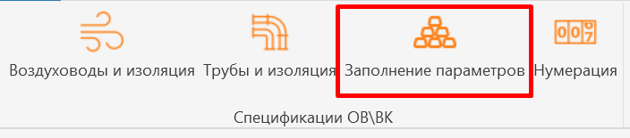
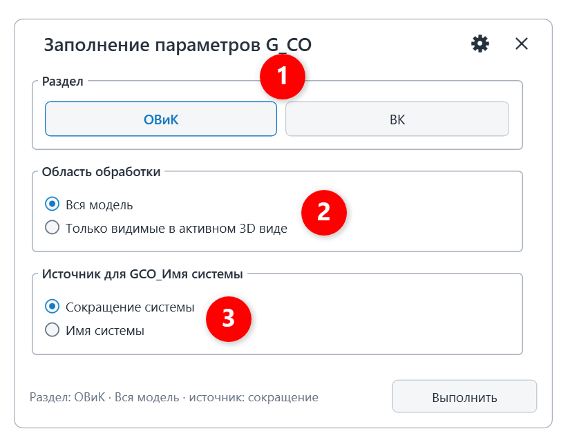
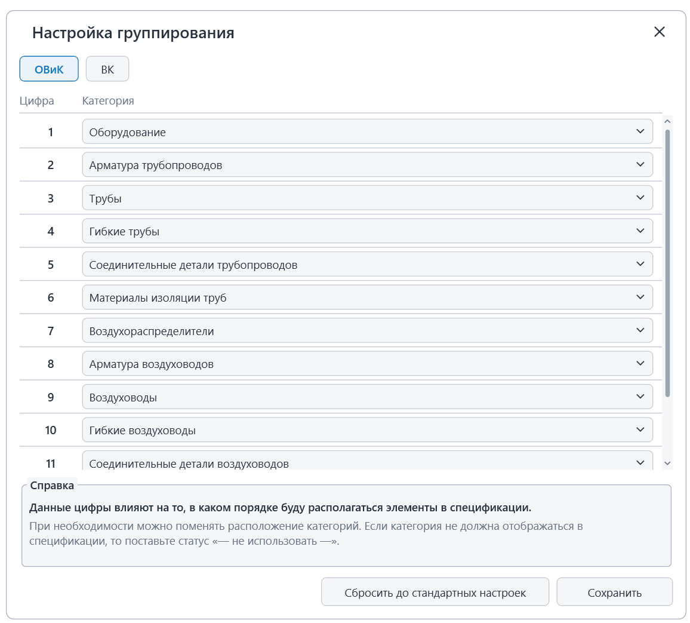
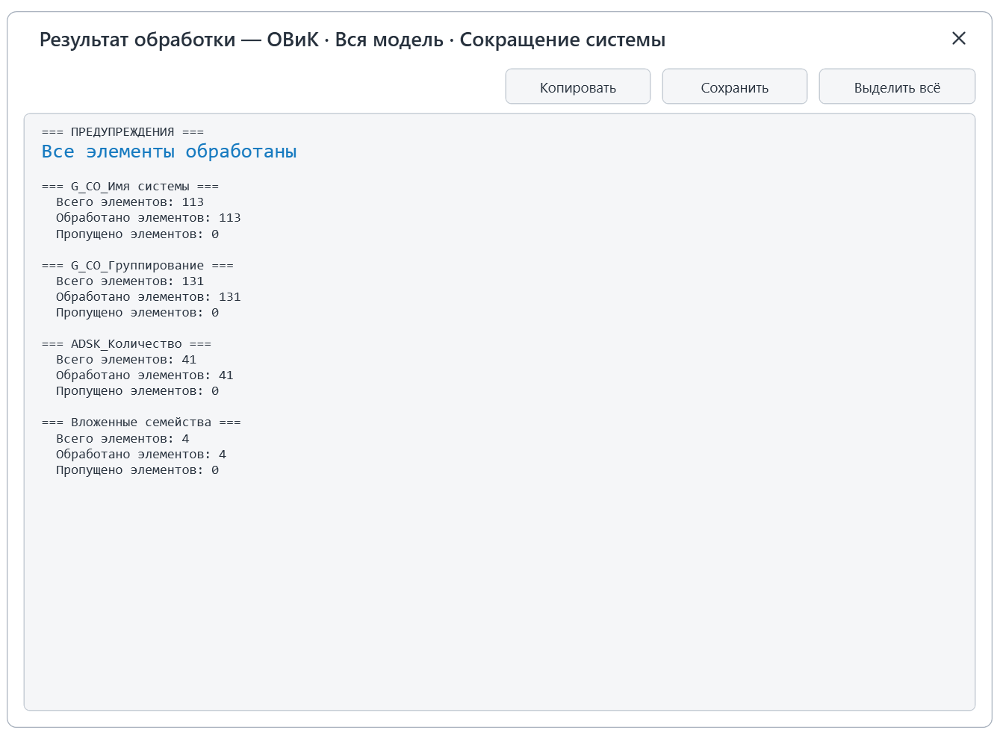
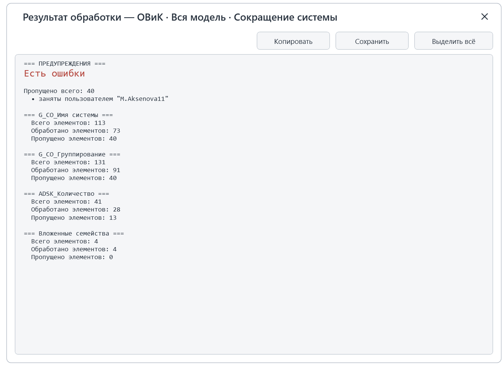

Плагин предназначен для автоматического заполнения параметров **G_СО_Имя системы**, **G_СО_Группирование** и **ADSK_Количество** (для штучных элементов) у инженерных систем.

## 1\. Где находится

Плагин расположен на вкладке «**GARDA_ВИС»**, панели «**Спецификации ОВ\\ВК»**.

{width=704px height=155px scale=430px}

## 2\. Как пользоваться

### 2\.1 Интерфейс

Запустите плагин. В открывшемся окне настройте параметры обработки:

{width=814px height=635px scale=353px}

1. \- проектируемый раздел;
2. \- обработать все элементы в проекте или только элементы на активном виде;
3. \- указывается что будет записываться в G_СО_Имя системы (по какому признаку вы будете собирать спецификацию);

После выбора настроек, необходимо нажать кнопку «Выполнить».

### 2\.2 Расширенные настройки

{width=1156px height=1043px scale=503px}

В данном окне приведены настройки в каком порядке будут отображаться элементы в спецификации. Данные значения согласовывались со специалистами по разделам и являются стандартными.

В случае, если нужно поменять порядок категорий в спецификации, их можно изменить под конкретный проект. Для этого поменяйте категории и нажмите сохранить.\
Кнопка «Сбросить до стандартных настроек» возвращает стандартные настройки.

### 3\. Отчет по обработке ошибок

Два варианта отчета:

1. Все прошло успешно и плагин отработал все элементы:

{width=1339px height=986px scale=594px}

2. Что-то пошло не так и плагин не смог обработать все элементы:

{width=1341px height=976px scale=597px}

Возможные причины:

<table header="row">
  <tr><td align="center">Причины ошибок</td><td align="center">Кто устраняет</td></tr>
  <tr>
    <td align="center">
      элементы заняты другим пользователем.\
      Данные элементы пропускаются плагинов и выводится ошибка : заняты пользователем «Имя пользователя»
    </td>
    <td align="center">Инженер просит коллегу синхронизироваться и повторно запускает плагин.</td>
  </tr>
  <tr><td align="center">У элемента недоступен параметр для записи/ параметр не добавлен в проект</td><td align="center">BIM-Координатор</td></tr>
</table>

## 4\. Логика работы

### 4\.1. G_СО_Имя системы

В данный параметр записывается либо значение параметра «Имя системы», либо «Сокращение системы» в зависимости от выбора пользователя. \
Во вложенные семейства значения передаются из родительского.\
Для семейств, где элемент принадлежит к нескольким системам, принимаются следующие правила:

- Оборудование ОВ -- по первичному коннектору подключённой системы;
- Сантехнические приборы ВК -- по первой найденной системе среди коннекторов;

### 4\.2. **G_СО_Группирование**

От данного параметра зависит, где будет располагаться элемент в спецификации.

### 4\.3. **ADSK_Количество**

Заполняется значением «1», **только** если параметр пуст. Для труб, воздуховодов и изоляции параметр через данный плагин не заполняется.
