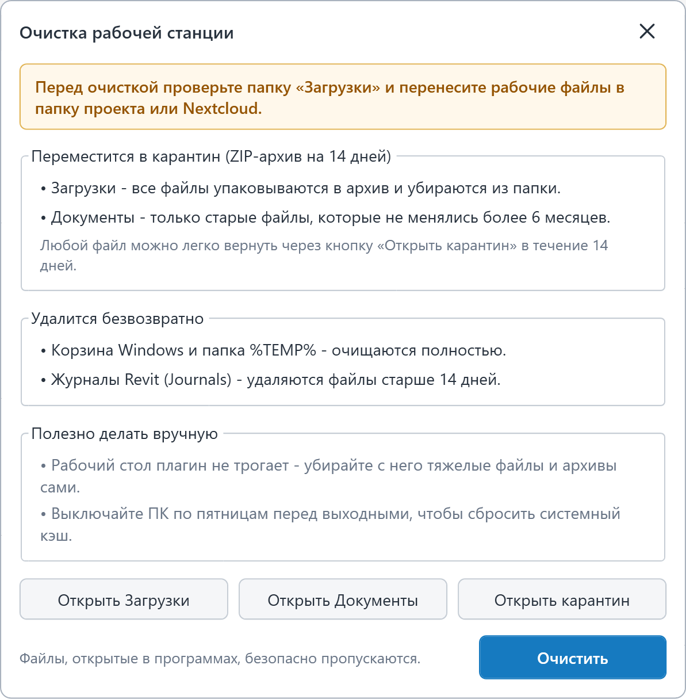

**Где найти:** Лента Revit -> вкладка **«GARDA_Общие»** -> панель **«Очистка»** -> кнопка **«Очистить систему»**.

### Зачем нужна эта кнопка и какие задачи решает?

При ежедневной работе в Revit на системном диске C: накапливаются десятки гигабайт временных файлов, старых журналов и забытых архивов в «Загрузках». Когда место на диске C: заканчивается, Revit начинает тормозить, долго синхронизироваться и выдавать фатальные ошибки при сохранении модели.

Кнопка **«Очистить систему»** в один клик освобождает место на компьютере и страхует вас от случайной потери забытых файлов с помощью встроенного **Карантина**.

{width=810px height=762px}

### Что делает плагин?

Все файлы делятся на две категории: те, которые отправляются во временный архив (карантин), и системный мусор, который удаляется сразу.

#### 1\. Отправляются в Карантин (можно вернуть в течение 14 дней):

- **Папка «Загрузки» (Downloads)** -- все файлы и папки упаковываются в сжатый ZIP-архив и убираются из «Загрузок».
- **Папка «Документы» (Documents)** -- в архив убираются **только старые файлы**, которые вы не открывали и не изменяли **более 6 месяцев** (свежие файлы в «Документах» остаются на месте).

  <note type="info">
    *Ни один файл из «Загрузок» или «Документов» не исчезает бесследно в момент очистки -- они бережно складываются в архив карантина на 2 недели, до следующего запуска очистки.*
  </note>

#### 2\. Удаляются безвозвратно:

- **Временные файлы (%TEMP%)** -- технический кэш и мусор от закрытых сессий программ.
- **Корзина Windows** -- полностью очищается.
- **Журналы Revit (Journals)** -- удаляются старые лог-файлы Revit старше 14 дней.
- **Старые архивы карантина** -- архивы, которым уже исполнилось больше 14 дней.

### Что важно знать (Безопасность)

1. **Проекты и Рабочий стол в безопасности:** Плагин **НЕ трогает** ваш Рабочий стол, рабочие папки проектов, папку Nextcloud и кэш совместной работы Revit (CollaborationCache / PacCache).
2. **Можно запускать прямо во время работы:** Все файлы, которые в данный момент открыты в Revit, AutoCAD, Excel, PDF-ридере и других программах, плагин автоматически распознает и безопасно пропускает.
3. **Защита от случайного нажатия:** Само нажатие на кнопку на ленте ничего не удаляет -- сначала откроется окно с подсказкой и кнопками для проверки папок, а перед стартом очистки появится дополнительный вопрос-подтверждение.

### Как пользоваться (3 простых шага)

1. Нажмите кнопку **«Очистить систему»** на вкладке «GARDA_Общие».
2. В открывшемся окне нажмите **«Открыть Загрузки»**, проверьте, нет ли там свежих рабочих файлов, и перенесите нужное в папку проекта или Nextcloud.
3. Нажмите синюю кнопку **«Очистить»** и подтвердите запуск. Весь процесс займет несколько секунд.

### Как вернуть файл, если в «Загрузках» или «Документах» оказалось что-то важное?

У вас есть **14 дней** после очистки, чтобы достать любой файл из карантина:

1. Нажмите на кнопку **«Очистить систему»** на ленте Revit (запускать саму очистку не нужно).
2. В окне плагина нажмите кнопку **«Открыть карантин»** -- откроется папка с архивами.
3. Вы увидите папки с датой и временем очистки:
   - Downloads_ГОД-МЕСЯЦ-ДЕНЬ\_... -- архив ваших «Загрузок».
   - Documents_ГОД-МЕСЯЦ-ДЕНЬ\_... -- архив старых файлов из «Документов».
4. Откройте нужную папку по дате и зайдите внутрь архива **payload.zip**.
5. **Скопируйте** нужные файлы из архива в свою рабочую папку проекта или Nextcloud. *(Важно: именно скопируйте файл из архива в обычную папку, не открывайте его для работы прямо внутри ZIP).*

### Полезные правила для быстрой работы ПК

- **Разбирайте Рабочий стол вручную:** не храните на Рабочем столе тяжелые модели .rvt, облака точек и архивы -- держите их в структурных папках проектов.
- **Выключайте ПК по пятницам:** перед уходом на выходные обязательно выключайте компьютер (а не оставляйте в спящем режиме), чтобы Windows сбросила накопленный системный кэш и освободила оперативную память.
