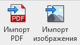
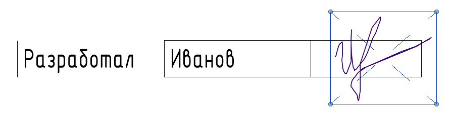
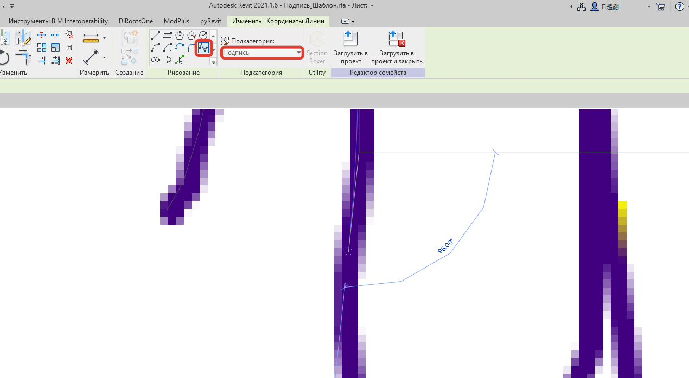
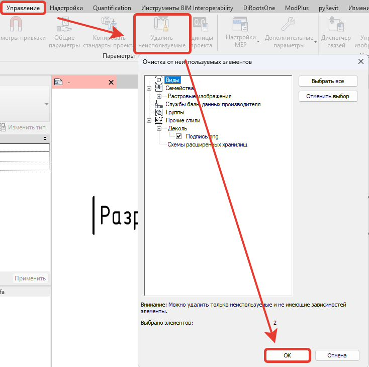
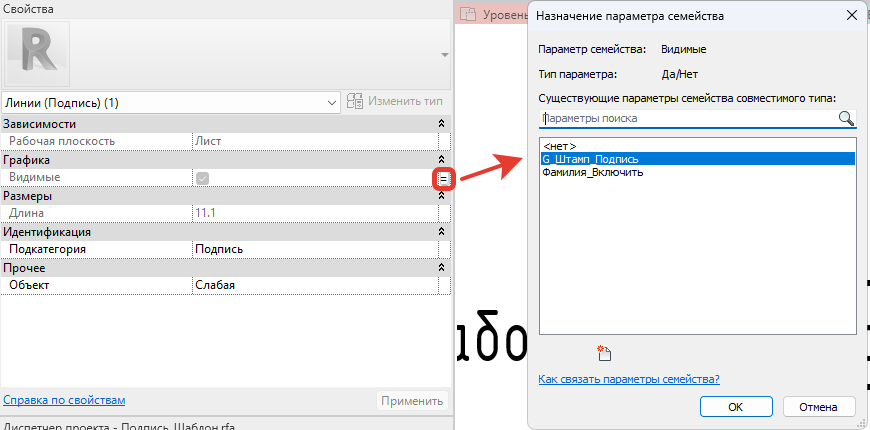
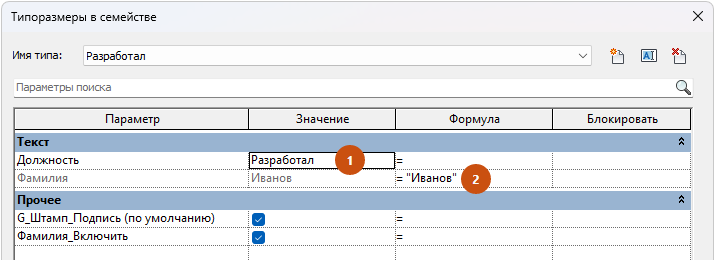
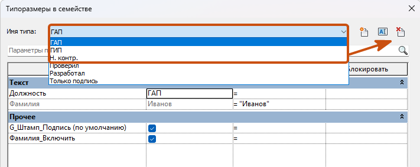

Данная инструкция описывает процесс формирования семейств подписей, предназначенных для заполнения штампов на листах и место хранения их.

<note type="info">
  Все подписи после проверки хранятся по пути:

  `C:\Nextcloud\Гарда - ТИМ – отдел\02_Семейства\00_Общие\00_Подписи`
</note>

## Создание семейства

1\. Для создания новой подписи для штампа необходимо заранее создать скан подписи (формат PNG, PDF)

2\. Откройте файл шаблона подписи, расположенный по пути:

`C:\Nextcloud\Гарда - ТИМ – отдел\02_Семейства\00_Общие\00_Подписи\Подпись_Шаблон.rfa`

3\. Импортируйте файл-изображение подписи в файл шаблона

<note type="lab">
  Вкладка «Вставить» -> «Импорт изображения» («Импорт PDF»)
</note>

{width=135px height=76px scale=137px}

4\. Отмасштабируйте изображение и разместите в области для расположения подписи:

{width=895px height=233px scale=611px}

5\. Обведите подпись инструментом «Сплайн»

<note type="lab">
  Вкладка «Создание» -> «Линейная» -> «Сплайн».
</note>

Для сплайна выберите подкатегорию «Подпись»

{width=1270px height=698px scale=636px}

6\. После обведения контуров подписи, удалите файл изображения с вида с последующей очисткой от неиспользуемых элементов:

{width=734px height=729px scale=456px}

7\. В свойствах сплайна параметру «Видимые» назначьте параметр  «G_Штамп_Подпись»:

{width=870px height=430px scale=650px}

8\. В свойствах типоразмера в параметрах «Должность» (1) и «Фамилия» (2) записываем нужную должность и фамилию соответственно:

{width=714px height=260px}

9\. Удаляем неиспользуемые должности:

{width=711px height=283px}

10\. Сохраняем семейство к себе в личную папку, название формируется по принципу:

`Подпись_<Фамилия>`

11\. Отправьте семейство на на почту руководителю BIM:

- Для Московского офиса это Александр Родионов ([a.rodionov@gardapro.ru](mailto:a.rodionov@gardapro.ru))
- Для Новосибирского офиса это Вадим Сталковский ([v.stalkovskiy@gardapro.ru](mailto:v.stalkovskiy@gardapro.ru))

###
