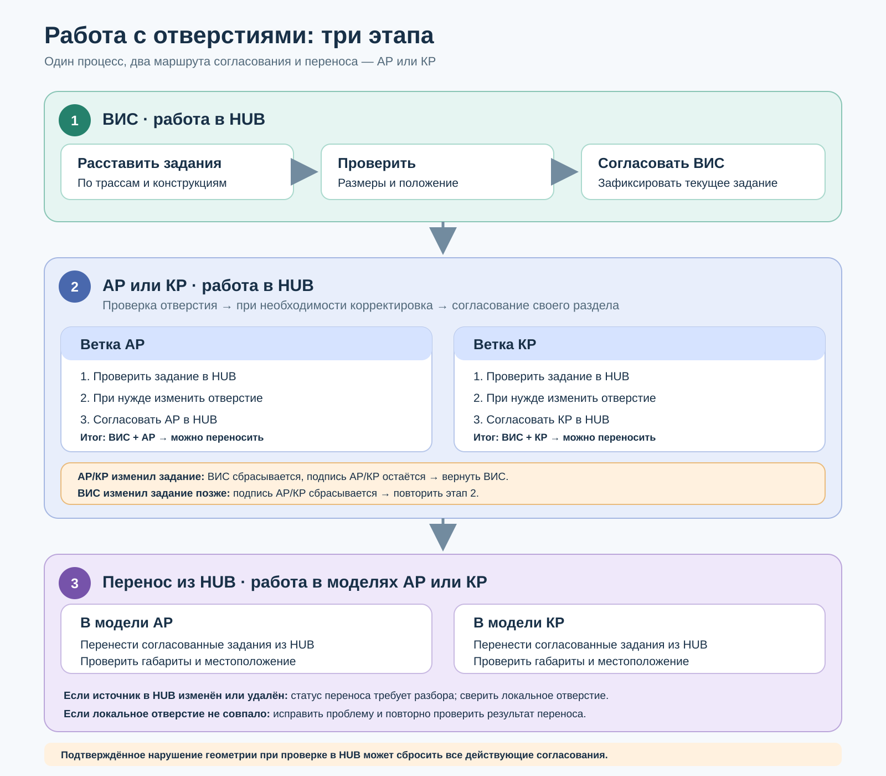

Инструкция описывает общий процесс работы с задания на отверстия для всех разделов

## 1\.Структура

Весь процесс состоит из трёх этапов. Первые два выполняют **в отдельной ревит модели**, созданой специально для работы с заданиями (далее **модель** **HUB**), третий -- **в моделях АР или КР**.

{width=1600px height=1400px scale=1055px}

## 2\. ВИС выдаёт и согласует задание в HUB

**Ответственный:** ВИС. **Рабочая модель:** HUB.

1. По инженерным системам и конструкциям связанных моделей ВИС создаёт задания плагином [«Расставить отверстия»](./../plaginy/garda_vis/otverstiya/untitled.md).
2. Если несколько систем должны пройти через одно задание, используйте плагин [«Объединение отверстий»](./../plaginy/garda_vis/otverstiya/untitled-2.md).
3. ВИС проверяет габариты и положение задания относительно систем и стены или плиты. Для проверки статуса задания можно запустить [«Проверка отверстий»](./../plaginy/garda_vis/otverstiya/untitled-4.md).
4. ВИС подтверждает текущий вариант кнопкой [«Согласовать отверстия ВИС»](./../plaginy/garda_vis/otverstiya/untitled-3.md). Состояние задания -- положение и размеры -- фиксируется в параметр `G_GUID`.

**Результат:** задание находится в HUB и согласовано ВИС. Его можно передать АР или КР на проверку.

## 3\. АР или КР проверяет и согласует задание в HUB

**Ответственный:** АР или КР. **Рабочая модель:** HUB.

| АР {width=356px} | КР {width=358px} |
|---|---|
| Проверяет задание по архитектурной конструкции. При необходимости корректирует размеры или положение. Запускает [«Проверка отверстий»](./../plaginy/garda_ar/otverstiya/proverka-otverstiy.md), затем [«Согласовать отверстия АР»](./../plaginy/garda_ar/otverstiya/untitled.md). | Проверяет задание по несущей конструкции. При необходимости корректирует размеры или положение. Запускает [«Проверка отверстий»](./../plaginy/garda_kr/otverstiya/proverka-otverstiy/_index.md), затем [«Согласовать отверстия КР»](./../plaginy/garda_kr/otverstiya/untitled.md). |

Для обычного маршрута перед вырезанием отверстия должны действовать согласования **ВИС + АР** или **ВИС + КР**. В отдельных проектных случаях состав согласующих может отличаться; ориентируйтесь на назначение задания и его фактические параметры.

### Если задание изменилось на этом этапе

| Ситуация {width=263px} | Что происходит {width=343px} | Как продолжить {width=287px} |
|---|---|---|
| **АР изменил положение или размеры задания** и согласовал его | Кнопка [«Согласовать отверстия АР»](./../plaginy/garda_ar/otverstiya/untitled.md) обновляет `G_GUID`, сбрасывает прежнее согласование ВИС и записывает согласование АР. Остаётся согласование **АР**, согласование ВИС требуется снова. | Передать новый вариант ВИС. После повторного согласования ВИС проверить оба согласования и вернуться к переносу. |
| **КР изменил положение или размеры задания** и согласовал его | Кнопка [«Согласовать отверстия КР»](./../plaginy/garda_kr/otverstiya/untitled.md) обновляет `G_GUID`, сбрасывает прежнее согласование ВИС и записывает согласование КР. Остаётся согласование **КР**, согласование ВИС требуется снова. | Передать новый вариант ВИС. После повторного согласования ВИС проверить оба согласования и вернуться к переносу. |
| **ВИС позже изменил положение или размеры задания** | При повторном согласовании ВИС прежнее согласование АР или КР, относящееся к старому варианту, сбрасывается. | Повторить проверку и согласование АР или КР по новому варианту. |
| [«Проверка отверстий»](./../plaginy/garda_vis/otverstiya/untitled-4.md) обнаружила подтверждённое нарушение геометрии обычного задания | Команда может сбросить все действующие согласования. Неоднозначный результат объединённого задания требует ручного разбора. | Исправить задание или исходные модели; затем повторить нужные согласования. Для поиска инж. систем по ID используйте [«Поиск по ID»](./../plaginy/garda_obschee/moskva/poisk-po-id.md). |

**Результат:** ВИС и принимающий раздел подтвердили один и тот же текущий вариант задания в HUB.

## 3\. АР или КР переносит задание в свою модель и вырезает отверстие

**Ответственный:** АР или КР. **Рабочая модель:** модель соответствующего раздела; HUB подключён как связь.

| Модель АР {width=391px} | Модель КР {width=408px} |
|---|---|
| Запустить [«Перенести отверстия АР»](./../plaginy/garda_ar/otverstiya/untitled-2.md), выбрать согласованные задания и тип семейства отверстий. После переноса проверить габариты и местоположение отверстия. | Запустить [«Перенести отверстия КР»](./../plaginy/garda_kr/otverstiya/untitled-2.md), выбрать согласованные задания и тип семейства отверстий. После переноса проверить габариты и местоположение отверстия. |

После любой команды переноса повторно просканируйте таблицу: задание должно отображаться как  актуальное.

<note type="info">
  Перенос меняет модель АР или КР, **не связанную модель HUB**.
</note>

### Если после переноса обнаружилось изменение

| Ситуация {width=335px} | Действие {width=464px} |
|---|---|
| **Задание в HUB изменено или удалено** | Разобрать статус «изменено» или «удалено» в таблице переноса. Сверить  отверстие в модели АР или КР с текущим заданием в модели HUB. При новом варианте пройти нужные согласования на этапе 2 и решить вопрос с  отверстием. |
| **Отверстие не совпадает по габаритам или положению** | Проверить выбранное семейство, положение HUB связи и исходное задание. Исправить причину и повторно проверить результат переноса в модели раздела. |

**Результат процесса:** в HUB есть актуальное задание с нужными согласованиями, а в модели АР или КР -- соответствующее ему  отверстие. После изменений возвращайтесь к тому этапу, на котором возникла причина, и повторяйте дальнейшие проверки.
