## Общая информация

Многие проекты (особенно реконструкция) делятся на временные периоды. Revit позволяет «разделить» модель на эти периоды с помощью инструмента **Стадии.**

Это дает возможность:

- Управлять видимостью объектов на видах (например, показывать снос красным, а новые конструкции зеленым, либо скрывать на виде определенную стадию через фильтр).
- Фильтровать элементы в спецификациях (ведомостях материалов).
- Выдавать разные комплекты чертежей для разных этапов строительства (демонтаж, монтаж).

**Стандартный набор стадий:**

1. Существующие - исходное состояние здания до начала работ (существующие элементы здания)
2. Демонтаж - этап, на котором демонтируются ненужные существующие элементы.
3. Новая конструкция - этап возведения новых элементов

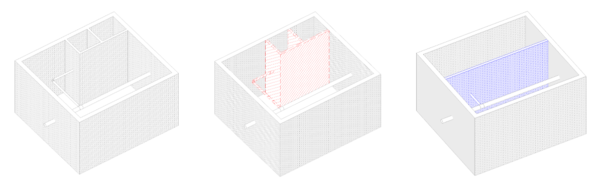{width=1207px height=374px}

## 1\. Стадии у элемента

У каждого графического элемента (стена, окно, воздуховод) в свойствах есть два ключевых параметра, относящихся к стадиям:

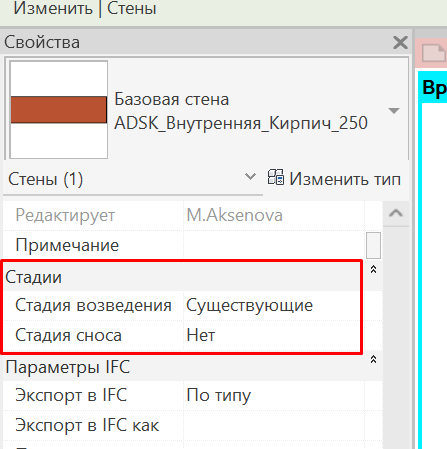{width=447px height=449px scale=31}

1. **Стадия возведения** *\- стадия, когда была возведена конструкция.*

   Выбирается из списка стадий, определённых в проекте. Обычно для существующих элементов выбирается *«Существующие»,* для новых *– «Новая конструкция»*
2. **Стадия сноса** ставится, если данных элемент демонтируется. Если элемент не сносится, поле остается с надписью «*Нет*». Если сносится -- выбираем стадию *Демонтаж*.

**Примеры настроек стадий у элемента:**

1. Для существующих конструкций, которые не демонтируются:

   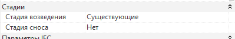{width=399px height=67px scale=402px}
2. Для существующих конструкций, которые демонтируются:

   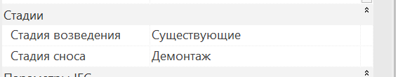{width=567px height=110px scale=397px}
3. Для новых конструкций:

   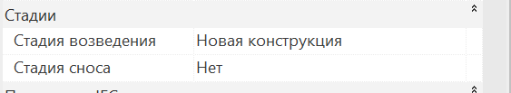{width=563px height=103px scale=398px}

   В случае, когда здание относится к новому строительству (не реконструкций), используется всегда только данная настройка.
4. Для временных конструкций (например, подпорка или ограждение):

   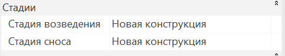{width=485px height=96px scale=393px}

Временные конструкции - это элементы, которые необходимы только на этапе строительства (крепления, страховочные ограждения, временные опоры)

## 2\. Стадии для вида

Для того чтобы вид (план этажа, разрез, 3D-вид или спецификация) отображал нужный этап строительства, у него есть две взаимосвязанные настройки:

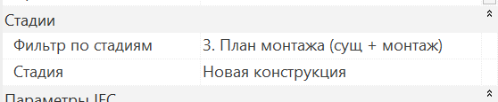{width=558px height=115px scale=66}

- Фильтр по стадиям - позволяет управлять отображением элементов на видах. Например, снесённые стены - красные, новые - зелёные. Либо какая-то стадия полностью скрывается (например, на стадии монтажа не показываются снесенные конструкции).
- Стадия - это «точка во времени», которую мы сейчас смотрим. Например, мы хотим увидеть здание на этапе *Демонтаж*.

Данные настройки работают в связке.

<note type="info">
  В проекте преднастроены количество и название стадий - данную настройку может менять только координатор. Очень важно, чтобы название стадий у разных моделей совпадало и было идентичным в настройках.
</note>

Объекты делятся на:

- Объекты реконструкции;
- Новое строительство

Настройки стадий для данных проектов будут отличаться.

### 2\.1. Новое строительство

Если объект не относится к реконструкции и возводится с нуля, то используются стандартные настройки:

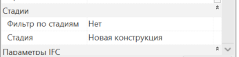{width=346px height=83px scale=38}

Никакие фильтры на виды не ставятся и все отображается корректно.

### 2\.2. Реконструкция

Когда проект относится к реконструкции, то необходимо правильно выставлять на виде «Фильтр по стадиям» и «Стадию».

**В проекте есть 4 преднастроенных фильтра для планов:**

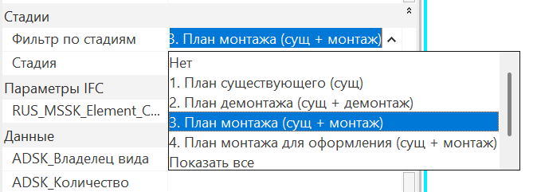{width=674px height=241px scale=51}

**1\. План существующего (сущ)** - показываются только существующие конструкции.

**2\. План демонтажа (сущ + демонтаж)** - видны существующие и снесённые элементы; новые скрыты. Элементы, которые относятся к демонтажу имеют красный контур.

**3\. План монтажа (сущ + монтаж)** - видны существующие и новые конструкции; снесённые скрыты.

Элементы подкрашиваются в зависимости от стадии:

Существующие конструкции - серые

Демонтируемые конструкции - красные

Новые конструкции - синие

Временные конструкции - зеленые

**4\. План монтажа для оформления (сущ + монтаж)** - видны те же элементы, что и в п.3 (существующие + новые, снесённые скрыты), но **без графических переопределений**– все элементы отображаются цветами своих категорий. Удобно для чистовых чертежей.

<note type="info">
  По умолчанию элементу назначается та стадия, которая стоит на виде на котором создается элемент. При необходимости данную настройку можно поправить в свойствах элемента (см. пункт выше).
</note>

**Примеры корректных настроек для видов:**

**Для существующих конструкций (без демонтажа):**

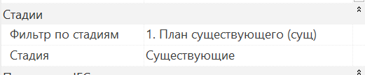{width=521px height=107px scale=42}

Пример отображения видов:

{width=1027px height=456px scale=80}

**Для существующих и демонтируемых конструкций:**

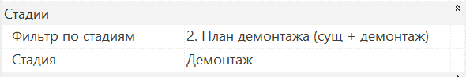{width=590px height=98px scale=51}

Пример отображения плана (существующие конструкции отображаются серым цветом, а демонтируемые - красным):

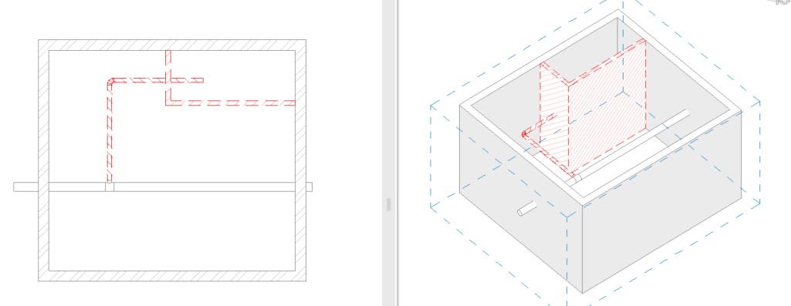{width=1025px height=397px scale=80}

**Для новых конструкций (демонтируемые конструкции скрыты, видимость элементов переопределена):**

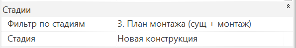{width=595px height=97px scale=51}

Пример отображения плана:

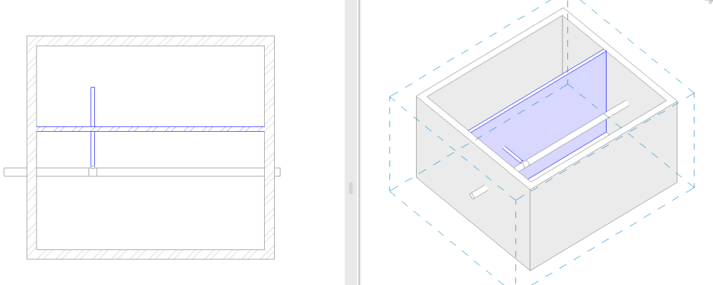{width=999px height=400px scale=83}

**Для новых конструкций (демонтируемые конструкции скрыты, видимость элементов по категориям):**

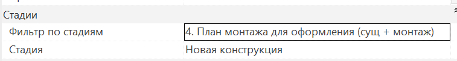{width=757px height=102px scale=51}

Пример отображения плана:

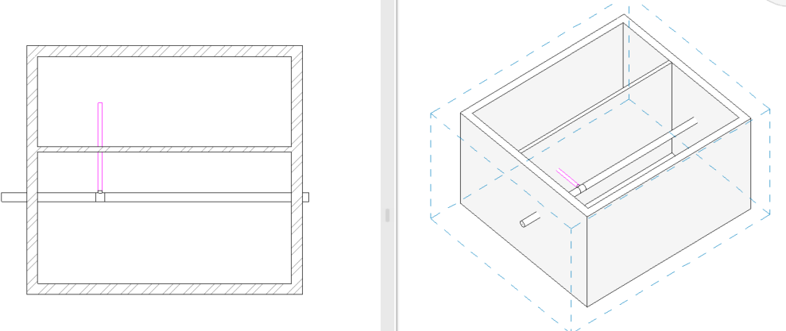{width=989px height=417px scale=85}

## 3\. Стадии у спецификаций

В спецификациях, как и у планов есть аналогичные настройки.

**Для демонтируемых конструкций:**

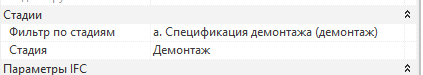{width=423px height=75px}

**Для новых конструкций:**

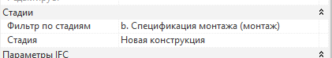{width=421px height=74px}

## 4\. Начало работы

По умолчанию координатор настраивает стадии в проекте при старте проекта.

Пример: Реконструируемое здание. Нужно начертить существующие стены, показать демонтируемые элементы и новые конструкции.

План действий:

1. Найдите готовый план или создайте план с нуля.

   Откройте вкладку «Вспомогательные виды» -- там часто лежат заранее настроенные планы для каждой стадии. Например, план с именем «Существующие» уже имеет нужную стадию. Если такой план есть -- используйте его.

   Если нет -- создайте новый план, откройте его свойства и выставьте нужные настройки.
2. Начертите существующие стены.

   Далее на этом плане можно располагать элементы -- они попадут в правильную стадию (например, «Существующие», так как в свойствах плана в графе «Стадия» стоит «Существующие»).

   Всё, что вы нарисуете на этом плане, автоматически получит стадию «Существующие». Дополнительно указывать стадию для каждого элемента не нужно -- стадия плана сама назначает её при создании элемента.
3. Сделайте план для демонтажа.

   Скопируйте предыдущий план или создайте новый. В его свойствах выставьте правильные настройки.

   Теперь выделите те стены или другие конструкции, которые должны быть снесены, и в их свойствах найдите параметр «Стадия сноса» -- выберите там «Демонтаж».
4. Сделайте план для новых конструкций.

   Создайте ещё один план, назначьте ему стадию «Новые конструкции» и рисуйте на нём всё, что будет построено заново. Эти элементы автоматически получат стадию «Новые конструкции».
