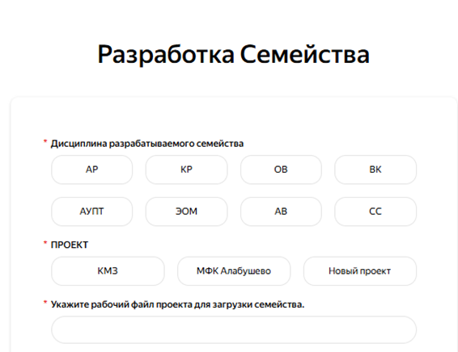

**Как создать задачу в Яндекс.Трекере для BIM Отдела НСК.**

1\. Необходимо перейти по ссылке:

<https://forms.yandex.ru/cloud/6a9e2bc01f1eb5d4be922993>

2\. Откроется форма для заполнения, в которой необходимо заполнить все поля.

{width=566px height=436px}

3\. Нажмите «Отправить». Заявка автоматически преобразуется в задачу отделу.
