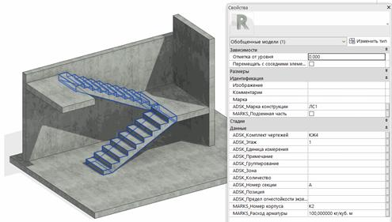

### *Требования к моделированию*

Таблица 130

<table header="row">
  <tr><td colspan="4">Инструмент моделирования</td></tr>
  <tr>
    <td colspan="4">
      - Системный инструмент «Лестница», «Перекрытие: несущее»
      - Загружаемые семейства категории «Обобщенные модели»
    </td>
  </tr>
  <tr><td colspan="4">Внешний вид</td></tr>
  <tr>
    <td colspan="4">
      
    </td>
  </tr>
  <tr><td colspan="4">Проектируемый объем</td></tr>
  <tr>
    <td rowspan="4">Этап</td>
    <td>К</td>
    <td>
      Выполняется:

      - Лестницы моделируются в разделе АР в условных габаритах и условном расположении.
    </td>
    <td></td>
  </tr>
  <tr>
    <td>ПД</td>
    <td>
      Выполняется:

      - Лестницы в точных габаритах и точном расположении в объеме всего здания;
      - Заполнение параметров.
    </td>
    <td></td>
  </tr>
  <tr>
    <td>ТД</td>
    <td>
      Выполняется:

      - Лестницы в точных габаритах и точном расположении в объеме всего здания;
      - Заполнение параметров, используемых при формировании сводной ведомости объемов работ и материалов.
    </td>
    <td></td>
  </tr>
  <tr>
    <td>РД</td>
    <td>
      Выполняется:

      - Лестницы в точных габаритах и точном расположении в объеме всего здания;
      - Заполнение параметров используемых при формировании рабочих спецификаций.
    </td>
    <td></td>
  </tr>
  <tr><td colspan="4">Примечание</td></tr>
  <tr>
    <td colspan="4">
      - В моделях проектного этапа «Концепция» допускается копирование лестниц из раздела АР категории «Лестница».
      - Межэтажные площадки должны быть выполнены системным семейством категории «Перекрытия» инструментом «Перекрытие: несущее».
      - Монолитные лестничные марши должны быть выполнены контекстными семействами категории «Обобщенные модели».
      - Сборные лестничные марши должны быть выполнены загружаемыми семействами категории «Обобщенные модели».
    </td>
  </tr>
  <tr><td colspan="4">Запрещенные действия</td></tr>
  <tr>
    <td colspan="4">
      - Разработка элементов модели участвующих в оформлении документации в рабочих наборах начинающихся с «(50)»
    </td>
  </tr>
</table>

### *Требования к параметризации*

Таблица 131

<table header="row">
  <tr><td colspan="2" rowspan="2">Атрибут</td><td colspan="4">Этап</td><td rowspan="2">Пример заполнения</td></tr>
  <tr><td>К</td><td>ПД</td><td>ТД</td><td>РД</td></tr>
  <tr><td colspan="7">Уровень геометрической проработки модели</td></tr>
  <tr><td rowspan="6">Геометрия</td><td>Условные габариты</td><td>●</td><td></td><td></td><td></td><td></td></tr>
  <tr><td>Точные габариты</td><td></td><td>●</td><td>●</td><td>●</td><td></td></tr>
  <tr><td>Условное расположение</td><td>●</td><td></td><td></td><td></td><td></td></tr>
  <tr><td>Точное расположение</td><td></td><td>●</td><td>●</td><td>●</td><td></td></tr>
  <tr><td>Внешний образ/вид</td><td>●</td><td>●</td><td>●</td><td>●</td><td></td></tr>
  <tr><td>Материалы1</td><td></td><td></td><td>●</td><td>●</td><td></td></tr>
  <tr><td colspan="7">Уровень проработки атрибутивной информации</td></tr>
  <tr><td>Размеры</td><td>Объем</td><td></td><td>●</td><td>●</td><td>●</td><td>0,5 м³</td></tr>
  <tr><td rowspan="4">Идентификация</td><td>Описание</td><td></td><td>●</td><td>●</td><td>●</td><td>Лестница монолитная</td></tr>
  <tr><td>ADSK_Материал / Материал несущих конструкций</td><td></td><td>●</td><td>●</td><td>●</td><td>Бетон B25</td></tr>
  <tr><td>ADSK_Предел огнестойкости2</td><td></td><td></td><td></td><td>●</td><td>R120</td></tr>
  <tr><td>G_Расход арматуры</td><td></td><td></td><td>●</td><td>●</td><td>120 кг/м³</td></tr>
  <tr><td>Маркировка</td><td>ADSK_Марка конструкции</td><td></td><td></td><td>●</td><td>●</td><td>Лм-1</td></tr>
  <tr><td rowspan="2">Ресурсы</td><td>ADSK_Единица измерения2</td><td></td><td></td><td></td><td>●</td><td>шт.</td></tr>
  <tr><td>ADSK_Завод-изготовитель2</td><td></td><td></td><td></td><td>●</td><td>Россия</td></tr>
  <tr><td rowspan="3">Положение</td><td>ADSK_Номер здания4</td><td></td><td>●</td><td>●</td><td>●</td><td>Строение 1</td></tr>
  <tr><td>ADSK_Этаж</td><td></td><td>●</td><td>●</td><td>●</td><td>2</td></tr>
  <tr><td>ADSK_Номер секции4</td><td></td><td>●</td><td>●</td><td>●</td><td>К1</td></tr>
  <tr><td>Прочее</td><td>ADSK_Комплект чертежей3</td><td></td><td></td><td></td><td>●</td><td>КЖ1</td></tr>
</table>

1 - Всем элементам (каждому отдельному слою) должен быть назначен конкретный материал из библиотеки материалов.

2 - Заполняется только у элементов, для которых явное указание изготовителя требуется согласно проектным решениям.

3 - Заполняется если из модели выпускается несколько комплектов документации.

4 - Заполняется, если здание разделено на несколько секций или есть требование согласно проектным решениям
