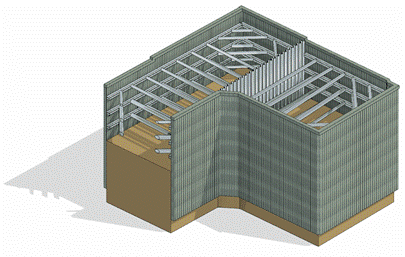

### *Требования к моделированию (при необходимости моделирования)*

Таблица 104

<table header="row">
  <tr><td colspan="4">Инструмент моделирования</td></tr>
  <tr>
    <td colspan="4">
      Системный инструмент:

      - «Стена»
      - «Перекрытие»
      - «Фундамент несущей конструкции»

      Загружаемые семейства категории:

      - «Каркас несущий»
      - «Несущие колонны»
    </td>
  </tr>
  <tr><td colspan="4">Внешний вид</td></tr>
  <tr>
    <td colspan="4">
      
    </td>
  </tr>
  <tr><td colspan="4">Проектируемый объем</td></tr>
  <tr><td rowspan="4">Этап</td><td>К</td><td>Не моделируется.</td><td></td></tr>
  <tr><td>ПД</td><td>Не моделируется.</td><td></td></tr>
  <tr><td>ТД</td><td>Не моделируется.</td><td></td></tr>
  <tr>
    <td>РД</td>
    <td>
      Выполняется:

      - Шпунтовые ограждения; подпорные стенки; распорки и подкосы, грунтовые анкеры; обвязочные балки;
      - Заполнение параметров используемых при формировании рабочих спецификаций.
    </td>
    <td></td>
  </tr>
  <tr><td colspan="4">Примечание</td></tr>
  <tr>
    <td colspan="4">
      - \-
    </td>
  </tr>
  <tr><td colspan="4">Запрещенные действия</td></tr>
  <tr>
    <td colspan="4">
      - Разработка элементов модели участвующих в оформлении документации в рабочих наборах начинающихся с «(50)\_»
    </td>
  </tr>
</table>

### *Требования к параметризации (при необходимости моделирования)*

Таблица 105

<table header="row">
  <tr><td colspan="2" rowspan="2">Атрибут</td><td colspan="4">Этап</td><td rowspan="2">Пример заполнения</td></tr>
  <tr><td>К</td><td>ПД</td><td>ТД</td><td>РД</td></tr>
  <tr><td colspan="7">Уровень геометрической проработки модели</td></tr>
  <tr><td rowspan="6">Геометрия</td><td>Условные габариты</td><td></td><td></td><td></td><td></td><td></td></tr>
  <tr><td>Точные габариты</td><td></td><td></td><td></td><td>●</td><td></td></tr>
  <tr><td>Условное расположение</td><td></td><td></td><td></td><td></td><td></td></tr>
  <tr><td>Точное расположение</td><td></td><td></td><td></td><td>●</td><td></td></tr>
  <tr><td>Внешний образ/вид</td><td></td><td></td><td></td><td>●</td><td></td></tr>
  <tr><td>Материалы1</td><td></td><td></td><td></td><td>●</td><td></td></tr>
  <tr><td colspan="7">Уровень проработки атрибутивной информации</td></tr>
  <tr><td rowspan="5">Размеры</td><td>ADSK_Размер_Высота</td><td></td><td></td><td></td><td>●</td><td>620 мм</td></tr>
  <tr><td>ADSK_Размер_Ширина</td><td></td><td></td><td></td><td>●</td><td>620 мм</td></tr>
  <tr><td>ADSK_Размер_Длина</td><td></td><td></td><td></td><td>●</td><td>5300 мм</td></tr>
  <tr><td>Площадь2</td><td></td><td></td><td></td><td>●</td><td>131,44 м2</td></tr>
  <tr><td>Объем2</td><td></td><td></td><td></td><td>●</td><td>2,03 м3</td></tr>
  <tr><td rowspan="2">Идентификация</td><td>ADSK_Наименование</td><td></td><td></td><td></td><td>●</td><td>Свая буровая D620</td></tr>
  <tr><td>ADSK_Предел огнестойкости2</td><td></td><td></td><td></td><td>●</td><td>R 120</td></tr>
  <tr><td>Маркировка</td><td>ADSK_Марка конструкции2</td><td></td><td></td><td></td><td>●</td><td>С-1</td></tr>
  <tr><td rowspan="2">Ресурсы</td><td>ADSK_Единица измерения2</td><td></td><td></td><td></td><td>●</td><td>шт.</td></tr>
  <tr><td>ADSK_Завод-изготовитель2</td><td></td><td></td><td></td><td>●</td><td>Россия</td></tr>
  <tr><td rowspan="3">Положение</td><td>ADSK_Номер здания4</td><td></td><td></td><td></td><td>●</td><td>Строение 1</td></tr>
  <tr><td>ADSK_Этаж</td><td></td><td></td><td></td><td>●</td><td>2</td></tr>
  <tr><td>ADSK_Номер секции4</td><td></td><td></td><td></td><td>●</td><td>К3</td></tr>
  <tr><td>Прочее</td><td>ADSK_Комплект чертежей3</td><td></td><td></td><td></td><td>●</td><td>КЖ0</td></tr>
</table>

1 - Всем элементам (каждому отдельному слою) должен быть назначен конкретный материал из библиотеки материалов.

2 - Заполняется только у элементов, для которых явное указание изготовителя и предела огнестойкости требуется согласно проектным решениям.

3 - Заполняется если из модели выпускается несколько комплектов документации.

4Заполняется, если здание разделено на несколько секций или есть требование согласно проектным решениям
