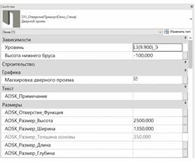

### *Требования к моделированию*

Таблица 124

<table header="row">
  <tr><td colspan="4">Инструмент моделирования</td></tr>
  <tr><td colspan="4">Загружаемые семейства категории «Окна» или «Двери».</td></tr>
  <tr><td colspan="4">Внешний вид</td></tr>
  <tr>
    <td colspan="4">
      
    </td>
  </tr>
  <tr><td colspan="4">Проектируемый объем</td></tr>
  <tr>
    <td rowspan="4">Этап</td>
    <td>К</td>
    <td>
      Выполняется:

      - Проемы моделируются в условных габаритах и условном расположении.;
      - Заполнение параметров.
    </td>
    <td></td>
  </tr>
  <tr>
    <td>ПД</td>
    <td>
      Выполняется:

      - Проемы моделируются в точных габаритах и точном расположении в объеме всего здания;
      - Заполнение параметров.
    </td>
    <td></td>
  </tr>
  <tr>
    <td>ТД</td>
    <td>
      Выполняется:

      - Проемы моделируются в точных габаритах и точном расположении в объеме всего здания;
      - Заполнение параметров.
    </td>
    <td></td>
  </tr>
  <tr>
    <td>РД</td>
    <td>
      Выполняется:

      - Проемы моделируются в точных габаритах и точном расположении в объеме всего здания;
      - Заполнение параметров используемых при формировании ведомостей проемов.
    </td>
    <td></td>
  </tr>
  <tr><td colspan="4">Примечание</td></tr>
  <tr>
    <td colspan="4">
      - Проемы должны образовывать физическое вырезание объема в стенах или перекрытиях.
    </td>
  </tr>
  <tr><td colspan="4">Запрещенные действия</td></tr>
  <tr>
    <td colspan="4">
      - Использование инструмента «Проем по грани».
      - Использование инструмента «Шахта».
      - Использование инструмента «Проем в стене»
      - Использование инструмента «Проем по вертикали».
    </td>
  </tr>
</table>

### *Требования к параметризации*

Таблица 125

<table header="row">
  <tr><td colspan="2" rowspan="2">Атрибут</td><td colspan="4">Этап</td><td rowspan="2">Пример заполнения</td></tr>
  <tr><td>К</td><td>ПД</td><td>ТД</td><td>РД</td></tr>
  <tr><td colspan="7">Уровень геометрической проработки модели</td></tr>
  <tr><td rowspan="5">Геометрия</td><td>Условные габариты</td><td>●</td><td></td><td></td><td></td><td></td></tr>
  <tr><td>Точные габариты</td><td></td><td>●</td><td>●</td><td>●</td><td></td></tr>
  <tr><td>Условное расположение</td><td>●</td><td></td><td></td><td></td><td></td></tr>
  <tr><td>Точное расположение</td><td></td><td>●</td><td>●</td><td>●</td><td></td></tr>
  <tr><td>Внешний образ/вид</td><td>●</td><td>●</td><td>●</td><td>●</td><td></td></tr>
  <tr><td colspan="7">Уровень проработки атрибутивной информации</td></tr>
  <tr><td rowspan="2">Размеры</td><td>ADSK_Размер_Высота</td><td>●</td><td>●</td><td>●</td><td>●</td><td>2200 мм</td></tr>
  <tr><td>ADSK_Размер_Ширина</td><td>●</td><td>●</td><td>●</td><td>●</td><td>2500 мм</td></tr>
  <tr><td>Идентификация</td><td>Описание</td><td></td><td></td><td>●</td><td>●</td><td>Проем</td></tr>
  <tr><td>Маркировка</td><td>ADSK_Позиция1</td><td></td><td></td><td></td><td>●</td><td>П-1</td></tr>
  <tr><td>Ресурсы</td><td>ADSK_Единица измерения1</td><td></td><td></td><td></td><td>●</td><td>шт.</td></tr>
  <tr><td rowspan="3">Положение</td><td>ADSK_Номер здания4</td><td>●</td><td>●</td><td>●</td><td>●</td><td>Строение 1</td></tr>
  <tr><td>ADSK_Этаж</td><td>●</td><td>●</td><td>●</td><td>●</td><td>3</td></tr>
  <tr><td>ADSK_Номер секции4</td><td>●</td><td>●</td><td>●</td><td>●</td><td>К1</td></tr>
  <tr><td>Прочее</td><td>ADSK_Комплект чертежей2</td><td></td><td></td><td></td><td>●</td><td>КЖ0</td></tr>
</table>

1 - Заполняется только у элементов, для которых явное указание требуется согласно проектным решениям.

2 - Заполняется если из модели выпускается несколько комплектов документации.

4 - Заполняется, если здание разделено на несколько секций или есть требование согласно проектным решениям
