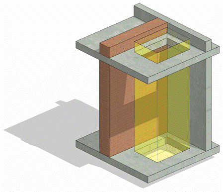

### Требования к моделированию

Таблица 122

<table header="row">
  <tr><td colspan="4">Инструмент моделирования</td></tr>
  <tr><td colspan="4">Загружаемые семейства категории «Окна».</td></tr>
  <tr><td colspan="4">Внешний вид</td></tr>
  <tr>
    <td colspan="4">
      
    </td>
  </tr>
  <tr><td colspan="4">Проектируемый объем</td></tr>
  <tr>
    <td rowspan="4">Этап</td>
    <td>К</td>
    <td>
      Выполняется:

      - Шахты в перекрытиях в условных габаритах и условном расположении;
      - Заполнение параметров.
    </td>
    <td></td>
  </tr>
  <tr>
    <td>ПД</td>
    <td>
      Выполняется:

      - Моделирование шахт и отверстий с указание условных габаритов и расположения.

      * Моделируются отверстия размерами ≥ 200 мм по одной из сторон или диаметром более ≥ 200 мм.

      В случае необходимости устройства закладной детали или дополнительных мероприятий по устройству, размер отверстия обязательного к моделированию может быть менее указанного;

      - Заполнение параметров.
    </td>
    <td></td>
  </tr>
  <tr>
    <td>ТД</td>
    <td>
      Выполняется:

      - Моделирование шахт и отверстий с указанием точных габаритов и точного расположения в объеме всего здания.

      * Моделируются отверстия размерами ≥ 100 мм по одной из сторон или диаметром более ≥ 100 мм. С указанием точных габаритов и точного расположения в объеме всего здания. В случае необходимости устройства закладной детали или дополнительных мероприятий по устройству, размер отверстия обязательного к моделированию может быть менее указанного;
      * Заполнение параметров.
    </td>
    <td></td>
  </tr>
  <tr>
    <td>РД</td>
    <td>
      Выполняется:

      - Моделирование шахт и отверстий с указанием точных габаритов и точного расположения в объеме всего здания.

      * Моделируются отверстия размерами ≥ 100 мм по одной из сторон или диаметром более ≥ 100 мм. В случае необходимости устройства закладной детали или дополнительных мероприятий по устройству, размер отверстия обязательного к моделированию может быть менее указанного;
      * Заполнение параметров, используемых при формировании ведомости отверстий.
    </td>
    <td></td>
  </tr>
  <tr><td colspan="4">Примечание</td></tr>
  <tr>
    <td colspan="4">
      - Элементы должны быть выполнены загружаемым семейством категории «Окна».
      - Отверстия должны образовывать физическое вырезание объема в стенах или перекрытиях.
    </td>
  </tr>
  <tr><td colspan="4">Запрещенные действия</td></tr>
  <tr>
    <td colspan="4">
      - Разработка элементов модели, участвующих в оформлении документации в рабочих наборах начинающихся с «(50)».
    </td>
  </tr>
</table>

### *Требования к параметризации*

Таблица 123

<table header="row">
  <tr><td colspan="2" rowspan="2">Атрибут</td><td colspan="4">Этап</td><td rowspan="2">Пример заполнения</td></tr>
  <tr><td>К</td><td>ПД</td><td>ТД</td><td>РД</td></tr>
  <tr><td colspan="7">Уровень геометрической проработки модели</td></tr>
  <tr><td rowspan="5">Геометрия</td><td>Условные габариты</td><td>●</td><td>●</td><td></td><td></td><td></td></tr>
  <tr><td>Точные габариты</td><td></td><td></td><td>●</td><td>●</td><td></td></tr>
  <tr><td>Условное расположение</td><td>●</td><td>●</td><td></td><td></td><td></td></tr>
  <tr><td>Точное расположение</td><td></td><td></td><td>●</td><td>●</td><td></td></tr>
  <tr><td>Внешний образ/вид</td><td>●</td><td>●</td><td>●</td><td>●</td><td></td></tr>
  <tr><td colspan="7">Уровень проработки атрибутивной информации</td></tr>
  <tr><td rowspan="3">Размеры</td><td>ADSK_Размер_Высота</td><td>●</td><td>●</td><td>●</td><td>●</td><td>1200 мм</td></tr>
  <tr><td>ADSK_Размер_Ширина</td><td>●</td><td>●</td><td>●</td><td>●</td><td>1200 мм</td></tr>
  <tr><td>ADSK_Размер_Глубина</td><td>●</td><td>●</td><td>●</td><td>●</td><td>250 мм</td></tr>
  <tr><td rowspan="3">Положение</td><td>ADSK_Номер здания4</td><td>●</td><td>●</td><td>●</td><td>●</td><td>Строение 1</td></tr>
  <tr><td>ADSK_Этаж</td><td>●</td><td>●</td><td>●</td><td>●</td><td>3</td></tr>
  <tr><td>ADSK_Номер секции4</td><td>●</td><td>●</td><td>●</td><td>●</td><td>К1</td></tr>
  <tr><td>Прочее</td><td>ADSK_Комплект чертежей1</td><td></td><td></td><td></td><td>●</td><td>КЖ1</td></tr>
</table>

1 - Заполняется если из модели выпускается несколько комплектов документации.

4 - Заполняется, если здание разделено на несколько секций или есть требование согласно проектным решениям
