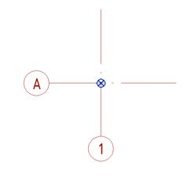

## 3\.1. Требования к единицам

- Моделирование производится в масштабе 1:1, в метрической системе измерений.
- Точность моделирования - в миллиметрах, с округлением до трех знаков после запятой (0,000 мм)
- Линейные размеры – в миллиметрах, с округлением до целых значений (0 мм);
- Высотные отметки – в метрах, с округлением до трех знаков после запятой (0,000м);
- Значения площади – в квадратных метрах, с округлением до двух знаков после запятой (0,00 м2)
- Значения объема материалов – кубические метры, с округлением до двух знаков после запятой (0,00 м3);
- Угловые размеры – градусы (0.00⁰’).
- Расход – литры в секунду (0.0 л/с);
- Скорость – метры в секунду (0.0 м/с);
- Температура – градусы Цельсия (0.0°С);
- Давление – Паскаль (0.0 Па);
- Воздушный поток – кубические метры в час (0.0 м3/ч);
- Массовая плотность, плотность – килограмм на кубический метр (0.00 кг/м3 );

### Требования к единицам измерения ГП

- Моделирование производится в масштабе 1:1, в метрической системе измерений;
- Линейные размеры – в метрах, с округлением до двух знаков после запятой (0,0 м);
- Высотные отметки – в метрах, с округлением до двух знаков после запятой (0,00 м);
- Значения площади – в квадратных метрах, с округлением до двух знаков после запятой (0,00 м2);
- Значения объема материалов – кубические метры, с округлением до двух знаков после запятой (0,00 м3);
- Угловые размеры – градус/минута/секунда (0⁰0’0”);
- Радиус – в метрах, с округлением до двух знаков после запятой (0,00 м);
- Радиус - в миллиметрах, с округлением до целого числа (0 мм);
- Диаметр – в метрах, с округлением до двух знаков после запятой (0,00 м);
- Диаметр – в миллиметрах, с округлением до целого числа (0 мм);

## 3\.2. Требования к системе общих координат

- Во всех моделях должны быть настроены общие координаты, которые предусматривают относительные и абсолютные высотные отметки, привязку к фактической посадке здания на геоподоснове в московской системе координат, а также направление истинного севера.
- Для передачи координат должна использоваться координационная модель.
- Во всех моделях должно быть настроено наименование площадки.
- Во всех моделях должны использоваться уровни, соответствующие высотным отметкам чистых полов архитектурных моделей. Допускается использовать вспомогательные уровни для привязки уникальных элементов.
- Начало единой системы координат должно быть согласовано для всех файлов проекта. Источником единой системы координат является файл геодезической подосновы или источник данных, определяющий местоположение участка и его координаты. Значения точки съемки должны оставаться нулевыми.
- Базовая точка модели размещается в левом нижнем углу, в точке пересечения оси А с осью 1 или эквивалентных осях для конкретной модели.

- В координационной модели базовая точка располагается в геодезическом кресте, ближайшем к левому нижнему углу здания.

## 3\.3. Общие требования

- Все основные элементы и объекты ЦИМ должны иметь габаритные размеры, соответствующие фактическим строительным элементам.
- Элементы модели необходимо создавать с разбивкой по этажам, за исключением элементов, деление которых поэтажно невозможно из-за конструктивных особенностей.
- Элементы модели должны быть привязаны к уровням, на которых они расположены.
- Элементы модели должны быть скоординированы и расположены в проектном положении.

**Не допускается:**

- Наличие некорректных зазоров/пересечений, примыкания/опирания строительных элементов, необоснованных проектным решением.
- Неточное построение элементов с последующим округлением размерных значений до целых чисел.
- Дублирование элементов ЦИМ, за исключением особенностей моделирования объектов, которые представлены ниже в регламенте.
- Использование линий модели для отображения 3D-элементов модели.
- Привязка элемента к некорректному уровню. Некорректным уровнем считается уровень этажа, который не соответствует этажу, на котором расположен элемент.
- Наличие нескоординированных элементов, которые находятся за пределами области моделирования.

## 3\.4. Схема разделения моделей

- На проектных этапах П ТД РД необходимо разделять ЦИМ по разделам проекта.
- Дальнейшее деление выполнять по функциональному признаку − Здания, Корпуса, Секции, Этажи и т.д.
- Фасады рекомендуется выполнять в отдельном файле. В случае не большого объекта допускается моделировать фасады в файле основной модели АР.
- На этапе рабочей документации при формировании схемы разделения моделей необходимо также учесть деление документации на комплекты/альбомы.
- Схему деления и список моделей для конкретного проекта необходимо согласовать с Заказчиком и зафиксировать в документе «План выполнения ЦИМ»

## 3\.5. Общие рабочие наборы

- В каждой модели должны быть созданы общие рабочие наборы. Данные рабочие наборы служат для настройки видимости общих элементов, таких как *оси, уровни и отверстия*. При отключении видимости рабочего набора в модели данный рабочий набор скрывается и в связанном файле, за счет одинакового наименования.[\[1\]](#_msocom_1)  Список общих рабочих наборов и их глобальные настройки видимости представлены в Таблице 7.

Таблица 7 - Список общих рабочих наборов

<table header="row">
  <tr><td>**Шифр модели**</td><td>**Оси и уровни**</td><td>**Геометрия**</td><td>**Отверстия**</td><td>**Скрытый**</td><td>**Связи1**</td></tr>
  <tr>
    <td>РФ</td>
    <td>(99)\_РФ_Оси и уровни</td>
    <td>\-</td>
    <td>\-</td>
    <td rowspan="38">(50)\_Temp</td>
    <td rowspan="38">
      (95)\_NWC_Имя файла

      (96)\_RVT_Имя файла

      (97)\_DWG

      (98)\_IFC_Имя файла
    </td>
  </tr>
  <tr>
    <td>АР</td>
    <td>(99)\_АР_Оси и уровни</td>
    <td>(10)\_АР</td>
    <td rowspan="35">
      (30)\_Отверстия АР

      (30)\_Отверстия КР

      (30)\_Отверстия ИОС
    </td>
  </tr>
  <tr><td>АИ</td><td>(99)\_АИ_Оси и уровни</td><td>(60)\_АИ</td></tr>
  <tr><td>КР</td><td>(99)\_КР_Оси и уровни</td><td>(20)\_ КР</td></tr>
  <tr><td>КЖ</td><td>(99)\_КЖ_Оси и уровни</td><td>(20)\_КЖ</td></tr>
  <tr><td>КМ</td><td>(99)\_КМ_Оси и уровни</td><td>(20)\_КМ</td></tr>
  <tr><td>ТС</td><td>(99)\_ТС_Оси и уровни</td><td>(30)\_ТС</td></tr>
  <tr><td>ОТ</td><td>(99)\_ОТ_Оси и уровни</td><td>(30)\_ОТ</td></tr>
  <tr><td>ОВВ</td><td>(99)\_ОВВ_Оси и уровни</td><td>(30)\_ОВВ</td></tr>
  <tr><td>ОВД</td><td>(99)\_ОВД_Оси и уровни</td><td>(30)\_ОВД</td></tr>
  <tr><td>ОВК</td><td>(99)\_ОВК_Оси и уровни</td><td>(30)\_ОВК</td></tr>
  <tr><td>ХС</td><td>(99)\_ХС_Оси и уровни</td><td>(30)\_ХС</td></tr>
  <tr><td>ХЦ</td><td>(99)\_ХЦ_Оси и уровни</td><td>(30)\_ХЦ</td></tr>
  <tr><td>ИТП</td><td>(99)\_ИТП_Оси и уровни</td><td>(30)\_ИТП</td></tr>
  <tr><td>ВК</td><td>(99)\_ВК_Оси и уровни</td><td>(30)\_ВК</td></tr>
  <tr><td>ВКВ</td><td>(99)\_ВКВ_Оси и уровни</td><td>(30)\_ВКВ</td></tr>
  <tr><td>ВКК</td><td>(99)\_ВКК_Оси и уровни</td><td>(30)\_ВКК</td></tr>
  <tr><td>ПТ</td><td>(99)\_ПТ_Оси и уровни</td><td>(30)\_ПТ</td></tr>
  <tr><td>АУПТ</td><td>(99)\_АУПТ_Оси и уровни</td><td>(30)\_АУПТ</td></tr>
  <tr><td>НС</td><td>(99)\_НС_Оси и уровни</td><td>(30)\_НС</td></tr>
  <tr><td>ЭОМ</td><td>(99)\_ЭОМ_Оси и уровни</td><td>(30)\_ЭОМ</td></tr>
  <tr><td>ЭО</td><td>(99)\_ЭО_Оси и уровни</td><td>(30)\_ЭО</td></tr>
  <tr><td>ЭМ</td><td>(99)\_ЭМ_Оси и уровни</td><td>(30)\_ЭМ</td></tr>
  <tr><td>МЗ</td><td>(99)\_МЗ_Оси и уровни</td><td>(30)\_МЗ</td></tr>
  <tr><td>СС</td><td>(99)\_СС_Оси и уровни</td><td>(30)\_СС</td></tr>
  <tr><td>СКУД</td><td>(99)\_СКУД_Оси и уровни</td><td>(30)\_СКУД</td></tr>
  <tr><td>СОТ</td><td>(99)\_СОТ_Оси и уровни</td><td>(30)\_СОТ</td></tr>
  <tr><td>СОТС</td><td>(99)\_СОТС_Оси и уровни</td><td>(30)\_СОТС</td></tr>
  <tr><td>СОВ</td><td>(99)\_СОВ_Оси и уровни</td><td>(30)\_СОВ</td></tr>
  <tr><td>СКС</td><td>(99)\_СКС_Оси и уровни</td><td>(30)\_СКС</td></tr>
  <tr><td>МГН</td><td>(99)\_МГН_Оси и уровни</td><td>(30)\_МГН</td></tr>
  <tr><td>РФ</td><td>(99)\_РФ_Оси и уровни</td><td>(30)\_РФ</td></tr>
  <tr><td>СВ</td><td>(99)\_СВ_Оси и уровни</td><td>(30)\_СВ</td></tr>
  <tr><td>СПС</td><td>(99)\_СПС_Оси и уровни</td><td>(30)\_СПС</td></tr>
  <tr><td>СОЭ</td><td>(99)\_СОЭ_Оси и уровни</td><td>(30)\_СОЭ</td></tr>
  <tr><td>АК</td><td>(99)\_АК_Оси и уровни</td><td>(30)\_АК</td></tr>
  <tr><td>ТХ</td><td>(99)\_ТХ_Оси и уровни</td><td>(40)\_ТХ</td><td>\-</td></tr>
  <tr><td>ГП</td><td>\-</td><td>\-</td><td>\-</td></tr>
</table>

1Каждая связь формата NWC, RVT, IFC, DWG (при загрузке в 3D режиме), помещается в отдельный рабочий набор, что позволяет отключить ее при загрузке файла.
