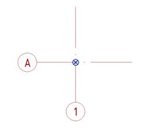

- Во всех моделях должны быть настроены общие координаты, которые предусматривают относительные и абсолютные высотные отметки, привязку к фактической посадке здания на геоподоснове в московской системе координат, а также направление истинного севера.
- Для передачи координат должна использоваться координационная модель.
- Во всех моделях должно быть настроено наименование площадки.
- Во всех моделях должны использоваться уровни, соответствующие высотным отметкам чистых полов архитектурных моделей. Допускается использовать вспомогательные уровни для привязки уникальных элементов.
- Начало единой системы координат должно быть согласовано для всех файлов проекта. Источником единой системы координат является файл геодезической подосновы или источник данных, определяющий местоположение участка и его координаты. Значения точки съемки должны оставаться нулевыми.
- Базовая точка модели размещается в левом нижнем углу, в точке пересечения оси А с осью 1 или эквивалентных осях для конкретной модели.

- В координационной модели базовая точка располагается в геодезическом кресте, ближайшем к левому нижнему углу здания.
