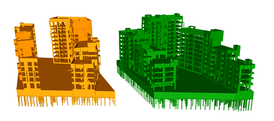
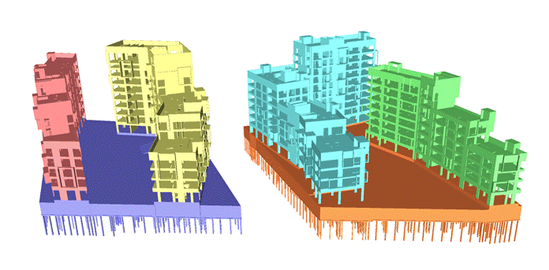
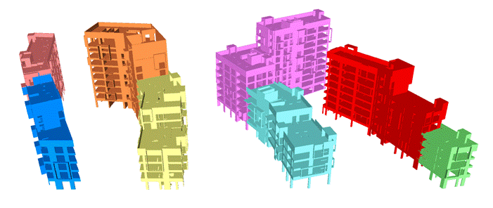
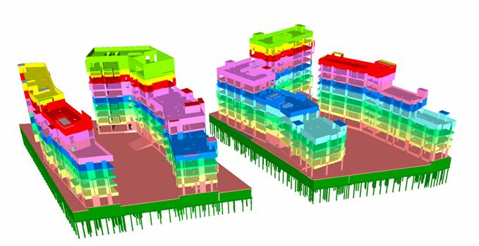

Параметры расположения позволяют проводить более точную идентицикацию места элементов в пространстве информационной модели. К таким параметрам относятся «*ADSK_Номер здания*», «*G_Номер корпуса*», «*G_Номер секции*» и «*G_Этаж*».

- *G_Номер здания* – отдельно стоящее здание с учетом паркинга или стилобата.

Пример заполнения: ЗД1, ЗД2, ЗД3...

- *G_Номер корпуса* – выступающая часть здания выше проектного нуля. Паркинг или стилобат являются отдельным «корпусом».

Пример заполнения: К1, К2, К3...

Если в проекте корпуса определены «Башнями», то допускается заполнять Б1, Б2, Б3...

- *G_Номер секции* – часть корпуса выше проектного нуля, отделенная деформационным швом.

Пример заполнения: С1,С2,С3...

- *ADSK_Этаж* – уровень, к которому привязан элемент.[\[1\]](#_msocom_1)

Пример заполнения: 1, 2, 3...
