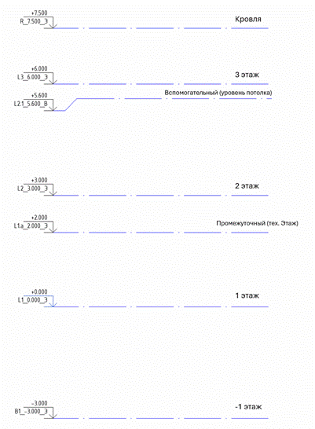

## 6\.1. Требования к именованию файлов модели

Таблица 10

<table header="row">
  <tr><td>1</td><td>2</td><td>3</td><td>4</td><td>5</td><td>6</td><td>7</td><td></td></tr>
  <tr>
    <td>Шифр проекта</td>
    <td>Шифр раздела</td>
    <td>Компания разработчик</td>
    <td>Этап проекта1</td>
    <td>Тип файла1</td>
    <td>
      Корпус/

      секция/

      этап строительства
    </td>
    <td>Часть модели2</td>
    <td></td>
  </tr>
  <tr><td>APU</td><td>AR</td><td>ME</td><td>RD</td><td>R21</td><td>K1</td><td>PRK</td><td>.rvt</td></tr>
</table>

*\<1>\_\<2>\_\<3>\_\<41>\_\<51>\_\<6>\_\<72>*

Пример: *APU_AR_ME_RD_R21_K1_PRK.rvt*

1. **Шифр проекта** – сокращенное наименование проекта (согласовывается с Заказчиком).
2. **Шифр раздела** – принимается по Таблице 5.

- **FM** для сводной модели всех разделов;
- **COORD** для координационного файла.

1. **Компания разработчик** – наименование участника проекта, используемое в наименовании файлов ЦИМ.
2. **Этап проекта1** указывается для моделей в формате RVT или NWD:

- **CONCP** для моделей Концепции;
- **PD** для моделей Проектной документации;
- **RD** для моделей Рабочей документации;
- **TD** для моделей Тендерной документации.

1. **Тип файла1**:

- **R20, R21** и т.п. Для файлов Autodesk Revit, где цифры номер версии программы, принятый для разработки проекта;
- **N20, N21** и т.п. Для файлов Autodesk Navisworks, где цифры номер версии программы, принятый для разработки проекта;
- **A20, A21** и т.п. Для файлов Autodesk Civil 3D, где цифры номер версии программы, принятый для разработки проекта.

**6\. Корпус/секция/этап строительства** – заполняется согласно схеме разделения моделей проекта. Может включать несколько значений, разделенных символом нижнего подчеркивания.

**7\. Часть модели2** – описывает части здания если в файле содержится только часть объекта

- **FSD** для моделей фасадов;
- **PRK** для моделей паркинга;
- **CTL** для моделей котлована;
- **ZONES** для моделей, содержащих зоны и т.д.

1 – Указывается при необходимости.

2 - Заполняется в случае, если в файле представлена только часть модели.

## 6\.2. Требования к именованию уровней

### 6\.2.1.     Схема именования уровней

Таблица 11

| 1 | 2 | 3 | 4 | 5 | 6 |
|---|---|---|---|---|---|
| Префикс | Этаж | Суффикс1 | Корпус/Секция/Блок1 | Отметка | Назначение уровня |
| L | 2 | a | K1 | (Отм.) | В |

*\<1>\<2>\<31>\_\<41>(\<5>)\_\<6>*

Пример: *L2а_К1(3.620)\_В*

1. **Префикс** - определяет, является этаж подземным или надземным.

- «R» - для уровня кровли,
- «L» - для надземных уровней,
- «B» - для подземных,
- «G» - для уровня земли,
- «M» - для уровня головки рельса.

1. **Этаж** - определяет номер этажа, к которому относится данный уровень.

Нумерация этажей выполняется в направлении от поверхности земли:

- для надземных этажей – снизу вверх,
- для подземных - сверху вниз.

В случае, если требуется создание дополнительных промежуточных уровней – после номера этажа должен быть добавлен порядковый номер через точку, если уровень промежуточный: «*L1.1*».

1. **Суффикс1** - Задается латинская буква для обозначения вспомогательного уровня: «*L1a*», «*L1b*», «*L1c*» и т.д.
2. **Корпус/Секция/Блок1** - В случае, если необходимо для каждой секции/корпуса/блока создать свой набор уровней, вводится дополнительное кодирование номера в наименование уровня. Например, «К1», «*B2*», «*С5*».
3. **Отметка** - высотная отметка данного уровня от уровня проектного нуля здания. Указывается в метрах, с точностью до трех знаков. В качестве разделителя использовать точку. Знак "+" для положительных значений не указывается.
4. **Назначение уровня** - пометка, которая отличает проектные уровни (основные и промежуточные) от вспомогательных.

- «*Э*» – основной (уровни, по которым считается этажность здания и по которым формируются планы);
- «*Э*» – промежуточный (уровни, по которым не считается этажность, но формируются планы (антресоли, террасы и т.п.));
- «*В*» – вспомогательный (уровень для дополнительных построений и привязки объектов модели).

1 – Указывается при необходимости.

*Важно!* Именем уровня является *весь набор символов*, состоящий из 4-6 блоков по схеме, включающий в себя: префикс, номер этажа, суффикс2, закодированный номер корпуса/секции2, отметку уровня и постфикс (назначение уровня).

1 – Указывается при необходимости.

2 - Уровень земли для жилых и общественных зданий или уровень головки рельса для объектов метро.

Рисунок 1 - Пример

## 6\.3. Требования к именованию видов и шаблонов

### 6\.3.1.     Правила именования видов

Таблица 12

<table header="row">
  <tr><td>1</td><td>2</td><td>3</td><td>4</td><td>5</td><td>6</td><td>7</td></tr>
  <tr>
    <td>Код вида</td>
    <td>Раздел проекта/Шифр альбома1</td>
    <td>
      Блок/подъезд

      /секция1
    </td>
    <td>Уровень вида</td>
    <td>Семейство вида</td>
    <td>Описание вида</td>
    <td>Частное расположение вида1</td>
  </tr>
  <tr><td></td><td>ОВ.В1.1</td><td>Блок</td><td>L01(0.000)</td><td>ПЭ</td><td>Имя</td><td>оси</td></tr>
</table>

*(\<1>)\_\<21>\_\<31>\_\<4>\_\<5>\_(\<6>)\_\<71>*

Пример: *(РД)\_* *ОВ.В1.1_Блок_L01(0.000)\_ПЭ\_(Имя)\_оси*

1 – Указывается при необходимости.

1. Коды вида:

Таблица 13

| Код вида | Назначение вида |
|---|---|
| В | Вспомогательный |
| К | Концепция |
| ПД | Проектная документация |
| ТД | Тендорная документация |
| РД | Рабочая документация |
| Э | Экспорт |
| ЗВ | Задание входящее |
| ЗИ | Задание исходящее |
| BIM | Для BIM координатора |

1. Семейство вида:

Таблица 14

|  | Тип вида |
|---|---|
| 3D | 3D виды |
| ГП | Генплан |
| ПЭ | Планы этажей |
| ПП | Планы потолков |
| ПЗ | Планы зонирования |
| Р | Разрезы |
| С | Сечения |
| У | Узлы |
| Ф | Фасады |
| ФР | Фрагмент вида |
| СП | Спецификации |
| Ч | Чертежный вид |

### 6\.3.2.     Правила именования шаблонов вида

Таблица 15

| 1 | 2 | 3 | 4 |
|---|---|---|---|
| Код вида | Раздел проекта1 | Семейство вида | Имя вида |
| ПД | АР | ПЭ | Имя |

*(\<1>)\_\<21>\_\<3>\_(\<4>)*

Пример: *(ПД)\_АР_ПЭ\_(Кладочный)*

1 – Указывается при необходимости.

## 6\.4. Требования к именованию рабочих наборов

**Рабочий набор** – это набор любых элементов проекта, позволяющий выполнять коллективную работу над проектом, но обеспечивающий редактирование конкретных элементов только одним участником. Рабочие наборы позволяют нескольким пользователям одновременно работать над файлом модели посредством использования центрального хранилища и синхронизированных локальных копий.

### 6\.4.1. Правила именования рабочих наборов

Таблица 16

<table header="row">
  <tr><td>1</td><td>2</td><td>3</td><td>4</td></tr>
  <tr>
    <td>Кодировка рабочего набора</td>
    <td>
      Блок/подъезд/секция/

      уровень/расположение

      в модели1
    </td>
    <td>
      Блок/подъезд/секция/

      уровень/расположение

      в модели1
    </td>
    <td>Комментарии к названию1</td>
  </tr>
  <tr><td>99</td><td>Блок</td><td>Раздел/Элемент</td><td>Ком.</td></tr>
</table>

*(\<1>)\_\<21>\_\<31>\_\<41>*

Пример: *(99)\_Общие уровни и сетки*

1 – Указывается при необходимости.

### 6\.4.2. Рекомендации по именованию рабочих наборов

При использовании рабочих наборов рекомендуется учесть следующее:

- При создании рабочих наборов каждый элемент модели получает новое свойство-параметр – принадлежность рабочему набору. Элемент может одновременно принадлежать только одному рабочему набору.
- Рабочие наборы необходимо именовать согласно правилам.
- Список рабочих наборов создается индивидуально к проекту.
- Дополнительные рабочие наборы могут создаваться при необходимости. Наличие кода в наименовании рабочего набора является обязательным.

Таблица 17 - Примеры рабочих наборов

<table header="row">
  <tr><td>Код</td><td>Группа</td><td>Пример</td><td>Описание</td><td></td></tr>
  <tr><td colspan="5">Рабочие наборы АР</td></tr>
  <tr>
    <td rowspan="8">(10)</td>
    <td rowspan="8">
      Пользовательские рабочие наборы.

      Раздел АР
    </td>
    <td>(10)\_АР</td>
    <td>Общий рабочий набор АР</td>
    <td></td>
  </tr>
  <tr><td>(10)\_Cтены</td><td>Рабочий набор, включающий стены АР.</td><td></td></tr>
  <tr><td>(10)\_Витраж</td><td>Рабочий набор, включающий витражные конструкции.</td><td></td></tr>
  <tr><td>(10)\_Кровля</td><td>Рабочий набор, включающий кровли, покрытия.</td><td></td></tr>
  <tr><td>(10)\_Полы</td><td>Рабочий набор, включающий полы, фальшполы, топпинги.</td><td></td></tr>
  <tr><td>(10)\_Ограждения</td><td>Рабочий набор, включающий ограждения.</td><td></td></tr>
  <tr><td>(10)\_Окна</td><td>Рабочий набор, включающий окна.</td><td></td></tr>
  <tr><td>(10)\_Двери</td><td>Рабочий набор, включающий двери, люки.</td><td></td></tr>
  <tr><td colspan="5">Рабочие наборы КР</td></tr>
  <tr>
    <td rowspan="4">(20)</td>
    <td rowspan="4">
      Пользовательские рабочие наборы.

      Раздел КР
    </td>
    <td>(20)\_КР</td>
    <td>Общий рабочий набор КР</td>
    <td></td>
  </tr>
  <tr><td>(20)\_Cтены</td><td>Рабочий набор, включающий стены КЖ.</td><td></td></tr>
  <tr><td>(20)\_Перекрытия</td><td>Рабочий набор, включающий перекрытия КЖ.</td><td></td></tr>
  <tr><td>(20)\_Лестницы</td><td>Рабочий набор, включающий лестницы КЖ.</td><td></td></tr>
  <tr><td colspan="5">Рабочие наборы ИОС</td></tr>
  <tr>
    <td rowspan="3">(30)</td>
    <td rowspan="3">
      Пользовательские рабочие наборы.

      Раздел ИОС
    </td>
    <td>(30)\_\<раздел></td>
    <td>Общий рабочий набор по разделу, например: (30)\_ОВ, (30)\_ВК, (30)\_ПТ и тд.</td>
    <td></td>
  </tr>
  <tr><td>(30)\_Сантехприборы</td><td>Рабочий набор, включающий сантехприборы.</td><td></td></tr>
  <tr><td>(30)\_Оборудование</td><td>Рабочий набор, включающий оборудование.</td><td></td></tr>
  <tr><td colspan="5">Рабочие наборы ТХ</td></tr>
  <tr>
    <td rowspan="3">(40)</td>
    <td rowspan="3">
      Пользовательские рабочие наборы.

      Раздел ТХ
    </td>
    <td>(40)\_ТХ</td>
    <td>Общий рабочий набор ТХ</td>
    <td></td>
  </tr>
  <tr><td>(40)\_Технология</td><td>Рабочий набор, включающий элементы технологии.</td><td></td></tr>
  <tr><td>(40)\_Оборудование</td><td>Рабочий набор, включающий оборудование.</td><td></td></tr>
  <tr><td colspan="5">Рабочие наборы. Прочее</td></tr>
  <tr><td rowspan="2">(50)</td><td rowspan="2">Пользовательские рабочие наборы. Прочее</td><td>(50)\_Temp</td><td>Рабочий набор для элементов не отображаемых на видах.</td><td></td></tr>
  <tr><td>(50)\_Имитация</td><td>Рабочий набор для имитационных элементов КЖ, ВИС и тд</td><td></td></tr>
  <tr><td colspan="5">Рабочие наборы АИ</td></tr>
  <tr><td rowspan="10">(60)</td><td rowspan="10">Пользовательские рабочие наборы. Раздел АИ</td><td>(60)\_АИ</td><td>Общий рабочий набор АИ</td><td></td></tr>
  <tr><td>(60)\_Отделка стен</td><td>Рабочий набор для отделки стен, декоративных элементов стен</td><td></td></tr>
  <tr><td>(60)\_Отделка полов</td><td>Рабочий набор для полов, декоративных элементов полов, плинтусов</td><td></td></tr>
  <tr><td>(60)\_Отделка потолков</td><td>Рабочий набор для потолков, декоративных элементов потолков</td><td></td></tr>
  <tr><td>(60)\_Осветительные приборы</td><td>Рабочий набор для элементов освещения</td><td></td></tr>
  <tr><td>(60)\_Сантехника</td><td>Рабочий набор для сантехники и оборудования санузлов</td><td></td></tr>
  <tr><td>(60)\_Оборудование</td><td>Рабочий набор для покупной мебели, мебели для индивидуального изготовления, электрооборудования, устройств вызова и оповещения, пожарной сигнализации</td><td></td></tr>
  <tr><td>(60)\_Розетки и выключатели</td><td>Рабочий набор для розеток, выключателей, электрических выводов</td><td></td></tr>
  <tr><td>(60)\_Перегородки</td><td>Рабочий набор для перегородок АИ</td><td></td></tr>
  <tr><td>(60)\_Двери</td><td>Рабочий набор для дверей и лючков АИ</td><td></td></tr>
  <tr><td colspan="5">Общие рабочие наборы</td></tr>
  <tr><td>(96)</td><td>Рабочие наборы связей формата RVT</td><td>(96)\_RVT_Имя файла</td><td>Рабочий набор для внешних ссылок Revit - файлов</td><td></td></tr>
  <tr><td>(97)</td><td>Рабочие наборы связей формата DWG</td><td>(97)\_DWG_Имя/Раздел_Комментарий</td><td>Рабочий набор для подгруженных DWG файлов</td><td></td></tr>
  <tr><td>(98)</td><td>Рабочие наборы связей формата IFC</td><td>(98)\_IFC_Имя/Раздел_Комментарий</td><td>Рабочий набор для подгруженных IFC файлов</td><td></td></tr>
  <tr><td rowspan="4">(99)</td><td rowspan="4">Базовые рабочие наборы</td><td>(99)\_Уровни \<раздел></td><td>Рабочий набор, включающий в себя уровни, например: (99)\_Уровни АР, (99)\_Уровни КР, (99)\_Уровни ОВВ и т.д</td><td></td></tr>
  <tr><td>(99)\_Оси \<раздел></td><td>Рабочий набор, включающий в себя оси, например: (99)\_Оси АР, (99)\_Оси КР, (99)\_Оси ОВВ и т.д.</td><td></td></tr>
  <tr><td>(99)\_Области видимости</td><td>Рабочий набор, включающий в себя области видимости</td><td></td></tr>
  <tr><td>(99)\_Рабочий набор</td><td>Для элементов с неопределенной категорией</td><td></td></tr>
</table>

## 6\.5. Требования к именованию семейств и типов

### 6\.5.1. Стены, перекрытия, крыши

Таблица 18

| 1 | 2 | 3 | 4 | 5 | 6 |
|---|---|---|---|---|---|
| Функция | Тип | Общая толщина | Материал 1[\[1\]](#_msocom_1) 1 | Материал 21 | Комментарий2 |
| ОТД | 1 | 21 | ШТК | КРСК |  |

*(\<1>.\<2>)\_\<3>\_(\<41>-\<51>)\_\<62>*

Примеры:

*(ОТД.1)\_21\_(ШТК_КРСК)\_Влагостойкая*

*(ВН.2)\_125\_(МТЛ+УТПмв_ГКЛ_ФБЦ)\_Кнауф С382.2*

*(П.3)\_150\_(ГКЛ_КРМ_ИЗЛ_ЦПС_ГРЛ_УСЛ_КПТ)\_Теплый пол*

*(П.4)\_235\_(КРМ_ЦПС_ГРЛ_КПТ)\_С разуклонкой*

*(ПТ.5)\_400\_(ВЗ_ШПН)\_Подвесной*

*(ПТ.6)\_400\_(ВЗ_ГКЛ_КРСК)\_Подвесной*

*(ПТ.7)\_600\_(КРСК_ВЗ_УСЛ)\_Грильято 100х100*

1 - Количество полей \<4> и \<5> должно совпадать с количеством слоев конструкции. Шифры материалов см. Таблица 20.

2 – Указывается при необходимости.

Таблица 19

| Шифр | Функция конструкции |
|---|---|
| НР | Наружная стена |
| ВН | Внутренняя стена |
| ФД | Фундамент |
| КРВ | Кровля |
| КР | Конструктив |
| ОТД | Отделочная стена |
| ПП | Плита перекрытия |
| П | Пол |
| ПТ | Потолок |
| ПЛ | Плинтус |
| ЛС | Лестница |
| ОГ | Ограждение |
| ФСД | Вент.фасад |

Таблица 20

<table header="row">
  <tr><td>Имя класса</td><td>Индекс</td><td>Имя материала</td></tr>
  <tr><td rowspan="5">01\.Бетоны</td><td>**БЕТ**</td><td>Бетон</td></tr>
  <tr><td>**ЖБ**</td><td>Железобетон</td></tr>
  <tr><td>**СЖБ**</td><td>Сборный железобетон</td></tr>
  <tr><td>**МБТ**</td><td>Бетон монолитный</td></tr>
  <tr><td>**ЦПС**</td><td>Цементно-песчаная стяжка</td></tr>
  <tr><td rowspan="6">02\.Кладка</td><td>**КЛД**</td><td>Кладка</td></tr>
  <tr><td>**КРП**</td><td>Кирпич</td></tr>
  <tr><td>**ББЛ**</td><td>Бетонный блок</td></tr>
  <tr><td>**КБЛ**</td><td>Керамический блок</td></tr>
  <tr><td>**ПГБ**</td><td>Пазогребень</td></tr>
  <tr><td>**ПГБвст**</td><td>Пазогребень (водостойкий)</td></tr>
  <tr><td rowspan="7">03\.Изоляция</td><td>**ИЗЛ**</td><td>Изоляция</td></tr>
  <tr><td>**ГОБ**</td><td>Гидроизоляция обмазочная</td></tr>
  <tr><td>**ГТК**</td><td>Геотекстиль</td></tr>
  <tr><td>**УТПмв**</td><td>Утеплитель минераловатный</td></tr>
  <tr><td>**УТПпп**</td><td>Утеплитель пенополистирол</td></tr>
  <tr><td>**ГРЛ**</td><td>Гидроизоляция рулонная</td></tr>
  <tr><td>**ПРЗ**</td><td>Пароизоляция</td></tr>
  <tr><td rowspan="17">04\.Отделка</td><td>**ПЛТ**</td><td>Плитка</td></tr>
  <tr><td>**КПТ**</td><td>Керамическая плитка</td></tr>
  <tr><td>**ТПТ**</td><td>Тротуарная плитка</td></tr>
  <tr><td>**ФБЦ**</td><td>Фиброцемент</td></tr>
  <tr><td>**ГКЛ**</td><td>Гипсокартонный лист</td></tr>
  <tr><td>**ШТК**</td><td>Штукатурка</td></tr>
  <tr><td>**ГРТ**</td><td>Грунтовка</td></tr>
  <tr><td>**КРВ**</td><td>Кровля</td></tr>
  <tr><td>**ДСК**</td><td>Доска</td></tr>
  <tr><td>**ПРК**</td><td>Паркет</td></tr>
  <tr><td>**КРСК**</td><td>Краска</td></tr>
  <tr><td>**ОБОИ**</td><td>Обои</td></tr>
  <tr><td></td><td></td></tr>
  <tr><td>**ШПК**</td><td>Шпаклевка</td></tr>
  <tr><td>**ПЛТ КЛ**</td><td>Плиточный клей</td></tr>
  <tr><td>**ЛИН**</td><td>Линолеум</td></tr>
  <tr><td>**КМН**</td><td>Облицовочный камень</td></tr>
  <tr><td rowspan="4">05\.Металл</td><td>**МТЛ**</td><td>Металл</td></tr>
  <tr><td>**СТЛ**</td><td>Сталь</td></tr>
  <tr><td>**МЕД**</td><td>Медь</td></tr>
  <tr><td>**АЛМ**</td><td>Алюминий</td></tr>
  <tr><td rowspan="2">06\.Древесина</td><td>**ДРВ**</td><td>Древесина</td></tr>
  <tr><td>**ШПН**</td><td>Шпон</td></tr>
  <tr><td rowspan="2">07\.Стекло</td><td>**СТК**</td><td>Стекло</td></tr>
  <tr><td>**СТМЛ**</td><td>Стемалит</td></tr>
  <tr><td rowspan="5">08\.Прочее</td><td>**ВЗ**</td><td>Воздушный зазор</td></tr>
  <tr><td>**ПСТ**</td><td>Пластик</td></tr>
  <tr><td>**ВД**</td><td>Вода</td></tr>
  <tr><td>**ЦВТ**</td><td>Цвет</td></tr>
  <tr><td>**СПЛ**</td><td>Сплошная</td></tr>
  <tr><td rowspan="5">09\.Геометрия</td><td>**ВРТ**</td><td>Штриховка вертикальная</td></tr>
  <tr><td>**ДГН**</td><td>Штриховка диагональная</td></tr>
  <tr><td>**ГРЗ**</td><td>Штриховка горизонтальная</td></tr>
  <tr><td>**КНК**</td><td>Штриховка крест-накрест</td></tr>
  <tr><td>**ФРМ**</td><td>Форма</td></tr>
  <tr><td rowspan="8">10\.Грунт</td><td>**ГНТ**</td><td>Грунт</td></tr>
  <tr><td>**ГРВ**</td><td>Гравий</td></tr>
  <tr><td>**ПСК**</td><td>Песок</td></tr>
  <tr><td>**ПЧВ**</td><td>Почва</td></tr>
  <tr><td>**ТРВ**</td><td>Трава</td></tr>
  <tr><td>**КМН**</td><td>Камень</td></tr>
  <tr><td>**ГЛН**</td><td>Глина</td></tr>
  <tr><td>**КРМ**</td><td>Керамзит</td></tr>
  <tr><td rowspan="2">11\.Дорога</td><td>**АСФ**</td><td>Асфальт</td></tr>
  <tr><td>**ТПТ**</td><td>Тротуарная плитка</td></tr>
  <tr><td>12\.Условный</td><td>**УСЛ**</td><td>Условная</td></tr>
</table>

### 6\.5.2. Ограждения

Таблица 21

| 1 | 2 | 3 | 4 | 5 |
|---|---|---|---|---|
| Функция | Тип | Основа1 | Высота | Комментарий2 |
| ОГ | 1 | Мрш | 900 | Боковое |

*(\<1>.\<2>)\_\<3***2***\>\_\<4>\_\<5***2***\>\_*

Пример: *(ОГ.1)\_Мрш_900_Диаметр поручня 60*

1 - Основа размещения ограждения (Лестничный марш, пандус, парапет и тд.).

2 – Указывается при необходимости.

### 6\.5.3. Лестницы

Таблица 22

| 1 | 2 | 3 | 4 | 5 | 6 | 7 |
|---|---|---|---|---|---|---|
| Функция | Тип | Материал1 | Отделка2 | Ширина проступи | Высота подступенка | Комментарий3 |
| ЛС | 1 | ЖБ | ПЛТ | 150 | 300 |  |

*(\<1>.\<2>)\_\<31>\_\<42>\_\<5>/\<6>\_\<73>*

Пример: *(ЛС.1)\_ЖБ_Плт_150/300_Парадная*

1 – Шифры материалов см. Таблица 31.

2 - Шифры материалов отделки см. Таблица 31. Указывается при необходимости.

3 – Указывается при необходимости.

### 6\.5.4. Витражи

Таблица 23

<table header="row">
  <tr><td>1</td><td>2</td><td>3</td><td>4</td><td>5</td><td>6</td><td>7</td></tr>
  <tr>
    <td>Функция1</td>
    <td>Тип</td>
    <td>Материал панелей2</td>
    <td>Тип импоста</td>
    <td>
      Габариты импоста

      (ШхГ)
    </td>
    <td>
      Габариты разрезки витража

      (ШхВ)
    </td>
    <td>Комментарий3</td>
  </tr>
  <tr><td>ВН</td><td>1</td><td>СТК</td><td>П</td><td>50х100</td><td>Шаг1000х1500</td><td></td></tr>
</table>

*(\<11>.\<22>)\_\<3>\_\<4>-\<5>\_\<6>\_\<73>*

Пример: *(НР.1)\_СТК_П-50х100_Шаг1000х1500*

1 – Шифры функций см. Таблица 19.

2 - Шифры материалов см. Таблица 31.

3 – Указывается при необходимости.

### 6\.5.5. Загружаемые семейства

Таблица 24

| 1 | 2 | 3 | 4 | 5 |  |
|---|---|---|---|---|---|
| Префикс | Категория элемента | Описание*1* | Производитель | Комментарий*1* |  |
| ADSK | Щит | Навестной | У |  |  |

*\<1>\_\<2>\_\<31>\_(\<4>)\_\<51>*

Пример: *ADSK_Щит_Навестной\_(У)*

*Датчик_Света\_(У)*

1. **Префикс** – указывается только в семействах ADSK.
2. **Категория элемента – указание на принадлежность, см. таблица 27.**
3. **Описание1, дополнительная информация для более точного понимания принадлежности элемента.**
4. **Производитель** – производитель, модель по каталогу производителя (при наличии), для универсального указываем «У», допускается не заполнятся для аннационных семейств.
5. **Комментарий1** – Вспомогательная информация.

1 – Указывается при необходимости.

Таблица 25

<table header="row">
  <tr><td>Категория элемента</td><td>Описание</td></tr>
  <tr><td colspan="2">Анатационные обозначения</td></tr>
  <tr><td>Начальный вид</td><td>Стартовое семейство</td></tr>
  <tr><td>Лист</td><td>Семейства, связанные с оформление листов</td></tr>
  <tr><td>Подпись</td><td>Подписи сотрудников для штампа</td></tr>
  <tr><td>Фиктивное</td><td>Семейства без геометрии для розмещение на видах</td></tr>
  <tr><td>Обозначение</td><td>Уровней, Осей и отметок</td></tr>
  <tr><td colspan="2">Архитектура</td></tr>
  <tr><td>Дверь</td><td>Двери</td></tr>
  <tr><td>Люк</td><td>Люки</td></tr>
  <tr><td>Ворота</td><td>Ворота</td></tr>
  <tr><td>Лифт</td><td>Лифтовые кабины</td></tr>
  <tr><td>Эскалатор</td><td>Эскалаторы</td></tr>
  <tr><td>Окно</td><td>Окна стандартные, штучные блоки</td></tr>
  <tr><td>Окно мансардное</td><td>Окна для скатных кровель</td></tr>
  <tr><td>Колонна арх</td><td>Архитектурные декоративные колонны, пилястры, базы, капители</td></tr>
  <tr><td>Карниз</td><td>Фасадные и интерьерные карнизы, молдинги, межэтажные тяги</td></tr>
  <tr><td>Козырек</td><td>Входные козырьки, навесы над дверями</td></tr>
  <tr><td>Наличник</td><td>Декоративное обрамление оконных и дверных проемов вне состава двери</td></tr>
  <tr><td>Отлив</td><td>Наружные оконные отливы</td></tr>
  <tr><td>Панель декоративная</td><td>Стеновые панели, рейки, объемные панели отделки с узорами</td></tr>
  <tr><td>Решетка</td><td>Вентиляционные, декоративные решетки, экраны радиаторов</td></tr>
  <tr><td>Мебель</td><td>Корпусная и мягкая мебель, столы, стулья, шкафы</td></tr>
  <tr><td>Оборудование быт.</td><td>Кухонная техника, бытовые приборы</td></tr>
  <tr><td>Сантехника</td><td>Ванны, раковины, унитазы итд</td></tr>
  <tr><td>МАФ</td><td>Малые архитектурные формы: скамьи, урны, велопарковки, навесы</td></tr>
  <tr><td>Озеленение</td><td>Деревья, кустарники, цветы в кашпо</td></tr>
  <tr><td>Лестница</td><td>Вертикальные, кровельные, итп лестницы</td></tr>
  <tr><td colspan="2">Конструктив</td></tr>
  <tr><td>Фундамент несущих конструкций</td><td>Фундаменты отдельные</td></tr>
  <tr><td>Фундамент несущих конструкций</td><td>Фундаменты под стены</td></tr>
  <tr><td>Перекрытия</td><td>Перекрытия</td></tr>
  <tr><td>Лестницы</td><td>Лестницы</td></tr>
  <tr><td>Несущие колонны</td><td>Колонны жб</td></tr>
  <tr><td colspan="2">Водоснабжение и канализация</td></tr>
  <tr><td>Насос</td><td>Насосы</td></tr>
  <tr><td>Резервуар</td><td>Аккумуляторы холода, емкости, баки</td></tr>
  <tr><td>РасшБак</td><td>Расширительный бак</td></tr>
  <tr><td>Узел регулирования</td><td>Узел регулирования</td></tr>
  <tr><td>Фильтр</td><td>Фильтр водяной</td></tr>
  <tr><td>Кран шаровой</td><td>Кран шаровой</td></tr>
  <tr><td>Клапан обратный</td><td>Клапан обратный</td></tr>
  <tr><td>Клапан балансировочный</td><td>Клапан балансировочный</td></tr>
  <tr><td>Клапан регулятор</td><td>Клапаны-регуляторы (давления, температуры прямого действия, под эл.приводы)</td></tr>
  <tr><td>Затвор</td><td>Дисковый затвор</td></tr>
  <tr><td>Коллектор</td><td>Коллекторы</td></tr>
  <tr><td>Компенсатор</td><td>Компенсаторы</td></tr>
  <tr><td>Воздухоотводчик</td><td>Воздухоотводчики</td></tr>
  <tr><td>Клапан предохранительный</td><td>Клапаны предохранительные</td></tr>
  <tr><td>Гибкая вставка</td><td>Гибкие вставки для трубопроводов</td></tr>
  <tr><td>Манометры</td><td>Манометры</td></tr>
  <tr><td>Термометры</td><td>Термометры</td></tr>
  <tr><td>Термоманометры</td><td>Термоманометры</td></tr>
  <tr><td>Шкафы</td><td>Шкафы противопожарные</td></tr>
  <tr><td></td><td>Детали трубопроводов:</td></tr>
  <tr><td>Отвод</td><td>Отводы</td></tr>
  <tr><td>Тройник</td><td>Тройники</td></tr>
  <tr><td>Переход</td><td>Переход</td></tr>
  <tr><td>Врезка</td><td>Врезки</td></tr>
  <tr><td>Заглушка</td><td>Заглушка</td></tr>
  <tr><td colspan="2">Вентиляция</td></tr>
  <tr><td>Вентустановка</td><td>Вентиляционные установки</td></tr>
  <tr><td>Вентустановка ПВ</td><td>Приточно-вытяжные установки</td></tr>
  <tr><td></td><td>Вентиляторы:</td></tr>
  <tr><td>Вентилятор Канальный</td><td>Канальные вентиляторы</td></tr>
  <tr><td>Вентилятор Радиальный</td><td>Радиальные вентиляторы</td></tr>
  <tr><td>Вентилятор Осевой</td><td>Осевые вентиляторы</td></tr>
  <tr><td>Вентилятор Крышный</td><td>Крышные вентиляторы</td></tr>
  <tr><td>Воздухонагреватель</td><td>Воздухонагреватели канальные</td></tr>
  <tr><td>Воздухоохладитель</td><td>Воздухоохладители канальные</td></tr>
  <tr><td>Увлажнитель</td><td>Увлажнители канальные</td></tr>
  <tr><td>Рекуператор</td><td>Рекуператоры</td></tr>
  <tr><td>Фильтр</td><td>Воздушные фильтры</td></tr>
  <tr><td>Шумоглушитель</td><td>Шумоглушители</td></tr>
  <tr><td>Дефлектор</td><td>Дефлекторы</td></tr>
  <tr><td>Диффузор Вытяжной</td><td>Диффузор вытяжной</td></tr>
  <tr><td>Диффузор Приточный</td><td>Диффузор приточный</td></tr>
  <tr><td>Решетка Вытяжная</td><td>Решетка вытяжная</td></tr>
  <tr><td>Решетка Приточная</td><td>Решетка приточная</td></tr>
  <tr><td>Лючок Круглый</td><td>Лючки для воздуховодов</td></tr>
  <tr><td>Лючок Прямоугольный</td><td>Лючки для воздуховодов</td></tr>
  <tr><td>Гибкая вставка</td><td>Гибкие вставки для воздуховодов</td></tr>
  <tr><td>Хомут</td><td>Хомуты для воздуховодов</td></tr>
  <tr><td></td><td>Клапаны для воздуховодов:</td></tr>
  <tr><td>Клапан</td><td>Воздушный клапан</td></tr>
  <tr><td>Клапан обратный</td><td>Обратный клапан</td></tr>
  <tr><td>Клапан ППК</td><td>Противопожарный клапан</td></tr>
  <tr><td></td><td>Детали воздуховодов:</td></tr>
  <tr><td>Врезка</td><td>Врезки</td></tr>
  <tr><td>Отвод</td><td>Отводы</td></tr>
  <tr><td>Тройник</td><td>Тройники</td></tr>
  <tr><td>Заглушка</td><td>Торцевые заглушки</td></tr>
  <tr><td>Соединение</td><td>Соединители</td></tr>
  <tr><td>Теплообменник</td><td>Теплообменники</td></tr>
  <tr><td>Радиатор</td><td>Отопительный прибор</td></tr>
  <tr><td>Конвектор</td><td>Отопительный прибор</td></tr>
  <tr><td>Завеса</td><td>Тепловая завеса</td></tr>
  <tr><td>Чиллер</td><td>Чиллеры</td></tr>
  <tr><td>Градирня</td><td>Градирни</td></tr>
  <tr><td>Гидромодуль</td><td>Гидромодуль</td></tr>
  <tr><td>УстПоддДавления</td><td>Установка поддержания давления</td></tr>
  <tr><td>Фанкойлы</td><td>Фанкойлы</td></tr>
  <tr><td>Внутренний блок</td><td>Кондиционеры -- внутренний блок</td></tr>
  <tr><td>Наружный блок</td><td>Кондиционеры -- наружный блок</td></tr>
  <tr><td>ККБ</td><td>Компрессорно-конденсаторный блок</td></tr>
  <tr><td>Клапан радиаторный</td><td>Клапан радиаторный</td></tr>
  <tr><td colspan="2">Электроснабжение</td></tr>
  <tr><td>Детали коробов</td><td>Детали коробов</td></tr>
  <tr><td>Детали кабельных лотков</td><td>Детали кабельных лотков</td></tr>
  <tr><td>Детали воздуховодов</td><td>Детали воздуховодов</td></tr>
  <tr><td>Щит</td><td>Щиты навесные, накладные</td></tr>
  <tr><td>Шкаф</td><td>Шкафы навесные, накладные, напольные</td></tr>
  <tr><td>Электрооборудование</td><td>Электрооборудование</td></tr>
  <tr><td>Электрические приборы</td><td>Электрические приборы</td></tr>
  <tr><td>Осветительные приборы</td><td>Осветительные приборы</td></tr>
  <tr><td>ONT-модем</td><td>Охранная сигнализация</td></tr>
  <tr>
    <td>АРМ</td>
    <td>
      АРМ

      ЦПИУ
    </td>
  </tr>
  <tr><td>Антенна</td><td>Антенна</td></tr>
  <tr>
    <td>Блок</td>
    <td>
      Блок:

      \-индикации

      \- контрольно-пусковой

      \-разветвительно-изолирующий

      \-сигнально пусковой
    </td>
  </tr>
  <tr>
    <td>Видеокамера</td>
    <td>
      \-купольная

      \-цилиндрическая
    </td>
  </tr>
  <tr><td>Видеостена</td><td>Видеостена</td></tr>
  <tr><td>Грозозащита</td><td>Грозозащита</td></tr>
  <tr>
    <td>Громкоговоритель</td>
    <td>
      Громкоговоритель:

      \-настенный

      \-колонный
    </td>
  </tr>
  <tr><td>Доводчик</td><td>Доводчик</td></tr>
  <tr><td>Замок</td><td>Замок</td></tr>
  <tr>
    <td>Извещатель</td>
    <td>
      Извещатель:

      \-акустический

      \-емкостной

      \-ИК

      \-комбинированный

      \-магнитоконтактный

      \-ножной

      \-ручной электроконтактный

      \-пожарный автономный

      \-пожарный дымовой

      \-пожарный аспирационный

      \-пожарный дымовой взрывозащищенный

      \-пожарный комбинированный

      \-пожарный оптикоэлектронный

      \-пожарный пламени

      \-пожарный ручной

      \-пожарный тепловой

      \-пьезоэлектрический

      \-радиоволновой

      \-ударно-контактный

      \-ультразвуковой
    </td>
  </tr>
  <tr><td>Фотоэлемент</td><td>Фотоэлемент</td></tr>
  <tr><td>Изолятор шлейфа</td><td>Изолятор шлейфа</td></tr>
  <tr><td>Инжектор удлинитель</td><td></td></tr>
  <tr>
    <td>Источник питания</td>
    <td>
      Источник:

      \-вторичного питания

      \-бесперебойного питания
    </td>
  </tr>
  <tr><td>Картоприемник</td><td>Картоприемник</td></tr>
  <tr>
    <td>Кнопка</td>
    <td>
      Кнопка:

      \-выхода

      \-вызова
    </td>
  </tr>
  <tr>
    <td>Контроллер</td>
    <td>
      Контроллер

      Контроллер 19”
    </td>
  </tr>
  <tr>
    <td>Коробка</td>
    <td>
      Коробка:

      \-клеммная

      \-ограничительная абонентская

      \-оптическая распределительная
    </td>
  </tr>
  <tr><td>Лампа сигнальная</td><td>Лампа сигнальная</td></tr>
  <tr><td>Метка адресная</td><td>Метка адресная</td></tr>
  <tr>
    <td>Модуль</td>
    <td>
      Модуль:

      \-дымоудаления

      \-доступа

      \-интерфейсный пожарный

      \-пожаротушения

      \-релейный

      \-сопряжения
    </td>
  </tr>
  <tr>
    <td>Оповещатель</td>
    <td>
      Оповещатель:

      \-звуковой

      \-речевой

      \-свето-звуковой

      \-световой

      \-стробоскопический
    </td>
  </tr>
  <tr><td>Панель 19''</td><td>Панель 19''</td></tr>
  <tr><td>Панель</td><td>Панель</td></tr>
  <tr><td>Преобразователь интерфейса</td><td>Преобразователь интерфейса</td></tr>
  <tr><td>Прибор приемно-контрольный</td><td>Прибор приемно-контрольный</td></tr>
  <tr>
    <td>Пульт</td>
    <td>
      Пульт:

      \-диспетчера

      \-селекторной связи
    </td>
  </tr>
  <tr><td>Расширитель адресный</td><td>Расширитель адресный</td></tr>
  <tr>
    <td>Розетка</td>
    <td>
      Розетка:

      \-RJ45

      \-оптическая

      \-радиовещания
    </td>
  </tr>
  <tr><td>Светофор</td><td>Светофор</td></tr>
  <tr><td>Станция объектовая</td><td>Станция объектовая</td></tr>
  <tr>
    <td>Стойка</td>
    <td>
      Стойка:

      \-под считыватель

      \-речевого оповещения
    </td>
  </tr>
  <tr><td>Считыватель</td><td>Считыватель</td></tr>
  <tr><td>Точка доступа</td><td>Точка доступа</td></tr>
  <tr><td>Турникет</td><td>Турникет</td></tr>
  <tr>
    <td>Устройство дистанционного пуска</td>
    <td>
      Устройство дистанционного пуска:

      \-дымоудаления

      \-насосов
    </td>
  </tr>
  <tr>
    <td>Устройство</td>
    <td>
      Устройство:

      \-пульт управления поворотной видеокамерой

      \-пульт управления пожаротушением

      \-ЭДУ-ПТ

      \-коммутационное
    </td>
  </tr>
  <tr><td>Фильтр оконечный</td><td>Фильтр оконечный</td></tr>
  <tr>
    <td>Часы</td>
    <td>
      Часы:

      \-вторичные

      \-первичные
    </td>
  </tr>
  <tr>
    <td>Шкаф</td>
    <td>
      Шкаф:

      \-ШКП

      \-навесной

      \-ШПС

      \-телекоммуникационный
    </td>
  </tr>
  <tr><td>Шлагбаум</td><td>Шлагбаум</td></tr>
  <tr><td>Шлюз беспроводных электронных замков</td><td>Шлюз беспроводных электронных замков</td></tr>
  <tr><td colspan="2">Автоматизация</td></tr>
  <tr><td>Детали воздуховодов</td><td>Детали воздуховодов</td></tr>
  <tr><td>Детали коробов</td><td>Детали коробов</td></tr>
  <tr><td>Детали кабельных лотков</td><td>Детали кабельных лотков</td></tr>
  <tr><td>Щиты</td><td>Щиты</td></tr>
  <tr><td>Шкафы</td><td>Шкафы</td></tr>
  <tr><td>Контроллер</td><td>Контроллер</td></tr>
  <tr><td>Датчик</td><td>Датчик</td></tr>
  <tr><td>Прибор</td><td>Прибор</td></tr>
</table>

### 6\.5.6. Загружаемые марки семейства

Таблица 26

<table header="row">
  <tr><td></td><td>2</td><td>3</td><td>4</td></tr>
  <tr>
    <td>Символ «М»</td>
    <td>Категория элемента в Revit</td>
    <td>
      Имя марки/

      Имена параметров1
    </td>
    <td>Комментарий1</td>
  </tr>
  <tr><td>М</td><td>Электрооборудование</td><td>Имя щита_Комментарий</td><td></td></tr>
</table>

*М\_\<1>\_(\<21>)\_\<3>\_ (\<41>)*

Примеры:

*М_ЭОМ (Помещение)Номера помещение Гарда\_(Для экспликации)*

*М_ЭОМ\_(Помещение)\_Имя помещения-G_Номер корпуса-G_Этаж-G_Номер помещения\_(5 типов марок)*

1. **Направление проекта** – цифровой индекс, см. Таблица 26.
2. **Имя марки** – Общее название марки, заполняется при условии возможности описать предназначение марки без указания списка параметров. При заполнении «Имя марки» необходимо поместить текст в «подчеркивание».

1) **Имена параметров** – Список параметров, которые будут выведены в марку. Для разделения параметров в записи использовать «-».
2) **Комментарий1** – Вспомогательная информация.

1 – Заполняется «Имя марки» или «Имена параметров».

1. **Направление проекта** – цифровой индекс, см. Таблица 26.
2. **Имя марки** – Общее название марки, заполняется при условии возможности описать предназначение марки без указания списка параметров. При заполнении «Имя марки» необходимо поместить текст в «подчеркивание».

1) **Имена параметров** – Список параметров, которые будут выведены в марку. Для разделения параметров в записи использовать «-».
2) **Комментарий1** – Вспомогательная информация.

1 – Заполняется «Имя марки» или «Имена параметров».

---

Лучше прям сюда приложить материалы и как будто бы легче весь материал прописать и наверно в конце лучше прописать толщину стены
