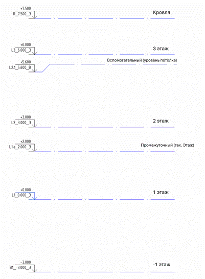

### 6\.2.1.     Схема именования уровней

Таблица 11

| 1 | 2 | 3 | 4 | 5 | 6 |
|---|---|---|---|---|---|
| Префикс | Этаж | Суффикс1 | Корпус/Секция/Блок1 | Отметка | Назначение уровня |
| L | 2 | a | K1 | (Отм.) | В |

*\<1>\<2>\<31>\_\<41>(\<5>)\_\<6>*

Пример: *L2а_К1(3.620)\_В*

1. **Префикс** - определяет, является этаж подземным или надземным.

- «R» - для уровня кровли,
- «L» - для надземных уровней,
- «B» - для подземных,
- «G» - для уровня земли,
- «M» - для уровня головки рельса.

1. **Этаж** - определяет номер этажа, к которому относится данный уровень.

Нумерация этажей выполняется в направлении от поверхности земли:

- для надземных этажей – снизу вверх,
- для подземных - сверху вниз.

В случае, если требуется создание дополнительных промежуточных уровней – после номера этажа должен быть добавлен порядковый номер через точку, если уровень промежуточный: «*L1.1*».

1. **Суффикс1** - Задается латинская буква для обозначения вспомогательного уровня: «*L1a*», «*L1b*», «*L1c*» и т.д.
2. **Корпус/Секция/Блок1** - В случае, если необходимо для каждой секции/корпуса/блока создать свой набор уровней, вводится дополнительное кодирование номера в наименование уровня. Например, «К1», «*B2*», «*С5*».
3. **Отметка** - высотная отметка данного уровня от уровня проектного нуля здания. Указывается в метрах, с точностью до трех знаков. В качестве разделителя использовать точку. Знак "+" для положительных значений не указывается.
4. **Назначение уровня** - пометка, которая отличает проектные уровни (основные и промежуточные) от вспомогательных.

- «*Э*» – основной (уровни, по которым считается этажность здания и по которым формируются планы);
- «*Э*» – промежуточный (уровни, по которым не считается этажность, но формируются планы (антресоли, террасы и т.п.));
- «*В*» – вспомогательный (уровень для дополнительных построений и привязки объектов модели).

1 – Указывается при необходимости.

*Важно!* Именем уровня является *весь набор символов*, состоящий из 4-6 блоков по схеме, включающий в себя: префикс, номер этажа, суффикс2, закодированный номер корпуса/секции2, отметку уровня и постфикс (назначение уровня).

1 – Указывается при необходимости.

2 - Уровень земли для жилых и общественных зданий или уровень головки рельса для объектов метро.

Рисунок 1 - Пример
