## 9\.1.                     Общие требования

Требования к минимальному составу ЦИМ приведены в Таблица 39.

Таблица 39

<table header="row">
  <tr><td rowspan="2">Таблица</td><td rowspan="2">Элемент модели</td><td colspan="4">Этап</td></tr>
  <tr><td>**К**</td><td>**ПД**</td><td>**ТД**</td><td>**РД**</td></tr>
  <tr><td>10\.2</td><td>Стены, перегородки из кладочных материалов</td><td>●</td><td>●</td><td>●</td><td>●</td></tr>
  <tr><td>10\.3</td><td>Перегородки из листовых материалов</td><td>●</td><td>●</td><td>●</td><td>●</td></tr>
  <tr><td>10\.4</td><td>Вентблоки</td><td></td><td>●</td><td>●</td><td>●</td></tr>
  <tr><td>10\.5</td><td>Наружная отделка (фасад), навесная фасадная система</td><td>●</td><td>●</td><td>●</td><td>●</td></tr>
  <tr><td>10\.6</td><td>Элементы фасада: отливы, откосы1</td><td></td><td>●</td><td>●</td><td>●</td></tr>
  <tr><td>10\.7</td><td>Элементы фасада: ламели декоративные, козырьки, карнизы, маркизы, декоративные решетки, вывески1</td><td>●</td><td>●</td><td>●</td><td>●</td></tr>
  <tr><td>10\.7</td><td>Элементы фасада: Корзины для кондиционеров1</td><td></td><td>●</td><td>●</td><td>●</td></tr>
  <tr><td>10\.8</td><td>Элементы фасада: декор и элементы ордера (колонны, пилястры, вазы, скульптуры, замковые камни, молдинги, капители) 1</td><td>●</td><td>●</td><td>●</td><td>●</td></tr>
  <tr><td>10\.9</td><td>Витражи и стеклянные перегородки, световые фонари</td><td>●</td><td>●</td><td>●</td><td>●</td></tr>
  <tr><td>10\.10</td><td>Лестницы</td><td>●</td><td>●</td><td>●</td><td>●</td></tr>
  <tr><td>10\.11</td><td>Ограждения, ограждения лестниц и кровли</td><td></td><td>●</td><td>●</td><td>●</td></tr>
  <tr><td>10\.12</td><td>Кровля</td><td>●</td><td>●</td><td>●</td><td>●</td></tr>
  <tr><td>10\.13</td><td>Крышки парапетов, галтели, дымники и колпаки, зенитные фонари1</td><td>●</td><td>●</td><td>●</td><td>●</td></tr>
  <tr><td>10\.14</td><td>Заполнение проемов: двери, ворота, противопожарные шторы, люки</td><td>●</td><td>●</td><td>●</td><td>●</td></tr>
  <tr><td>10\.15</td><td>Заполнение проемов: окна, балконные блоки, вентиляционные решетки</td><td>●</td><td>●</td><td>●</td><td>●</td></tr>
  <tr><td>10\.16</td><td>Проемы</td><td>●</td><td>●</td><td>●</td><td>●</td></tr>
  <tr><td>10\.17</td><td>Полы</td><td>●</td><td>●</td><td>●</td><td>●</td></tr>
  <tr><td>10\.18</td><td>Плинтус</td><td></td><td>●</td><td>●</td><td>●</td></tr>
  <tr><td>10\.19</td><td>Потолки2</td><td>●</td><td>●</td><td>●</td><td>●</td></tr>
  <tr><td>10\.20</td><td>Отделка стен</td><td></td><td>●</td><td>●</td><td>●</td></tr>
  <tr><td>10\.21</td><td>Отделка потолков3</td><td></td><td>●</td><td>●</td><td>●</td></tr>
  <tr><td>10\.22</td><td>Отделка лестниц, рамп, пандусов</td><td></td><td>●</td><td>●</td><td>●</td></tr>
  <tr><td>10\.23</td><td>Сантехнические приборы, мебель и бытовая техника1</td><td></td><td>●</td><td>●</td><td>●</td></tr>
  <tr><td>10\.24</td><td>Паркинг</td><td>●</td><td>●</td><td>●</td><td>●</td></tr>
  <tr><td>10\.25</td><td>Помещения</td><td>●</td><td>●</td><td>●</td><td>●</td></tr>
  <tr><td>10\.26</td><td>Зоны</td><td>●</td><td>●</td><td>●</td><td>●</td></tr>
  <tr><td>10\.27</td><td>Шахты для инженерных систем</td><td>●</td><td>●</td><td>●</td><td>●</td></tr>
  <tr><td>10\.27</td><td>Отверстия в стенах для инженерных систем</td><td></td><td>●</td><td>●</td><td>●</td></tr>
  <tr><td>10\.28</td><td>Усиление стен и перегородок из штучных материалов: стальные перемычки, фахверки, обрамления и т.д.</td><td></td><td>●</td><td>●</td><td>●</td></tr>
  <tr><td>10\.29</td><td>Транспортное оборудование (лифты, подъемники и подъемники мгн, эскалаторы, траволаторы)</td><td>●</td><td>●</td><td>●</td><td>●</td></tr>
  <tr><td>10\.30</td><td>Система наружного водостока</td><td></td><td>●</td><td>●</td><td>●</td></tr>
  <tr><td>10\.31</td><td>Проезды автомобилей</td><td></td><td>●</td><td>●</td><td>●</td></tr>
  <tr><td>10\.32</td><td>Лестницы пожарные, стремянки, переходные мостики, фальшполы</td><td></td><td>●</td><td>●</td><td>●</td></tr>
  <tr><td>10\.33</td><td>Технико-экономические показатели</td><td>●</td><td>●</td><td>●</td><td>●</td></tr>
  <tr><td></td><td>Навигация, информационные носители</td><td></td><td>●</td><td>●</td><td>●</td></tr>
  <tr><td>\-</td><td>Паркинг: оборудование: колесоотбойники, защита колонн, защита стен и пр. 5</td><td></td><td></td><td></td><td></td></tr>
  <tr><td>\-</td><td>Мусоропровод (Шахта мусоропровода) 6</td><td></td><td></td><td></td><td></td></tr>
  <tr><td>\-</td><td>Конструкции вертикальных и горизонтальных деформационных швов6</td><td></td><td></td><td></td><td></td></tr>
  <tr><td>\-</td><td>Тактильная плитка6</td><td></td><td></td><td></td><td></td></tr>
</table>

1 - Решение о моделировании элементов, не перечисленных в таблице, принимает проектировщик исходя из проектной необходимости.

2 - Потолки – это конструкция, которая является ограничением для прохождения инженерных сетей.

3 - Отделка потолков – тонкий слой штукатурки/покраски, которая не влияет на системы инженерных сетей и строится конкретно для подсчета материалов на этапе РД.

4 - Решение о моделировании элементов, не перечисленных в таблице, принимает проектировщик исходя из проектной необходимости.

5 – Разрабатывается в разделе ТХ.

6 – Не моделируется.

## 9\.2.                     Стены, перегородки из кладочных материалов

### *Требования к моделированию*

Таблица 40

<table header="row">
  <tr><td colspan="4">Инструмент моделирования</td></tr>
  <tr>
    <td colspan="4">
      - Системный инструмент «Стены» инструментом «Стена: архитектурная».
    </td>
  </tr>
  <tr><td colspan="4">Внешний вид</td></tr>
  <tr>
    <td colspan="4">
      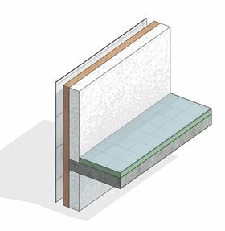
    </td>
  </tr>
  <tr><td colspan="4">Проектируемый объем</td></tr>
  <tr>
    <td rowspan="4">Этап</td>
    <td>**К**</td>
    <td>
      Выполняется:

      - Условное расположение основных кладочных наружных стен и перегородок, а также стен МОПов. Допустимо моделирование одним элементом с послойным разделением.
    </td>
    <td></td>
  </tr>
  <tr>
    <td>**ПД**</td>
    <td>
      Выполняется:

      - Точное расположение всех наружных и внутренних стен и перегородок из кладочных материалов во всех помещениях типовых и уникальных этажей в объеме всего здания, согласно проектным решениям.
      - Все слои толщиной более 5мм моделируются отдельными стенами без деления по слоям.
      - Заполнение основных параметров, необходимых для идентификации элемента.
    </td>
    <td></td>
  </tr>
  <tr>
    <td>**ТД**</td>
    <td>
      Выполняется:

      - Точное расположение всех наружных и внутренних стен и перегородок из кладочных материалов во всех помещениях типовых и уникальных этажей в объеме всего здания, согласно проектным решениям.
      - Все слои толщиной более 5мм моделируются отдельными стенами без деления по слоям.
      - Заполнение параметров необходимых для формирования сводной ведомости объемов работ.
    </td>
    <td></td>
  </tr>
  <tr>
    <td>**РД**</td>
    <td>
      Выполняется:

      - Точное расположение всех наружных и внутренних стен и перегородок из кладочных материалов во всех помещениях типовых и уникальных этажей в объеме всего здания, согласно проектным решениям.
      - Все слои толщиной более 5мм моделируются отдельными стенами без деления по слоям.
      - Заполнение всех параметров, необходимых для формирования спецификаций и ведомостей элементов в рабочей документации.
    </td>
    <td></td>
  </tr>
  <tr><td colspan="4">Примечание</td></tr>
  <tr>
    <td colspan="4">
      - Всем слоям должна быть назначена корректная функция.
      - Стены должны быть разделены по этажам.
      - Стены должны иметь корректные привязки к уровням.
      - Свободные торцы стен должны быть отсоединены.
      - Несущие стены КР могут присутствовать в архитектурной модели только как имитационные элементы, в точности повторяющие, размещенные в конструктивной модели. Имитация служит для размещения в них дверей и окон, подрезки стен для выреза под балки и должна быть невидимой на виде Navisworks и находится в отдельном Рабочем наборе (Имя такого РН рекомендуется задать: «(50)\_Имитация»). Данные имитационные элементы не участвуют в подсчетах ВОР, а также в экспорте моделей в NWC/IFC.
      - Моделирование основных слоев: основа, отделка – должно выполняться из отдельных элементов, кроме оговоренных на этапе проектирования. Допускается моделирование структуры слоев в составе стены укрупненно с подробным описанием состава стены/перегородки в параметре G_Состав конструкции.
      - В составе многослойной стены допускается включение слоев отделки на этапах в соответствии с таблицей параметризации
    </td>
  </tr>
  <tr><td colspan="4">Запрещенные действия</td></tr>
  <tr>
    <td colspan="4">
      - Использование инструмента «Составная стена».
      - Использование многослойных стен на этапах, когда многослойность не допускается.
      - Использование инструмента «Присоединить верх/основание» (за исключением случаев примыкания к низу лестничных маршей, рамп и кровель сложной формы).
      - Моделирование стен через несколько этажей, в случае если это не обусловлено проектной идеей.
      - Размещение стен со свободным торцом без отсоединения.
      - Некорректное использование функций слоев.
      - Использование инструмента «Редактировать профиль» для создания проема или отверстия.
      - Использование инструмента «Модель в контексте» категории Стены, кроме случаев фасадного декора сложной формы.
      - Разработка элементов модели участвующих в оформлении документации в рабочих наборах начинающихся с «(50)\_»
    </td>
  </tr>
</table>

### *Требования к параметризации*

Таблица 41

<table header="row">
  <tr><td colspan="2" rowspan="2">Атрибут</td><td colspan="4">Этап</td><td rowspan="2">Пример заполнения</td></tr>
  <tr><td>К</td><td>ПД</td><td>ТД</td><td>РД</td></tr>
  <tr><td colspan="7">Уровень геометрической проработки модели</td></tr>
  <tr><td rowspan="8">Геометрия</td><td>Условные габариты</td><td>●</td><td></td><td></td><td></td><td></td></tr>
  <tr><td>Точные габариты</td><td></td><td>●</td><td>●</td><td>●</td><td></td></tr>
  <tr><td>Условное расположение</td><td>●</td><td></td><td></td><td></td><td></td></tr>
  <tr><td>Точное расположение</td><td></td><td>●</td><td>●</td><td>●</td><td></td></tr>
  <tr><td>Внешний образ/вид</td><td>●</td><td>●</td><td>●</td><td>●</td><td></td></tr>
  <tr><td>Многослойная структура4</td><td>●</td><td></td><td></td><td></td><td></td></tr>
  <tr><td>Слои в виде отдельных стен4</td><td></td><td>●</td><td>●</td><td>●</td><td></td></tr>
  <tr><td>Материалы2</td><td></td><td>●</td><td>●</td><td>●</td><td></td></tr>
  <tr><td colspan="7">Уровень проработки атрибутивной информации</td></tr>
  <tr><td rowspan="5">Размеры</td><td>Длина</td><td></td><td>●</td><td>●</td><td>●</td><td>3000 мм</td></tr>
  <tr><td>Толщина</td><td></td><td>●</td><td>●</td><td>●</td><td>250 мм</td></tr>
  <tr><td>Неприсоединенная высота</td><td></td><td>●</td><td>●</td><td>●</td><td>3000 мм</td></tr>
  <tr><td>Площадь</td><td></td><td>●</td><td>●</td><td>●</td><td>9,0 м²</td></tr>
  <tr><td>Объем</td><td></td><td>●</td><td>●</td><td>●</td><td>2,25 м³</td></tr>
  <tr><td rowspan="3">Идентификация</td><td>Описание</td><td></td><td></td><td>●</td><td>●</td><td>Перегородка из газосиликатных блоков D500 100х250х600</td></tr>
  <tr><td>G_Состав конструкции4</td><td></td><td>●</td><td>●</td><td>●</td><td>Блоки газосиликатные D500 − 100 мм</td></tr>
  <tr><td>ADSK_Предел огнестойкости1</td><td></td><td>●</td><td>●</td><td>●</td><td>REI 45; EI 45</td></tr>
  <tr><td>Маркировка</td><td>ADSK_Марка</td><td></td><td></td><td></td><td>●</td><td>СТ-1</td></tr>
  <tr><td rowspan="2">Ресурсы</td><td>ADSK_Единица измерения</td><td></td><td>●</td><td>●</td><td>●</td><td>м2</td></tr>
  <tr><td>ADSK_Завод-изготовитель1</td><td></td><td></td><td></td><td>●</td><td>Россия</td></tr>
  <tr><td rowspan="3">Положение</td><td>ADSK_Номер здания</td><td></td><td>●</td><td>●</td><td>●</td><td>Строение 1</td></tr>
  <tr><td>ADSK_Этаж</td><td></td><td>●</td><td>●</td><td>●</td><td>2</td></tr>
  <tr><td>ADSK_Номер секции</td><td></td><td>●</td><td>●</td><td>●</td><td>3</td></tr>
  <tr><td>Прочее</td><td>ADSK_Комплект чертежей3</td><td></td><td></td><td></td><td>●</td><td>АР1</td></tr>
</table>

1 - Заполняется только у элементов, для которых явное указание требуется, согласно проектным решениям.

2 - Всем элементам (каждому отдельному слою) должен быть назначен конкретный материал из библиотеки материалов.

3 - Заполняется если из модели выпускается несколько комплектов документации.

4 - Многослойное моделирование стен – моделирование одной стеной слоев с различным функциональным назначением: основа, черновая отделка, чистовая отделка и т.д. Моделирование отдельной стеной – экземпляр стены соответствует одному назначению (основа, отделка).

## 9\.3.                     Перегородки из листовых материалов

### *Требования к моделированию*

Таблица 42

<table header="row">
  <tr><td colspan="4">Инструмент моделирования</td></tr>
  <tr>
    <td colspan="4">
      - Системный инструмент «Стены» инструментом «Стена: архитектурная».
    </td>
  </tr>
  <tr><td colspan="4">Внешний вид</td></tr>
  <tr>
    <td colspan="4">
      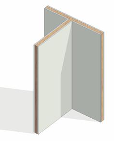
    </td>
  </tr>
  <tr><td colspan="4">Проектируемый объем</td></tr>
  <tr><td rowspan="4">Этап</td><td>К</td><td>Не моделируется.</td><td></td></tr>
  <tr>
    <td>ПД</td>
    <td>
      Выполняется:

      - Условное расположение всех внутренних перегородок из листовых материалов во всех помещениях типовых и уникальных этажей в объеме всего здания, согласно проектным решениям.
      - Заполнение основных параметров, необходимых для идентификации элемента.
    </td>
    <td></td>
  </tr>
  <tr>
    <td>ТД</td>
    <td>
      Выполняется:

      - Точное расположение всех внутренних перегородок из листовых материалов многослойной стеной с разделением на слои во всех помещениях типовых и уникальных этажей в объеме всего здания, согласно проектным решениям. При этом допускается моделирование однослойной стеной.
      - Заполнение параметров необходимых для формирования сводной ведомости объемов работ.
    </td>
    <td></td>
  </tr>
  <tr>
    <td>РД</td>
    <td>
      Выполняется:

      - Точное расположение всех внутренних перегородок из листовых материалов многослойной стеной с разделением на слои во всех помещениях типовых и уникальных этажей в объеме всего здания, согласно проектным решениям. При этом допускается моделирование однослойной стеной.
      - Заполнение всех параметров, необходимых для формирования спецификаций и ведомостей элементов в рабочей документации.
    </td>
    <td></td>
  </tr>
  <tr><td colspan="4">Примечание</td></tr>
  <tr>
    <td colspan="4">
      - Всем слоям должна быть назначена корректная функция.
      - Стены должны быть разделены по этажам.
      - Стены должны иметь корректные привязки к уровням.
      - Свободные торцы стен должны быть отсоединены.
      - Моделирование основных слоев: основа, отделка – должно выполняться из отдельных элементов, кроме оговоренных на этапе проектирования. Допускается моделирование структуры слоев в составе стены укрупненно с подробным описанием состава стены/перегородки в параметре G_Состав конструкции.
      - В составе многослойной стены допускается включение слоев отделки на этапах в соответствии с таблицей параметризации
      - В составе многослойной стены допускается включение слоев отделки на этапах в соответствии с таблицей параметризации.
    </td>
  </tr>
  <tr><td colspan="4">Запрещенные действия</td></tr>
  <tr>
    <td colspan="4">
      - Использование инструмента «Составная стена».
      - Моделирование отдельными стенами каждого слоя каркасно-обшивной конструкции.
      - Использование инструмента «Присоединить верх/основание» (за исключением случаев примыкания к низу лестничных маршей, рамп и кровель сложной формы).
      - Моделирование стен через несколько этажей, в случае если это не обусловлено проектной идеей.
      - Размещение стен со свободным торцом без отсоединения.
      - Некорректное использование функций слоев.
      - Использование инструмента «Редактировать профиль» для создания проема или отверстия.
      - Использование инструмента «Модель в контексте» категории Стены.
      - Разработка элементов модели участвующих в оформлении документации в рабочих наборах начинающихся с «(50)\_»
    </td>
  </tr>
</table>

### *Требования к параметризации*

Таблица 43

<table header="row">
  <tr><td colspan="2" rowspan="2">Атрибут</td><td colspan="4">Этап</td><td rowspan="2">Пример заполнения</td></tr>
  <tr><td>К</td><td>ПД</td><td>ТД</td><td>РД</td></tr>
  <tr><td colspan="7">Уровень геометрической проработки модели</td></tr>
  <tr><td rowspan="8">Геометрия</td><td>Условные габариты</td><td>●</td><td>●</td><td></td><td></td><td></td></tr>
  <tr><td>Точные габариты</td><td></td><td></td><td>●</td><td>●</td><td></td></tr>
  <tr><td>Условное расположение</td><td>●</td><td>●</td><td></td><td></td><td></td></tr>
  <tr><td>Точное расположение</td><td></td><td></td><td>●</td><td>●</td><td></td></tr>
  <tr><td>Внешний образ/вид</td><td>●</td><td>●</td><td>●</td><td>●</td><td></td></tr>
  <tr><td>Многослойная структура 4</td><td>●</td><td></td><td></td><td></td><td></td></tr>
  <tr><td>Слои в виде отдельных стен4</td><td></td><td>●</td><td>●</td><td>●</td><td></td></tr>
  <tr><td>Материалы2</td><td></td><td>●</td><td>●</td><td>●</td><td></td></tr>
  <tr><td colspan="7">Уровень проработки атрибутивной информации</td></tr>
  <tr><td rowspan="5">Размеры</td><td>Длина</td><td></td><td>●</td><td>●</td><td>●</td><td>3000 мм</td></tr>
  <tr><td>Толщина/ADSK_Размер_Толщина</td><td></td><td>●</td><td>●</td><td>●</td><td>100 мм</td></tr>
  <tr><td>Неприсоединенная высота</td><td></td><td>●</td><td>●</td><td>●</td><td>3000 мм</td></tr>
  <tr><td>Площадь</td><td></td><td>●</td><td>●</td><td>●</td><td>9,0 м²</td></tr>
  <tr><td>Объем</td><td></td><td>●</td><td>●</td><td>●</td><td>0,9 м³</td></tr>
  <tr><td rowspan="3">Идентификация</td><td>Описание</td><td></td><td></td><td>●</td><td>●</td><td>Перегородка с двухслойными обшивками из влагостойкого гипсокартона на двойном КНАУФ-профиле.</td></tr>
  <tr>
    <td>G_Состав конструкции4</td>
    <td></td>
    <td>●</td>
    <td>●</td>
    <td>●</td>
    <td>
      1\. Гипсокартон 2 слоя − 25 мм

      2\. Базальтовый утеплитель между стоек – 50 мм

      3\. Гипсокартон 2 слоя − 25 мм
    </td>
  </tr>
  <tr><td>ADSK_Предел огнестойкости1</td><td></td><td>●</td><td>●</td><td>●</td><td>EI 60</td></tr>
  <tr><td>Маркировка</td><td>ADSK_Марка</td><td></td><td></td><td></td><td>●</td><td>П-12</td></tr>
  <tr><td rowspan="2">Ресурсы</td><td>ADSK_Единица измерения1</td><td></td><td>●</td><td>●</td><td>●</td><td>м2</td></tr>
  <tr><td>ADSK_Завод-изготовитель1</td><td></td><td></td><td></td><td>●</td><td>Knauf</td></tr>
  <tr><td rowspan="3">Положение</td><td>ADSK_Номер здания</td><td></td><td>●</td><td>●</td><td>●</td><td>Строение 1</td></tr>
  <tr><td>ADSK_Этаж</td><td></td><td>●</td><td>●</td><td>●</td><td>2</td></tr>
  <tr><td>ADSK_Номер секции</td><td></td><td>●</td><td>●</td><td>●</td><td>3</td></tr>
  <tr><td>Прочее</td><td>ADSK_Комплект чертежей3</td><td></td><td></td><td></td><td>●</td><td>АР1</td></tr>
</table>

1 - Заполняется только у элементов, для которых явное указание требуется, согласно проектным решениям.

2 - Всем элементам (каждому отдельному слою) должен быть назначен конкретный материал из библиотеки материалов.

3 - Заполняется если из модели выпускается несколько комплектов документации.

4 - Многослойное моделирование стен – моделирование одной стеной слоев с различным функциональным назначением: основа, черновая отделка, чистовая отделка и тд. Моделирование отдельной стеной – экземпляр стены соответствует одному назначению (основа, отделка). Каркас не моделируется.

## 9\.4. Вентблоки

### *Требования к моделированию*

Таблица 44

<table header="row">
  <tr><td colspan="4">Инструмент моделирования</td></tr>
  <tr>
    <td colspan="4">
      - «Обобщённая модель»
      - «Специальное оборудование»
      - «Колонна»
    </td>
  </tr>
  <tr><td colspan="4">Внешний вид</td></tr>
  <tr>
    <td colspan="4">
      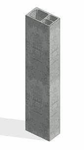
    </td>
  </tr>
  <tr><td colspan="4">Проектируемый объем</td></tr>
  <tr><td rowspan="4">Этап</td><td>К</td><td>Не моделируется.</td><td></td></tr>
  <tr>
    <td>ПД</td>
    <td>
      Выполняется:

      - Расстановка в точных габаритах и с точным расположением на типовых и уникальных этажах в объеме всего здания, согласно проектным решениям.
      - Заполнение основных параметров, необходимых для идентификации элемента.
    </td>
    <td></td>
  </tr>
  <tr>
    <td>ТД</td>
    <td>
      Выполняется:

      - Расстановка в точных габаритах и с точным расположением на типовых и уникальных этажах в объеме всего здания, согласно проектным решениям.
      - Заполнение параметров необходимых для формирования сводной ведомости объемов работ.
    </td>
    <td></td>
  </tr>
  <tr>
    <td>РД</td>
    <td>
      Выполняется:

      - Расстановка в точных габаритах и с точным расположением на типовых и уникальных этажах в объеме всего здания, согласно проектным решениям.
      - Заполнение всех параметров, необходимых для формирования спецификаций и ведомостей элементов в рабочей документации.
    </td>
    <td></td>
  </tr>
  <tr><td colspan="4">Примечание</td></tr>
  <tr>
    <td colspan="4">
      - \-
    </td>
  </tr>
  <tr><td colspan="4">Запрещенные действия</td></tr>
  <tr>
    <td colspan="4">
      - Разработка элементов модели участвующих в оформлении документации в рабочих наборах начинающихся с «(50)\_»
    </td>
  </tr>
</table>

### *Требования к параметризации*

Таблица 45

<table header="row">
  <tr><td colspan="2" rowspan="2">Атрибут</td><td colspan="4">Этап</td><td rowspan="2">Пример заполнения</td></tr>
  <tr><td>К</td><td>ПД</td><td>ТД</td><td>РД</td></tr>
  <tr><td colspan="7">Уровень геометрической проработки модели</td></tr>
  <tr><td rowspan="4">Геометрия</td><td>Точные габариты</td><td></td><td>●</td><td>●</td><td>●</td><td></td></tr>
  <tr><td>Точное расположение</td><td></td><td>●</td><td>●</td><td>●</td><td></td></tr>
  <tr><td>Внешний образ/вид</td><td></td><td>●</td><td>●</td><td>●</td><td></td></tr>
  <tr><td>Материалы2</td><td></td><td>●</td><td>●</td><td>●</td><td></td></tr>
  <tr><td colspan="7">Уровень проработки атрибутивной информации</td></tr>
  <tr><td rowspan="4">Размеры</td><td>ADSK_Размер_Высота</td><td></td><td>●</td><td>●</td><td>●</td><td>3000 мм</td></tr>
  <tr><td>ADSK_Размер_Ширина</td><td></td><td>●</td><td>●</td><td>●</td><td>800 мм</td></tr>
  <tr><td>ADSK_Размер_Глубина</td><td></td><td>●</td><td>●</td><td>●</td><td>400 мм</td></tr>
  <tr><td>Объем</td><td></td><td></td><td>●</td><td>●</td><td>0,96 м³</td></tr>
  <tr><td rowspan="2">Идентификация</td><td>Описание</td><td></td><td></td><td>●</td><td>●</td><td>Вентблок</td></tr>
  <tr><td>ADSK_Предел огнестойкости1</td><td></td><td>●</td><td>●</td><td>●</td><td>EI 30</td></tr>
  <tr><td>Маркировка</td><td>ADSK_Марка</td><td></td><td></td><td></td><td>●</td><td>ВБ-11</td></tr>
  <tr><td rowspan="2">Ресурсы</td><td>ADSK_Единица измерения1</td><td></td><td>●</td><td>●</td><td>●</td><td>Шт.</td></tr>
  <tr><td>ADSK_Завод-изготовитель1</td><td></td><td></td><td></td><td>●</td><td>Россия</td></tr>
  <tr><td rowspan="3">Положение</td><td>ADSK_Номер здания</td><td></td><td>●</td><td>●</td><td>●</td><td>Строение 1</td></tr>
  <tr><td>ADSK_Этаж</td><td></td><td>●</td><td>●</td><td>●</td><td>2</td></tr>
  <tr><td>ADSK_Номер секции</td><td></td><td>●</td><td>●</td><td>●</td><td>3</td></tr>
  <tr><td>Прочее</td><td>ADSK_Комплект чертежей3</td><td></td><td></td><td></td><td>●</td><td>АР1</td></tr>
</table>

1 - Заполняется только у элементов, для которых явное указание требуется, согласно проектным решениям.

2 - Всем элементам (каждому отдельному слою) должен быть назначен конкретный материал из библиотеки материалов.

3 - Заполняется если из модели выпускается несколько комплектов документации.

## 9\.5. Наружная отделка (фасад), навесная фасадная система.

### *Требования к моделированию*

Таблица 46

<table header="row">
  <tr><td colspan="4">Инструмент моделирования</td></tr>
  <tr>
    <td colspan="4">
      Вертикальные элементы:

      - Cистемный инструмент «Стена: архитектурная»
      - Cистемный инструмент «Стена: Витраж»

      Горизонтальные элементы:

      - Системный инструмент «Перекрытие: архитектурное»
      - Cистемный инструмент «Кровля»
    </td>
  </tr>
  <tr><td colspan="4">Внешний вид</td></tr>
  <tr>
    <td colspan="4">
      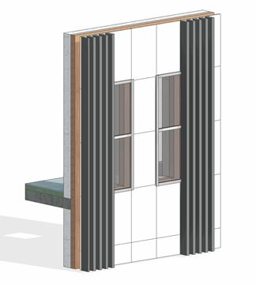
    </td>
  </tr>
  <tr><td colspan="4">Проектируемый объем</td></tr>
  <tr><td rowspan="4">Этап</td><td>К</td><td>Проработка основной идеи фасада, согласно архитектурной задумке.</td><td></td></tr>
  <tr>
    <td>ПД</td>
    <td>
      Выполняется:

      - Моделирование фасада, согласно архитектурной задумке по всем типовым и уникальным этажам.
      - Навесной фасад моделируется отдельным элементом.
      - Заполнение основных параметров, необходимых для идентификации элемента.
    </td>
    <td></td>
  </tr>
  <tr>
    <td>ТД</td>
    <td>
      Выполняется:

      - Моделирование фасада, согласно архитектурной задумке по всем типовым и уникальным этажам.
      - Навесной фасад моделируется отдельным элементом.
      - Заполнение параметров, необходимых для формирования сводной ведомости объемов работ.
    </td>
    <td></td>
  </tr>
  <tr>
    <td>РД</td>
    <td>
      Выполняется:

      - Моделирование фасада, согласно архитектурной задумке по всем типовым и уникальным этажам.
      - Навесной фасад моделируется отдельным элементом.
      - Заполнение всех параметров, необходимых для формирования спецификаций и ведомостей элементов в рабочей документации.
    </td>
    <td></td>
  </tr>
  <tr><td colspan="4">Примечание</td></tr>
  <tr>
    <td colspan="4">
      - Всем слоям должна быть назначена корректная функция.
      - Моделирование основных слоев: основа, утеплитель, финишная отделка – должно выполняться из отдельных элементов. Допускается моделирование финишного покрытия в составе фасадной стены совместно с утеплителем на стадии 3D-концепции, стена-основа должна моделироваться отдельной стеной.
      - Допускается укрупненное моделирование слоев в структуре стены при условии заполнения подробного состава структуры в параметр G_Состав конструкции.
      - Система каркаса: кронштейны, направляющие, металлический каркас не моделируется
    </td>
  </tr>
  <tr><td colspan="4">Запрещенные действия</td></tr>
  <tr>
    <td colspan="4">
      - Использование инструмента «Составная стена».
      - Использование многослойных стен на этапах, когда многослойность не допускается.
      - Использование инструмента «Присоединить верх/основание» (за исключением случаев примыкания к низу лестничных маршей, рамп и кровель сложной формы).
      - Моделирование стен через несколько этажей, в случае если это не обусловлено проектной идеей.
      - Размещение стен со свободным торцом без отсоединения.
      - Некорректное использование функций слоев.
      - Использование инструмента «Редактировать профиль» для создания проема или отверстия.
      - Использование инструмента «Модель в контексте» категории Стены, кроме случаев фасадного декора сложной формы.
      - Разработка элементов модели участвующих в оформлении документации в рабочих наборах начинающихся с «(50)\_»
    </td>
  </tr>
</table>

### *Требования к параметризации*

Таблица 47

<table header="row">
  <tr><td colspan="2" rowspan="2">Атрибут</td><td colspan="4">Этап</td><td rowspan="2">Пример заполнения</td></tr>
  <tr><td>К</td><td>ПД</td><td>ТД</td><td>РД</td></tr>
  <tr><td colspan="7">Уровень геометрической проработки модели</td></tr>
  <tr><td rowspan="7">Геометрия</td><td>Условные габариты</td><td>●</td><td>●</td><td></td><td></td><td></td></tr>
  <tr><td>Точные габариты</td><td></td><td></td><td>●</td><td>●</td><td></td></tr>
  <tr><td>Условное расположение</td><td>●</td><td>●</td><td></td><td></td><td></td></tr>
  <tr><td>Точное расположение</td><td></td><td></td><td>●</td><td>●</td><td></td></tr>
  <tr><td>Внешний образ/вид4</td><td>●</td><td>●</td><td>●</td><td>●</td><td></td></tr>
  <tr><td>Материалы2</td><td></td><td>●</td><td>●</td><td>●</td><td></td></tr>
  <tr><td>Система каркаса5</td><td></td><td></td><td></td><td></td><td></td></tr>
  <tr><td colspan="7">Уровень проработки атрибутивной информации</td></tr>
  <tr><td rowspan="5">Размеры</td><td>Площадь / ADSK_Размер_Площадь</td><td></td><td>●</td><td>●</td><td>●</td><td>120,0 м²</td></tr>
  <tr><td>Длина / ADSK_Размер_Длина</td><td></td><td>●</td><td>●</td><td>●</td><td>2000 мм</td></tr>
  <tr><td>Высота / ADSK_Размер_Высота</td><td></td><td>●</td><td>●</td><td>●</td><td>3500 мм</td></tr>
  <tr><td>Толщина / ADSK_Размер_Толщина</td><td></td><td>●</td><td>●</td><td>●</td><td>120 мм</td></tr>
  <tr><td>Объем</td><td></td><td>●</td><td>●</td><td>●</td><td>1,01 м³</td></tr>
  <tr><td rowspan="3">Идентификация</td><td>Описание</td><td></td><td></td><td>●</td><td>●</td><td>Фасадный кирпич</td></tr>
  <tr><td>G_Состав конструкции4</td><td></td><td>●</td><td>●</td><td>●</td><td></td></tr>
  <tr><td>ADSK_Предел огнестойкости1</td><td></td><td>●</td><td>●</td><td>●</td><td>REI 45; EI 45</td></tr>
  <tr><td>Маркировка</td><td>ADSK_Марка</td><td></td><td></td><td></td><td>●</td><td>ПД-1</td></tr>
  <tr><td rowspan="2">Ресурсы</td><td>ADSK_Единица измерения1</td><td></td><td>●</td><td>●</td><td>●</td><td>м²</td></tr>
  <tr><td>ADSK_Завод-изготовитель1</td><td></td><td></td><td></td><td>●</td><td>Россия</td></tr>
  <tr><td rowspan="3">Положение</td><td>ADSK_Номер здания</td><td></td><td>●</td><td>●</td><td>●</td><td>Строение 1</td></tr>
  <tr><td>ADSK_Этаж</td><td></td><td>●</td><td>●</td><td>●</td><td>2</td></tr>
  <tr><td>ADSK_Номер секции</td><td></td><td>●</td><td>●</td><td>●</td><td>3</td></tr>
  <tr><td>Прочее</td><td>ADSK_Комплект чертежей3</td><td></td><td></td><td></td><td>●</td><td>АР1</td></tr>
</table>

1 - Заполняется только у элементов, для которых явное указание требуется, согласно проектным решениям.

2 - Всем элементам (каждому отдельному слою) должен быть назначен конкретный материал из библиотеки материалов.

3 - Заполняется если из модели выпускается несколько комплектов документации.

4 - Многослойная стена приемлема только для штукатурных фасадов.

5 – Система каркаса: кронштейны, направляющие, металлический каркас не моделируется.

## 9\.6. Элементы фасада: отливы, откосы

### Требования к моделированию

Таблица 48

<table header="row">
  <tr><td colspan="4">Инструмент моделирования</td></tr>
  <tr>
    <td colspan="4">
      - «Обобщенные модели» с указанием пользовательской подкатегории «Фасад»
    </td>
  </tr>
  <tr><td colspan="4">Внешний вид</td></tr>
  <tr>
    <td colspan="4">
      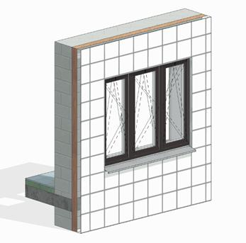
    </td>
  </tr>
  <tr><td colspan="4">Проектируемый объем</td></tr>
  <tr><td rowspan="4">Этап</td><td>К</td><td>Не моделируется.</td><td></td></tr>
  <tr>
    <td>ПД</td>
    <td>
      Выполняется:

      - Условное моделирование по всем фасаду, согласно архитектурной задумке по всем типовым и уникальным этажам.
      - Заполнение основных параметров, необходимых для идентификации элемента.
    </td>
    <td></td>
  </tr>
  <tr>
    <td>ТД</td>
    <td>
      Выполняется:

      - Моделируется в точном расположении и габаритах по всему фасаду, согласно архитектурной задумке по всем типовым и уникальным этажам.
      - Заполнение параметров, необходимых для формирования сводной ведомости объемов работ.
    </td>
    <td></td>
  </tr>
  <tr>
    <td>РД</td>
    <td>
      Выполняется:

      - Моделируется в точном расположении и габаритах по всему фасаду, согласно архитектурной задумке по всем типовым и уникальным этажам.
      - Заполнение всех параметров, необходимых для формирования спецификаций и ведомостей элементов в рабочей документации.
    </td>
    <td></td>
  </tr>
  <tr><td colspan="4">Примечание</td></tr>
  <tr><td colspan="4">Моделирование фасада должно быть выполнено с учетом пластики фасадных решений.</td></tr>
  <tr><td colspan="4">Запрещенные действия</td></tr>
  <tr><td colspan="4">Разработка элементов модели участвующих в оформлении документации в рабочих наборах начинающихся с «(50)\_»</td></tr>
</table>

### Требования к параметризации

Таблица 49

<table header="row">
  <tr><td colspan="2" rowspan="2">Атрибут</td><td colspan="4">Этап</td><td rowspan="2">Пример заполнения</td></tr>
  <tr><td>К</td><td>ПД</td><td>ТД</td><td>РД</td></tr>
  <tr><td colspan="7">Уровень геометрической проработки модели</td></tr>
  <tr><td rowspan="6">Геометрия</td><td>Условные габариты</td><td></td><td>●</td><td></td><td></td><td></td></tr>
  <tr><td>Точные габариты</td><td></td><td></td><td>●</td><td>●</td><td></td></tr>
  <tr><td>Условное расположение</td><td></td><td>●</td><td></td><td></td><td></td></tr>
  <tr><td>Точное расположение</td><td></td><td></td><td>●</td><td>●</td><td></td></tr>
  <tr><td>Внешний образ/вид</td><td></td><td>●</td><td>●</td><td>●</td><td></td></tr>
  <tr><td>Материалы2</td><td></td><td>●</td><td>●</td><td>●</td><td></td></tr>
  <tr><td colspan="7">Уровень проработки атрибутивной информации</td></tr>
  <tr><td rowspan="3">Размеры</td><td>ADSK_Размер_Высота</td><td></td><td>●</td><td>●</td><td>●</td><td>1800 мм</td></tr>
  <tr><td>ADSK_Размер_Ширина</td><td></td><td>●</td><td>●</td><td>●</td><td>2000 мм</td></tr>
  <tr><td>ADSK_Размер_Глубина / ADSK_Размер_Толщина</td><td></td><td>●</td><td>●</td><td>●</td><td>300 мм</td></tr>
  <tr><td rowspan="3">Идентификация</td><td>Описание</td><td></td><td></td><td>●</td><td>●</td><td>Отлив</td></tr>
  <tr><td>ADSK_Обозначение</td><td></td><td></td><td>●</td><td>●</td><td>ГОСТ 977-88</td></tr>
  <tr><td>ADSK_Наименование</td><td></td><td></td><td>●</td><td>●</td><td>20ФЛ</td></tr>
  <tr><td>Маркировка</td><td>ADSK_Марка</td><td></td><td></td><td></td><td>●</td><td>К-24</td></tr>
  <tr><td rowspan="3">Ресурсы</td><td>ADSK_Единица измерения1</td><td></td><td>●</td><td>●</td><td>●</td><td>шт.</td></tr>
  <tr><td>ADSK_Завод-изготовитель1</td><td></td><td></td><td></td><td>●</td><td>Россия</td></tr>
  <tr><td>ADSK_Количество</td><td></td><td>●</td><td>●</td><td>●</td><td>5</td></tr>
  <tr><td rowspan="3">Положение</td><td>ADSK_Номер здания</td><td></td><td>●</td><td>●</td><td>●</td><td>Строение 1</td></tr>
  <tr><td>ADSK_Этаж</td><td></td><td>●</td><td>●</td><td>●</td><td>2</td></tr>
  <tr><td>ADSK_Номер секции</td><td></td><td>●</td><td>●</td><td>●</td><td>3</td></tr>
  <tr><td>Прочее</td><td>ADSK_Комплект чертежей3</td><td></td><td></td><td></td><td>●</td><td>АР1</td></tr>
</table>

1 - Заполняется только у элементов, для которых явное указание требуется, согласно проектным решениям.

2 - Всем элементам (каждому отдельному слою) должен быть назначен конкретный материал из библиотеки материалов.

3 - Заполняется если из модели выпускается несколько комплектов документации.

## 9\.7. Корзины для кондиционеров, козырьки, вывески

### *Требования к моделированию*

Таблица 50

<table header="row">
  <tr><td colspan="4">Инструмент моделирования</td></tr>
  <tr>
    <td colspan="4">
      - «Обобщенные модели»
      - «Каркас несущий»
    </td>
  </tr>
  <tr><td colspan="4">Вывески могут моделироваться инструментом «Модель в контексте»</td></tr>
  <tr><td colspan="4">Внешний вид</td></tr>
  <tr>
    <td colspan="4">
      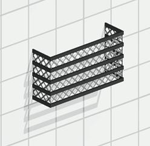
    </td>
  </tr>
  <tr><td colspan="4">Проектируемый объем</td></tr>
  <tr>
    <td rowspan="4">Этап</td>
    <td>К</td>
    <td>
      Выполняется:

      - Условное моделирование для формирования архитектурного облика по всему фасаду.
    </td>
    <td></td>
  </tr>
  <tr>
    <td>ПД</td>
    <td>
      Выполняется:

      - Условное моделирование по всему фасаду, согласно архитектурной задумке по всем типовым и уникальным этажам.
      - Заполнение основных параметров, необходимых для идентификации элемента.
    </td>
    <td></td>
  </tr>
  <tr>
    <td>ТД</td>
    <td>
      Выполняется:

      - Моделируется в точном расположении и габаритах по всему фасаду, согласно архитектурной задумке по всем типовым и уникальным этажам.
      - Заполнение параметров, необходимых для формирования сводной ведомости объемов работ.
    </td>
    <td></td>
  </tr>
  <tr>
    <td>РД</td>
    <td>
      Выполняется:

      - Моделируется в точном расположении и габаритах по всему фасаду, согласно архитектурной задумке по всем типовым и уникальным этажам.
      - Заполнение всех параметров, необходимых для формирования спецификаций и ведомостей элементов в рабочей документации.
    </td>
    <td></td>
  </tr>
  <tr><td colspan="4">Примечание</td></tr>
  <tr>
    <td colspan="4">
      - \-
    </td>
  </tr>
  <tr><td colspan="4">Запрещенные действия</td></tr>
  <tr>
    <td colspan="4">
      - Разработка элементов модели участвующих в оформлении документации в рабочих наборах начинающихся с «(50)\_»
    </td>
  </tr>
</table>

### *Требования к параметризации*

Таблица 51

<table header="row">
  <tr><td colspan="2" rowspan="2">Атрибут</td><td colspan="4">Этап</td><td rowspan="2">Пример заполнения</td></tr>
  <tr><td>К</td><td>ПД</td><td>ТД</td><td>РД</td></tr>
  <tr><td colspan="7">Уровень геометрической проработки модели</td></tr>
  <tr><td rowspan="6">Геометрия</td><td>Условные габариты</td><td>●</td><td>●</td><td></td><td></td><td></td></tr>
  <tr><td>Точные габариты</td><td></td><td></td><td>●</td><td>●</td><td></td></tr>
  <tr><td>Условное расположение</td><td>●</td><td>●</td><td></td><td></td><td></td></tr>
  <tr><td>Точное расположение</td><td></td><td></td><td>●</td><td>●</td><td></td></tr>
  <tr><td>Внешний образ/вид</td><td>●</td><td>●</td><td>●</td><td>●</td><td></td></tr>
  <tr><td>Материалы2</td><td>●</td><td>●</td><td>●</td><td>●</td><td></td></tr>
  <tr><td colspan="7">Уровень проработки атрибутивной информации</td></tr>
  <tr><td rowspan="3">Размеры</td><td>ADSK_Размер_Глубина / ADSK_Размер_Толщина</td><td></td><td>●</td><td>●</td><td>●</td><td>300 мм</td></tr>
  <tr><td>ADSK_Размер_Ширина</td><td></td><td>●</td><td>●</td><td>●</td><td>1540 мм</td></tr>
  <tr><td>ADSK_Размер_Высота</td><td></td><td>●</td><td>●</td><td>●</td><td>670 мм</td></tr>
  <tr><td rowspan="2">Идентификация</td><td>Описание</td><td></td><td></td><td>●</td><td>●</td><td>Корзина для кондиционера</td></tr>
  <tr><td>ADSK_Наименование</td><td></td><td></td><td>●</td><td>●</td><td>По ГОСТ</td></tr>
  <tr><td>Маркировка</td><td>ADSK_Марка</td><td></td><td></td><td></td><td>●</td><td>ККД-1</td></tr>
  <tr><td rowspan="2">Ресурсы</td><td>ADSK_Единица измерения1</td><td></td><td>●</td><td>●</td><td>●</td><td>шт</td></tr>
  <tr><td>ADSK_Завод-изготовитель1</td><td></td><td></td><td></td><td>●</td><td>Россия</td></tr>
  <tr><td rowspan="3">Положение</td><td>ADSK_Номер здания</td><td></td><td>●</td><td>●</td><td>●</td><td>Строение 1</td></tr>
  <tr><td>ADSK_Этаж</td><td></td><td>●</td><td>●</td><td>●</td><td>3</td></tr>
  <tr><td>ADSK_Номер секции</td><td></td><td>●</td><td>●</td><td>●</td><td>К1</td></tr>
  <tr><td>Прочее</td><td>ADSK_Комплект чертежей3</td><td></td><td></td><td></td><td>●</td><td>АР1</td></tr>
</table>

1 - Заполняется только у элементов, для которых явное указание требуется, согласно проектным решениям.

2 - Всем элементам (каждому отдельному слою) должен быть назначен конкретный материал из библиотеки материалов.

3 - Заполняется если из модели выпускается несколько комплектов документации.

## 9\.8. Декоративные элементы фасада (колонны, пилястры, вазы, скульптуры, замковые камни, молдинги, капители и прочие элементы ордера)

### Требования к моделированию

Таблица 52

<table header="row">
  <tr><td colspan="4">Инструмент моделирования</td></tr>
  <tr>
    <td colspan="4">
      - «Обобщенные модели» с указанием пользовательской подкатегории «Фасад»
    </td>
  </tr>
  <tr><td colspan="4">Внешний вид</td></tr>
  <tr>
    <td colspan="4">
      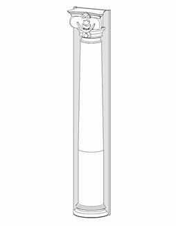
    </td>
  </tr>
  <tr><td colspan="4">Проектируемый объем</td></tr>
  <tr><td rowspan="4">Этап</td><td>К</td><td>Не моделируется</td><td></td></tr>
  <tr>
    <td>ПД</td>
    <td>
      Выполняется:

      - Моделирование всех декоративных элементов фасада в виде укрупненных форм, согласно архитектурной задумке по всем типовым и уникальным этажам.
      - Заполнение основных параметров, необходимых для идентификации элемента.
    </td>
    <td></td>
  </tr>
  <tr>
    <td>ТД</td>
    <td>
      Выполняется:

      - Моделирование всех декоративных элементов фасада в виде укрупненных форм в точном расположении и габаритах по всему фасаду, согласно архитектурной задумке по всем типовым и уникальным этажам.
      - Заполнение параметров, необходимых для формирования сводной ведомости объемов работ.
    </td>
    <td></td>
  </tr>
  <tr>
    <td>РД</td>
    <td>
      Выполняется:

      - Моделирование всех декоративных элементов фасада в виде укрупненных форм в точном расположении и габаритах по всему фасаду, согласно архитектурной задумке по всем типовым и уникальным этажам.
      - Заполнение всех параметров, необходимых для формирования спецификаций и ведомостей элементов в рабочей документации.
    </td>
    <td></td>
  </tr>
  <tr><td colspan="4">Примечание</td></tr>
  <tr>
    <td colspan="4">
      - Моделирование фасада должно быть выполнено с учетом пластики фасадных решений.
    </td>
  </tr>
  <tr><td colspan="4">Запрещенные действия</td></tr>
  <tr>
    <td colspan="4">
      - Разработка элементов модели участвующих в оформлении документации в рабочих наборах начинающихся с «(50)\_»
    </td>
  </tr>
</table>

### Требования к параметризации

Таблица 53

<table header="row">
  <tr><td colspan="2" rowspan="2">Атрибут</td><td colspan="4">Этап</td><td rowspan="2">Пример заполнения</td></tr>
  <tr><td>К</td><td>ПД</td><td>ТД</td><td>РД</td></tr>
  <tr><td colspan="7">Уровень геометрической проработки модели</td></tr>
  <tr><td rowspan="4">Геометрия</td><td>Условные габариты</td><td>●</td><td>●</td><td></td><td></td><td></td></tr>
  <tr><td>Точное расположение</td><td></td><td></td><td>●</td><td>●</td><td></td></tr>
  <tr><td>Внешний образ/вид4</td><td></td><td>●</td><td>●</td><td>●</td><td></td></tr>
  <tr><td>Материалы2</td><td></td><td>●</td><td>●</td><td>●</td><td></td></tr>
  <tr><td colspan="7">Уровень проработки атрибутивной информации</td></tr>
  <tr><td rowspan="3">Размеры</td><td>ADSK_Размер_Высота</td><td></td><td>●</td><td>●</td><td>●</td><td>1800 мм</td></tr>
  <tr><td>ADSK_Размер_Длина / ADSK_Размер_Толщина</td><td></td><td>●</td><td>●</td><td>●</td><td>200 мм</td></tr>
  <tr><td>ADSK_Размер_Глубина</td><td></td><td>●</td><td>●</td><td>●</td><td>300 мм</td></tr>
  <tr><td rowspan="3">Идентификация</td><td>Описание</td><td></td><td></td><td>●</td><td>●</td><td>Колонна декоративная</td></tr>
  <tr><td>ADSK_Обозначение</td><td></td><td></td><td>●</td><td>●</td><td>ГОСТ Р 70034-2022</td></tr>
  <tr><td>ADSK_Наименование</td><td></td><td></td><td>●</td><td>●</td><td>ГМ плита фасадная рельефная</td></tr>
  <tr><td>Маркировка</td><td>ADSK_Марка</td><td></td><td></td><td></td><td>●</td><td>К-24</td></tr>
  <tr><td rowspan="3">Ресурсы</td><td>ADSK_Единица измерения1</td><td></td><td>●</td><td>●</td><td>●</td><td>шт.</td></tr>
  <tr><td>ADSK_Завод-изготовитель1</td><td></td><td></td><td></td><td>●</td><td>Россия</td></tr>
  <tr><td>ADSK_Количество</td><td></td><td>●</td><td>●</td><td>●</td><td>5</td></tr>
  <tr><td rowspan="3">Положение</td><td>ADSK_Номер здания</td><td></td><td>●</td><td>●</td><td>●</td><td>Строение 1</td></tr>
  <tr><td>ADSK_Этаж</td><td></td><td>●</td><td>●</td><td>●</td><td>2</td></tr>
  <tr><td>ADSK_Номер секции</td><td></td><td>●</td><td>●</td><td>●</td><td>3</td></tr>
  <tr><td>Прочее</td><td>ADSK_Комплект чертежей3</td><td></td><td></td><td></td><td>●</td><td>АР1</td></tr>
</table>

1 - Заполняется только у элементов, для которых явное указание требуется, согласно проектным решениям.

2 - Всем элементам (каждому отдельному слою) должен быть назначен конкретный материал из библиотеки материалов.

3 - Заполняется если из модели выпускается несколько комплектов документации.

4 - Моделируются условно, с сохранением общего вида элемента, без детальной проработки.

## 9\.9. Витражи и стеклянные перегородки, световые фонари

### *Требования к моделированию*

Таблица 54

<table header="row">
  <tr><td colspan="4">Инструмент моделирования</td></tr>
  <tr>
    <td colspan="4">
      - Вертикальные элементы семейством категории «Стены» инструментом «Стена: Витраж»
      - Элементы под наклоном системным семейством категории «Крыши» инструментом «Крыши: Наклонное остекление»
      - Размещение дверей и створок в витражи осуществляется путем замены панелей на соответствующие семейства
      - Допускается моделирование семейством категории «Окна»
    </td>
  </tr>
  <tr><td colspan="4">Внешний вид</td></tr>
  <tr>
    <td colspan="4">
      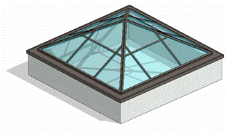
    </td>
  </tr>
  <tr><td colspan="4">Проектируемый объем</td></tr>
  <tr>
    <td rowspan="4">Этап</td>
    <td>К</td>
    <td>
      Выполняется:

      - Условным графическим представлением в виде упрощенных эскизов.
    </td>
    <td></td>
  </tr>
  <tr>
    <td>ПД</td>
    <td>
      Выполняется:

      - Трехмерная геометрия основной формы элементов на типовых и уникальных этажах.
      - Заполнение основных параметров, необходимых для идентификации элемента.
    </td>
    <td></td>
  </tr>
  <tr>
    <td>ТД</td>
    <td>
      Выполняется:

      - Точная трехмерная геометрия элементов по всем типовым и уникальным этажам в объеме всего здания.
      - Заполнение параметров, необходимых для формирования сводной ведомости объемов работ.
    </td>
    <td></td>
  </tr>
  <tr>
    <td>РД</td>
    <td>
      Выполняется:

      - Точная трехмерная геометрия элементов по всем типовым и уникальным этажам в объеме всего здания.
      - Заполнение всех параметров, необходимых для формирования спецификаций и ведомостей элементов в рабочей документации.
    </td>
    <td></td>
  </tr>
  <tr><td colspan="4">Примечание</td></tr>
  <tr>
    <td colspan="4">
      - Двери, оконные створки и решетки необходимо вставлять в витражи путем замены панели витража на дверь-панель, окно-панель и решетка-панель соответственно.
    </td>
  </tr>
  <tr><td colspan="4">Запрещенные действия</td></tr>
  <tr>
    <td colspan="4">
      - Разработка элементов модели участвующих в оформлении документации в рабочих наборах начинающихся с «(50)\_»
      - Использование инструмента «Зеркало».
      - Использование инструмента «Изменение ориентации стены».
    </td>
  </tr>
</table>

### *Требования к параметризации*

Таблица 55

<table header="row">
  <tr><td colspan="2" rowspan="2">Атрибут</td><td colspan="4">Этап</td><td rowspan="2">Пример заполнения</td></tr>
  <tr><td>К</td><td>ПД</td><td>ТД</td><td>РД</td></tr>
  <tr><td colspan="7">Уровень геометрической проработки модели</td></tr>
  <tr><td rowspan="6">Геометрия</td><td>Условные габариты</td><td>●</td><td>●</td><td></td><td></td><td></td></tr>
  <tr><td>Точные габариты</td><td></td><td></td><td>●</td><td>●</td><td></td></tr>
  <tr><td>Условное расположение</td><td>●</td><td>●</td><td></td><td></td><td></td></tr>
  <tr><td>Точное расположение</td><td></td><td></td><td>●</td><td>●</td><td></td></tr>
  <tr><td>Внешний образ/вид</td><td>●</td><td>●</td><td>●</td><td>●</td><td></td></tr>
  <tr><td>Материалы2</td><td></td><td>●</td><td>●</td><td>●</td><td></td></tr>
  <tr><td colspan="7">Уровень проработки атрибутивной информации</td></tr>
  <tr><td rowspan="3">Размеры</td><td>Площадь / ADSK_Размер_Площадь</td><td></td><td>●</td><td>●</td><td>●</td><td>7,5 м²</td></tr>
  <tr><td>Длина / ADSK_Размер_Длина</td><td></td><td>●</td><td>●</td><td>●</td><td>2500 мм</td></tr>
  <tr><td>Высота / ADSK_Размер_Высота / Неприсоединенная высота</td><td></td><td>●</td><td>●</td><td>●</td><td>3000 мм</td></tr>
  <tr><td rowspan="4">Идентификация</td><td>Описание</td><td></td><td></td><td>●</td><td>●</td><td>Витраж наружный, алюминиевый профиль, двухкамерный стеклопакет</td></tr>
  <tr><td>ADSK_Наименование</td><td></td><td></td><td>●</td><td>●</td><td>РВПИ-15</td></tr>
  <tr><td>ADSK_Обозначение</td><td></td><td></td><td>●</td><td>●</td><td>ГОСТ Р 59913-2021</td></tr>
  <tr><td>ADSK_Предел огнестойкости1</td><td></td><td>●</td><td>●</td><td>●</td><td>EIW45</td></tr>
  <tr><td>Маркировка</td><td>ADSK_Марка</td><td></td><td></td><td></td><td>●</td><td>К1</td></tr>
  <tr><td rowspan="2">Ресурсы</td><td>ADSK_Единица измерения1</td><td></td><td>●</td><td>●</td><td>●</td><td>м³</td></tr>
  <tr><td>ADSK_Завод-изготовитель1</td><td></td><td></td><td></td><td>●</td><td>Россия</td></tr>
  <tr><td rowspan="3">Положение</td><td>ADSK_Номер здания</td><td></td><td>●</td><td>●</td><td>●</td><td>Строение 1</td></tr>
  <tr><td>ADSK_Этаж</td><td></td><td>●</td><td>●</td><td>●</td><td>3</td></tr>
  <tr><td>ADSK_Номер секции</td><td></td><td>●</td><td>●</td><td>●</td><td>К1</td></tr>
  <tr><td>Прочее</td><td>ADSK_Комплект чертежей3</td><td></td><td></td><td></td><td>●</td><td>АР1</td></tr>
</table>

1 - Заполняется только у элементов, для которых явное указание требуется, согласно проектным решениям.

2 - Всем элементам (каждому отдельному слою) должен быть назначен конкретный материал из библиотеки материалов.

3 - Заполняется если из модели выпускается несколько комплектов документации.

## 9\.10. Лестницы

### *Требования к моделированию*

Таблица 56

<table header="row">
  <tr><td colspan="4">Инструмент моделирования</td></tr>
  <tr>
    <td colspan="4">
      - Системное семейство категории «Лестницы».
    </td>
  </tr>
  <tr><td colspan="4">Внешний вид</td></tr>
  <tr>
    <td colspan="4">
      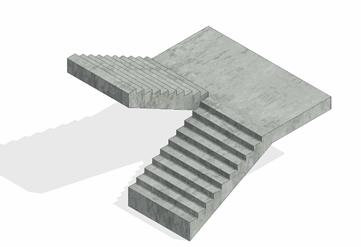
    </td>
  </tr>
  <tr><td colspan="4">Проектируемый объем</td></tr>
  <tr>
    <td rowspan="4">Этап</td>
    <td>К</td>
    <td>
      Выполняется:

      - В модели АР условно в условных габаритах по всем типовым и уникальным этажам.
    </td>
    <td></td>
  </tr>
  <tr>
    <td>ПД</td>
    <td rowspan="3">
      Лестницы разрабатываются в модели КР

      В АР разрабатывается только отделка (см. п. 10.22 «Отделка лестниц, рамп, пандусов»).
    </td>
    <td></td>
  </tr>
  <tr><td>ТД</td><td></td></tr>
  <tr><td>РД</td><td></td></tr>
  <tr><td colspan="4">Примечание</td></tr>
  <tr>
    <td colspan="4">
      - См. пункт 10.22 «Отделка лестниц, рамп, пандусов»
    </td>
  </tr>
  <tr><td colspan="4">Запрещенные действия</td></tr>
  <tr>
    <td colspan="4">
      - Разработка элементов модели участвующих в оформлении документации в рабочих наборах начинающихся с «(50)\_»
    </td>
  </tr>
</table>

### *Требования к параметризации*

Таблица 57

<table header="row">
  <tr><td colspan="2" rowspan="2">Атрибут</td><td colspan="4">Этап</td><td rowspan="2">Пример заполнения</td></tr>
  <tr><td>К</td><td>ПД</td><td>ТД</td><td>РД</td></tr>
  <tr><td colspan="7">Уровень геометрической проработки модели</td></tr>
  <tr><td rowspan="3">Геометрия</td><td>Условные габариты</td><td>●</td><td></td><td></td><td></td><td></td></tr>
  <tr><td>Условное расположение</td><td>●</td><td></td><td></td><td></td><td></td></tr>
  <tr><td>Внешний образ/вид</td><td>●</td><td></td><td></td><td></td><td></td></tr>
</table>

## 9\.11. Ограждения, ограждения лестниц и кровли

### *Требования к моделированию*

Таблица 58

<table header="row">
  <tr><td colspan="4">Инструмент моделирования</td></tr>
  <tr>
    <td colspan="4">
      - Системное семейство категории «Ограждения» инструментом «Ограждение»
      - Допустимо использование загружаемых семейств категории «Ограждения» для подсчета расхода элементов.
    </td>
  </tr>
  <tr><td colspan="4">Внешний вид</td></tr>
  <tr>
    <td colspan="4">
      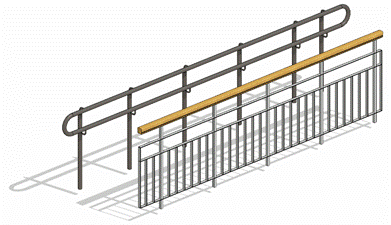
    </td>
  </tr>
  <tr><td colspan="4">Проектируемый объем</td></tr>
  <tr><td rowspan="4">Этап</td><td>К</td><td>Не моделируется</td><td></td></tr>
  <tr>
    <td>ПД</td>
    <td>
      Выполняется:

      - Условное моделирование ограждений, ограждений лестниц и кровли в объеме всего здания.

      * Заполнение основных параметров, необходимых для идентификации элемента.
    </td>
    <td></td>
  </tr>
  <tr>
    <td>ТД</td>
    <td>
      Выполняется:

      - Точное моделирование трёхмерной геометрии основной формы ограждений, ограждений лестниц и кровли по всем типовым и уникальным этажам в объеме всего здания.
      - Заполнение параметров, необходимых для формирования сводной ведомости объемов работ.
    </td>
    <td></td>
  </tr>
  <tr>
    <td>РД</td>
    <td>
      Выполняется:

      - Точное моделирование и расположение трёхмерной геометрии основной формы и ограждений, ограждений лестниц и кровли по всем типовым и уникальным этажам в объеме всего здания.
      - Заполнение всех параметров, необходимых для формирования спецификаций и ведомостей элементов в рабочей документации.
    </td>
    <td></td>
  </tr>
  <tr><td colspan="4">Примечание</td></tr>
  <tr>
    <td colspan="4">
      - Расход металла по ограждениям не считается, а также не формируется поэлементные спецификации.
    </td>
  </tr>
  <tr><td colspan="4">Запрещенные действия</td></tr>
  <tr>
    <td colspan="4">
      - Разработка элементов модели участвующих в оформлении документации в рабочих наборах начинающихся с «(50)\_».
    </td>
  </tr>
</table>

### *Требования к параметризации*

Таблица 59

<table header="row">
  <tr><td colspan="2" rowspan="2">Атрибут</td><td colspan="4">Этап</td><td rowspan="2">Пример заполнения</td></tr>
  <tr><td>К</td><td>ПД</td><td>ТД</td><td>РД</td></tr>
  <tr><td colspan="7">Уровень геометрической проработки модели</td></tr>
  <tr><td rowspan="6">Геометрия</td><td>Условные габариты</td><td></td><td>●</td><td></td><td></td><td></td></tr>
  <tr><td>Точные габариты</td><td></td><td></td><td>●</td><td>●</td><td></td></tr>
  <tr><td>Условное расположение</td><td></td><td>●</td><td></td><td></td><td></td></tr>
  <tr><td>Точное расположение</td><td></td><td></td><td>●</td><td>●</td><td></td></tr>
  <tr><td>Внешний образ/вид</td><td></td><td>●</td><td>●</td><td>●</td><td></td></tr>
  <tr><td>Материалы2</td><td></td><td></td><td>●</td><td>●</td><td></td></tr>
  <tr><td colspan="7">Уровень проработки атрибутивной информации</td></tr>
  <tr><td rowspan="2">Размеры</td><td>Длина / ADSK_Размер_Длина</td><td></td><td>●</td><td>●</td><td>●</td><td>120 мм</td></tr>
  <tr><td>Высота / ADSK_Размер_Высота</td><td></td><td>●</td><td>●</td><td>●</td><td>1200 мм</td></tr>
  <tr><td>Идентификация</td><td>Описание</td><td></td><td></td><td>●</td><td>●</td><td>Ограждение</td></tr>
  <tr><td>Маркировка</td><td>ADSK_Марка</td><td></td><td></td><td></td><td>●</td><td>ОГ-1</td></tr>
  <tr><td rowspan="2">Ресурсы</td><td>ADSK_Единица измерения1</td><td></td><td>●</td><td>●</td><td>●</td><td>м.п.</td></tr>
  <tr><td>ADSK_Завод-изготовитель1</td><td></td><td></td><td></td><td>●</td><td>Россия</td></tr>
  <tr><td rowspan="3">Положение</td><td>ADSK_Номер здания</td><td></td><td>●</td><td>●</td><td>●</td><td>Строение 1</td></tr>
  <tr><td>ADSK_Этаж</td><td></td><td>●</td><td>●</td><td>●</td><td>3</td></tr>
  <tr><td>ADSK_Номер секции</td><td></td><td>●</td><td>●</td><td>●</td><td>К1</td></tr>
  <tr><td>Прочее</td><td>ADSK_Комплект чертежей3</td><td></td><td></td><td></td><td>●</td><td>АР1</td></tr>
</table>

1 - Заполняется только у элементов, для которых явное указание требуется, согласно проектным решениям.

2 - Всем элементам (каждому отдельному слою) должен быть назначен конкретный материал из библиотеки материалов.

3 - Заполняется если из модели выпускается несколько комплектов документации.

## 9\.12. Кровля

### *Требования к моделированию*

Таблица 60

<table header="row">
  <tr><td colspan="4">Инструмент моделирования</td></tr>
  <tr>
    <td colspan="4">
      Системное семейство категории «Крыши» инструментом:

      - «Крыша по контуру»
      - «Крыша выдавливанием»
      - «Крыша по грани».
    </td>
  </tr>
  <tr><td colspan="4">Внешний вид</td></tr>
  <tr>
    <td colspan="4">
      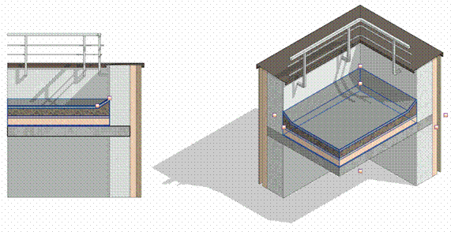
    </td>
  </tr>
  <tr><td colspan="4">Проектируемый объем</td></tr>
  <tr><td rowspan="4">Этап</td><td>К</td><td>Моделируется кровля без уклонов</td><td></td></tr>
  <tr>
    <td>ПД</td>
    <td>
      Выполняется:

      - Путем моделирования с уклонами в виде многослойной структуры на уровнях кровли. Допускается моделирование основных слоев с заполнением точного состава кровли в параметр «G_Состав конструкции»
      - Заполнение основных параметров, необходимых для идентификации элемента.
    </td>
    <td></td>
  </tr>
  <tr>
    <td>ТД</td>
    <td>
      Выполняется:

      - Путем моделирования с уклонами в виде многослойной структуры на уровнях кровли. Допускается моделирование основных слоев с заполнением точного состава кровли в параметр «G_Состав конструкции»
      - Заполнение параметров, необходимых для формирования сводной ведомости объемов работ.
    </td>
    <td></td>
  </tr>
  <tr>
    <td>РД</td>
    <td>
      Выполняется:

      Путем моделирования кровли с уклонами в виде многослойной структуры на уровнях кровли. Допускается моделирование основных слоев с заполнением точного состава кровли в параметр «G_Состав конструкции»

      Заполнение всех параметров, необходимых для формирования спецификаций и ведомостей элементов в рабочей документации.
    </td>
    <td></td>
  </tr>
  <tr><td colspan="4">Примечание</td></tr>
  <tr>
    <td colspan="4">
      - \-
    </td>
  </tr>
  <tr><td colspan="4">Запрещенные действия</td></tr>
  <tr>
    <td colspan="4">
      - Разработка элементов модели участвующих в оформлении документации в рабочих наборах начинающихся с «(50)\_».
    </td>
  </tr>
</table>

### *Требования к параметризации*

Таблица 61

<table header="row">
  <tr><td colspan="2" rowspan="2">Атрибут</td><td colspan="4">Этап</td><td rowspan="2">Пример заполнения</td></tr>
  <tr><td>К</td><td>ПД</td><td>ТД</td><td>РД</td></tr>
  <tr><td colspan="7">Уровень геометрической проработки модели</td></tr>
  <tr><td rowspan="9">Геометрия</td><td>Условные габариты</td><td>●</td><td></td><td></td><td></td><td></td></tr>
  <tr><td>Точные габариты</td><td></td><td>●</td><td>●</td><td>●</td><td></td></tr>
  <tr><td>Условное расположение</td><td>●</td><td></td><td></td><td></td><td></td></tr>
  <tr><td>Точное расположение</td><td></td><td>●</td><td>●</td><td>●</td><td></td></tr>
  <tr><td>Внешний образ/вид</td><td></td><td>●</td><td>●</td><td>●</td><td></td></tr>
  <tr><td>Однослойная структура</td><td>●</td><td></td><td></td><td></td><td></td></tr>
  <tr><td>Многослойная структура</td><td></td><td>●</td><td>●</td><td>●</td><td></td></tr>
  <tr><td>Материалы1</td><td></td><td>●</td><td>●</td><td>●</td><td></td></tr>
  <tr><td>Уклон</td><td></td><td>●</td><td>●</td><td>●</td><td></td></tr>
  <tr><td colspan="7">Уровень проработки атрибутивной информации</td></tr>
  <tr><td rowspan="3">Размеры</td><td>Площадь / G_Площадь</td><td></td><td>●</td><td>●</td><td>●</td><td>8 м²</td></tr>
  <tr><td>Периметр</td><td></td><td>●</td><td>●</td><td>●</td><td>12200 мм</td></tr>
  <tr><td>Толщина / ADSK_Размер_Толщина</td><td></td><td>●</td><td>●</td><td>●</td><td>280 мм</td></tr>
  <tr><td rowspan="4">Идентификация</td><td>Описание</td><td></td><td></td><td>●</td><td>●</td><td>Кровля плоская</td></tr>
  <tr><td>ADSK_Наименование</td><td></td><td></td><td>●</td><td>●</td><td>По ГОСТ</td></tr>
  <tr><td>ADSK_Предел огнестойкости1</td><td></td><td>●</td><td>●</td><td>●</td><td>REI45</td></tr>
  <tr>
    <td>G_Состав конструкции</td>
    <td></td>
    <td></td>
    <td>●</td>
    <td>●</td>
    <td>
      1\. Мембрана изоляционная – 2 слоя

      2\. Праймер битумный – 2 слоя

      3\. Утеплитель – 150мм

      ….
    </td>
  </tr>
  <tr><td>Маркировка</td><td>ADSK_Марка</td><td></td><td></td><td></td><td>●</td><td>ЗФ-12</td></tr>
  <tr><td rowspan="2">Ресурсы</td><td>ADSK_Единица измерения1</td><td></td><td>●</td><td>●</td><td>●</td><td>м²</td></tr>
  <tr><td>ADSK_Завод-изготовитель1</td><td></td><td></td><td></td><td>●</td><td>Россия</td></tr>
  <tr><td rowspan="3">Положение</td><td>ADSK_Номер здания</td><td></td><td>●</td><td>●</td><td>●</td><td>Строение 1</td></tr>
  <tr><td>ADSK_Этаж</td><td></td><td>●</td><td>●</td><td>●</td><td>3</td></tr>
  <tr><td>ADSK_Номер секции</td><td></td><td>●</td><td>●</td><td>●</td><td>К1</td></tr>
  <tr><td>Прочее</td><td>ADSK_Комплект чертежей3</td><td></td><td></td><td></td><td>●</td><td>АР1</td></tr>
</table>

1 - Заполняется только у элементов, для которых явное указание требуется, согласно проектным решениям.

2 - Всем элементам (каждому отдельному слою) должен быть назначен конкретный материал из библиотеки материалов.

3 - Заполняется если из модели выпускается несколько комплектов документации.
